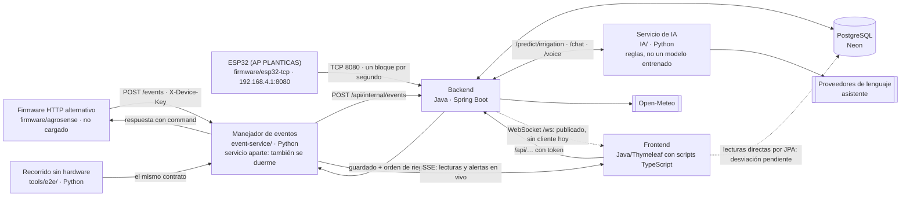

# AgroSense

Monitoreo de cultivos: un dispositivo en el campo mide suelo y aire, un backend guarda las lecturas, genera alertas y
recomendaciones de riego, y una aplicación web lo muestra todo y permite ordenar riegos.

## Arquitectura



| Carpeta | Qué es | Pruebas |
|---|---|---|
| `backend/agrosense/` | API, alertas, predicciones, órdenes de riego | `./mvnw test` |
| `frontend/` | Páginas Thymeleaf y scripts TypeScript | `./mvnw test`, `npm test` |
| `IA/` | Reglas de riego y asistente | `pytest` (necesita FastAPI); `python -m unittest tests.test_patterns tests.test_rules` |
| `event-service/` | Webhook de dispositivos y canal en vivo | `pytest` (necesita FastAPI) |
| `firmware/` | Dispositivo final | `sh firmware/test/run-tests.sh`, `sh firmware/test/compile.sh` |
| `database/`, `api/` | Esquema y migraciones (`database/README.md`); contrato OpenAPI | `python api/tools/validate_spec.py` |
| `tools/e2e/` | Recorrido completo sin hardware | `python tools/e2e/run_e2e.py` |

`docs/ARQUITECTURA.md` tiene las decisiones, `docs/PATRONES.md` los patrones de diseño y `docs/DEMO.md` el plan de la demo.

## Correr todo en local

```bash
cp .env.example .env      # y completa los secretos
docker compose up --build
```

El frontend queda en `http://localhost:8080` y el webhook en `http://localhost:8100/events`. Para recorrer todo sin placa
(evento, alerta, predicción y orden de riego), con el backend en `IRRIGATION_ACTUATOR=relay`:

```bash
API_PASSWORD=<SEED_USER_PASSWORD> DEVICE_KEY=<SEED_DEVICE_KEY> python tools/e2e/run_e2e.py
```

Solo usa la biblioteca estándar de Python y envía los eventos con el mismo contrato que el ESP32. La lista de materiales,
el cableado, las advertencias de pines y la calibración del dispositivo están en `firmware/README.md`.

### ESP32 por TCP (el dispositivo real)

**Para correrlo en este PC con un solo comando:** `tools\esp32\run-demo.ps1` (sección «Correr con el ESP32 real» de
`docs/DEMO.md`).

El dispositivo de campo corre `firmware/esp32-tcp/`: crea su propia red Wi-Fi (`PLANTICAS`), es un servidor TCP en
`192.168.4.1:8080` y escribe un bloque de texto con sus tres lecturas cada segundo. Con `ESP32_TCP_ENABLED=true` el
backend se conecta a él, promedia 60 s y guarda una lectura por minuto por el mismo camino que el webhook (alertas y
predicción incluidas). La vista del cultivo se actualiza cada 30 s y dice si el ESP32 está enviando. El ESP32 no acepta
órdenes: el riego de su cultivo solo se registra. El PC se une a la red desde el sistema operativo. Pasos en
`docs/DEMO.md`; la decisión y su riesgo, en `docs/ARQUITECTURA.md` (decisión 40). `firmware/agrosense/` es un firmware
alternativo por HTTP que no está cargado en la placa.

## Variables nuevas

Todas están en `.env.example`. Además, **`AI_ALLOW_OPEN`**: sin él, el servicio de IA se niega a arrancar en una dirección
pública si no tiene credencial.

| Variable | Servicio | Por defecto | Efecto |
|---|---|---|---|
| `ESP32_TCP_ENABLED` | Backend | `false` | `true` conecta el backend al ESP32 por TCP. Apagado en Render |
| `ESP32_TCP_HOST`, `ESP32_TCP_PORT` | Backend | `192.168.4.1`, `8080` | Dónde escucha el ESP32. Solo una IPv4 privada |
| `ESP32_DEVICE_ID` | Backend | `ESP32-PLANTICAS` | Dispositivo de `devices` al que pertenecen esas lecturas. La conexión no trae llave |
| `ESP32_AGGREGATE_SECONDS` | Backend | `60` | Segundos que se promedian antes de guardar una lectura |
| `IRRIGATION_ACTUATOR` | Backend y frontend | `simulated` | `relay` envía cada riego al dispositivo y cambia los textos de la interfaz |
| `IRRIGATION_AI_ORDERS` | Backend | `false` | `true` deja a una predicción con confianza de 0,70 o más ordenar un riego sola |
| `AI_INGESTION_PREDICTION_MINUTES` | Backend | `30` | Cada cuánto pide predicción cada cultivo con dispositivo; 0 lo apaga |
| `ALERTS_DEVICE_SILENT_MINUTES` | Backend | `15` | Silencio antes de `SENSOR_OFFLINE`; 0 lo apaga |
| `ALERTS_FROST_WATCH` | Backend | `true` | Consulta Open-Meteo cada hora por finca con coordenadas |
| `ALERTS_STUCK_READINGS` | Backend | `10` | Lecturas iguales en 0 o 100 % antes de `SENSOR_FAULT`; 0 lo apaga |
| `DEVICE_MAX_EVENTS_PER_MINUTE` | Backend | `60` | Eventos por dispositivo; después responde 429; 0 lo apaga |
| `READINGS_RETENTION_DAYS` | Backend | `0` | Días de lecturas crudas. Las anteriores pasan a promedios por hora y **se borran**; 0 lo conserva todo |
| `IRRIGATION_MAX_RUN_MINUTES` | Backend | `5` | Con relé, duración máxima. Debe coincidir con `MAX_PUMP_ON_MS` del firmware: una persona que pida más recibe 400 y una orden de la IA se recorta |
| `SENSOR_CALIBRATION` | Backend | vacío | Corrección por tipo de sensor, ver abajo |
| `AI_PROVIDER_REQUESTS_PER_MINUTE` | IA | `60` | Límite de llamadas al proveedor |
| `AI_REPLY_CACHE_SECONDS` | IA | `60` | Reutiliza una respuesta idéntica |

### Calibrar un tipo de sensor en el backend

Cada tipo empieza neutro, sin corrección: inventar valores falsearía todas las lecturas. Para corregir, mide con una
referencia y define `SENSOR_CALIBRATION` como `TIPO=desplazamiento:ganancia`, separados por comas:

```bash
SENSOR_CALIBRATION=PH=0.1:1.02,SOIL_MOISTURE=-1.5:1
```

Para el ESP32 (`firmware/esp32-tcp/`), que envía los valores crudos, `.env.example` y `compose.yaml` traen
`SENSOR_CALIBRATION=AIR_TEMPERATURE=-8.5:1,RELATIVE_HUMIDITY=-6:1`: las compensaciones que antes restaba el sketch. **Están por verificar con un
termómetro y un higrómetro de referencia.**

El valor guardado es `lectura × ganancia + desplazamiento`: con ese ejemplo, un pH de 6 se guarda como 6,22. Se aplica antes
de validar el rango, y a todos los sensores de ese tipo. Una entrada mal escrita impide arrancar. Reinicia el backend para
aplicar un cambio. Es distinto de `AGRO_SOIL_DRY_RAW` y `AGRO_SOIL_WET_RAW`, que calibran el sensor de suelo en el firmware.

## Orden de despliegue

1. **Migraciones:** `database/migrations/002_alert_types.sql` y `003_reliability.sql`, primero en una base de desarrollo y
   después en Neon. Son idempotentes. Sin la 003 el backend nuevo no arranca.
2. **Frontend:** antes que el backend, porque una versión vieja falla al leer un tipo de alerta que no conoce.
3. **Backend**, con las variables nuevas.
4. **Servicio de IA.** Exige `INTERNAL_API_KEY` o `AI_SERVICE_TOKEN`.
5. **Manejador de eventos.** `docs/EVENT-SERVICE.md` compara mantenerlo o quitarlo.
6. **Dispositivo:** el ESP32, con `arduino_secrets.h` apuntando al manejador de eventos (`firmware/README.md`).

## Avisos

- Las **plantillas de cultivo** traen rangos de partida, no validados agronómicamente.
- El **pH** solo es fiable con una sonda calibrada. El firmware actual no lo mide.
- El **modelo de IA son reglas fijas**, no un modelo entrenado. Cada recomendación nombra en `factors` las reglas que la
  produjeron.
- **`AGRO_SOIL_DRY_RAW` y `AGRO_SOIL_WET_RAW`** vienen en 0, sin calibrar: hasta medirlos con tu sensor el ESP32 no envía
  la humedad del suelo.
- La **bomba** no se ha probado con hardware real. Sigue `firmware/README.md` y prueba primero sin carga.
