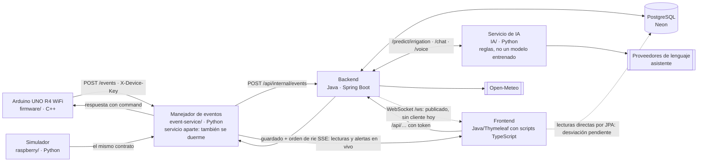

# AgroSense

Monitoreo de cultivos: un dispositivo en el campo mide suelo y aire, un backend guarda las lecturas, genera alertas y
recomendaciones de riego, y una aplicación web lo muestra todo y permite ordenar riegos.

## Arquitectura



| Carpeta | Qué es | Pruebas |
|---|---|---|
| `backend/agrosense/` | API, alertas, predicciones, órdenes de riego | `./mvnw test` |
| `frontend/` | Páginas Thymeleaf y scripts TypeScript | `./mvnw test`, `npm test` |
| `IA/` | Reglas de riego y asistente | `pytest` (necesita FastAPI); `python -m unittest tests.test_patterns tests.test_rules` |
| `event-service/` | Webhook de dispositivos y canal en vivo | `pytest` (necesita FastAPI) |
| `firmware/` | Dispositivo final | `sh firmware/test/run-tests.sh`, `sh firmware/test/compile.sh` |
| `raspberry/` | Simulador de dispositivo | `pytest` |
| `database/`, `api/` | Esquema y migraciones (`database/README.md`); contrato OpenAPI | `python api/tools/validate_spec.py` |
| `tools/e2e/` | Recorrido completo sin hardware | `python tools/e2e/run_e2e.py` |

`docs/ARQUITECTURA.md` tiene las decisiones, `docs/PATRONES.md` los patrones de diseño y `docs/DEMO.md` el plan de la demo.

## Correr todo en local

```bash
cp .env.example .env      # y completa los secretos
docker compose up --build
```

El frontend queda en `http://localhost:8080` y el webhook en `http://localhost:8100/events`. Para enviar lecturas falsas:

```bash
cd raspberry
cp simulator.example.env simulator.env   # EVENTS_URL, DEVICE_ID=RPI-DEMO-01 y DEVICE_KEY=SEED_DEVICE_KEY
pip install -r requirements.txt
python simulator.py --once               # sin --once, una lectura cada 30 s
```

La lista de materiales, el cableado y la calibración del dispositivo real están en `firmware/README.md`.

## Variables nuevas

Todas están en `.env.example`. Además, **`AI_ALLOW_OPEN`**: sin él, el servicio de IA se niega a arrancar en una dirección
pública si no tiene credencial.

| Variable | Servicio | Por defecto | Efecto |
|---|---|---|---|
| `IRRIGATION_ACTUATOR` | Backend y frontend | `simulated` | `relay` envía cada riego al dispositivo y cambia los textos de la interfaz |
| `IRRIGATION_AI_ORDERS` | Backend | `false` | `true` deja a una predicción con confianza de 0,70 o más ordenar un riego sola |
| `AI_INGESTION_PREDICTION_MINUTES` | Backend | `30` | Cada cuánto pide predicción cada cultivo con dispositivo; 0 lo apaga |
| `ALERTS_DEVICE_SILENT_MINUTES` | Backend | `15` | Silencio antes de `SENSOR_OFFLINE`; 0 lo apaga |
| `ALERTS_FROST_WATCH` | Backend | `true` | Consulta Open-Meteo cada hora por finca con coordenadas |
| `ALERTS_STUCK_READINGS` | Backend | `10` | Lecturas iguales en 0 o 100 % antes de `SENSOR_FAULT`; 0 lo apaga |
| `DEVICE_MAX_EVENTS_PER_MINUTE` | Backend | `60` | Eventos por dispositivo; después responde 429; 0 lo apaga |
| `READINGS_RETENTION_DAYS` | Backend | `0` | Días de lecturas crudas. Las anteriores pasan a promedios por hora y **se borran**; 0 lo conserva todo |
| `IRRIGATION_MAX_RUN_MINUTES` | Backend | `5` | Con relé, duración máxima. Debe coincidir con `MAX_PUMP_ON_MS` del firmware: una persona que pida más recibe 400 y una orden de la IA se recorta |
| `SENSOR_CALIBRATION` | Backend | vacío | Corrección por tipo de sensor, ver abajo |
| `AI_PROVIDER_REQUESTS_PER_MINUTE` | IA | `60` | Límite de llamadas al proveedor |
| `AI_REPLY_CACHE_SECONDS` | IA | `60` | Reutiliza una respuesta idéntica |

### Calibrar un tipo de sensor en el backend

Cada tipo empieza neutro, sin corrección: inventar valores falsearía todas las lecturas. Para corregir, mide con una
referencia y define `SENSOR_CALIBRATION` como `TIPO=desplazamiento:ganancia`, separados por comas:

```bash
SENSOR_CALIBRATION=PH=0.1:1.02,SOIL_MOISTURE=-1.5:1
```

El valor guardado es `lectura × ganancia + desplazamiento`: con ese ejemplo, un pH de 6 se guarda como 6,22. Se aplica antes
de validar el rango, y a todos los sensores de ese tipo. Una entrada mal escrita impide arrancar. Reinicia el backend para
aplicar un cambio. Es distinto de `soilDryRaw` y `soilWetRaw`, que calibran el firmware.

## Orden de despliegue

1. **Migraciones:** `database/migrations/002_alert_types.sql` y `003_reliability.sql`, primero en una base de desarrollo y
   después en Neon. Son idempotentes. Sin la 003 el backend nuevo no arranca.
2. **Frontend:** antes que el backend, porque una versión vieja falla al leer un tipo de alerta que no conoce.
3. **Backend**, con las variables nuevas.
4. **Servicio de IA.** Exige `INTERNAL_API_KEY` o `AI_SERVICE_TOKEN`.
5. **Manejador de eventos.** `docs/EVENT-SERVICE.md` compara mantenerlo o quitarlo.
6. **Dispositivo.**

## Avisos

- Las **plantillas de cultivo** traen rangos de partida, no validados agronómicamente.
- El **pH** solo es fiable con una sonda calibrada. El firmware actual no lo mide.
- El **modelo de IA son reglas fijas**, no un modelo entrenado. Cada recomendación nombra en `factors` las reglas que la
  produjeron.
- Los valores de **`soilDryRaw` y `soilWetRaw`** deben medirse con tu sensor antes de confiar en cualquier porcentaje.
- La **bomba** no se ha probado con hardware real. Sigue `firmware/README.md` y prueba primero sin carga.
