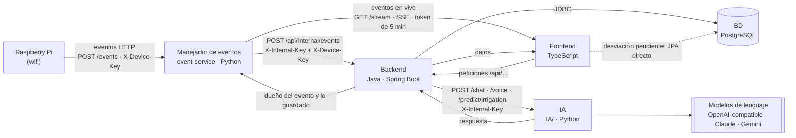

# Arquitectura de AgroSense

Estado al 16 de octubre de 2026. Este documento recoge la inspección del repositorio, la arquitectura de
servicios (sección 2), las decisiones tomadas, qué partes de la interfaz usan datos reales, parciales o no
disponibles, y dónde está desplegado cada componente.

## 1. Inspección del workspace

| Carpeta     | Contenido                                                                                  |
|-------------|--------------------------------------------------------------------------------------------|
| `backend/`  | Proyecto Spring Boot de William Chávez (`BACKEND-AGROSENSE`), auditado y corregido.         |
| `frontend/` | Aplicación web Spring Boot + Thymeleaf (este documento la describe en detalle).             |
| `database/` | Todo lo de base de datos: `schema.sql`, `seed_demo.sql`, `reset.sql`, `datasource.properties`, `.env.example` y `README.md`. |
| `api/`      | Contrato de la API del backend: `openapi.json`, peticiones de ejemplo y `tools/check_contract.py`, que comprueba un backend en marcha contra el contrato. |
| `IA/`       | Servicio de IA (Python, FastAPI) que el backend llama en `AI_SERVICE_URL`: predicción de riego y asistente (`/chat`, `/voice`). |
| `event-service/` | Manejador de eventos (Python, FastAPI): webhook de las Raspberry y canal en vivo (SSE) de cada usuario. |
| `raspberry/` | Programa del dispositivo de campo (simulado en un PC): envía lecturas al webhook, con reintentos y cola en disco. |
| `compose.yaml`, `.env.example` | Todos los servicios en una máquina (`docker compose up`) y todas sus variables. |

### Repositorios

El workspace es un monorepo local de trabajo. Cada carpeta se publica en su propio repositorio, que
tiene su propio historial y no comparte commits con el workspace:

| Carpeta del workspace | Repositorio                              | Raíz en el repositorio                    |
|-----------------------|------------------------------------------|-------------------------------------------|
| `backend/agrosense/`   | `WilliamChavez-Grupo2b/BACKEND-AGROSENSE` | `src/`, `pom.xml`, `Dockerfile` (y `backend/README.md` como `README.md`) |
| `frontend/`           | `ssantivr/FRONTEND-AGROSENSE`            | `src/`, `pom.xml`, `package.json`         |
| `database/`           | `ssantivr/BASE-DE-DATOS-AGROSENSE`       | los seis archivos de la carpeta           |
| `api/`                | `ssantivr/API-AGROSENSE`                 | los archivos de la carpeta                |
| `IA/`                 | `ssantivr/IA-AGROSENSE`                  | los archivos de la carpeta                |
| `event-service/`, `raspberry/`, `compose.yaml` | ninguno todavía; solo existen en el workspace |                  |
| `docs/`               | ninguno; solo existe en el workspace     |                                           |

Una rama del workspace no se puede subir tal cual a ninguno de ellos. Para publicar, los commits de
una carpeta se repiten sobre la rama del repositorio correspondiente sin el prefijo de la carpeta
(`git format-patch --relative=<carpeta>` y `git am --3way` en un worktree creado desde la rama remota) y
esa rama se sube con un `git push` normal, sin forzar.

### Backend (`backend/agrosense`)

- **Versiones:** Java 17, Spring Boot 4.1.1, Maven.
- **Paquetes:** `ai` (`controller`, `service`, `dto`), `config`, `controller`, `domain.enums`, `dto`, `event`, `exception`, `models`, `mqtt`,
  `pattern`, `repository`, `security`, `seed`, `service`, `websocket`.
- **Entidades:** `User`, `Estate`, `Crop`, `Sensor`, `SensorReading`, `Alert`, `Irrigation`, `AiPrediction`,
  con un repositorio Spring Data por cada una.
- **API REST** (JSON, bajo `/api`):

  | Ruta                                             | Uso                                             |
  |--------------------------------------------------|-------------------------------------------------|
  | `GET /`                                          | Qué servicio es; lo que se ve al abrir la dirección. Pública |
  | `GET /api/health`                                | Estado del servicio. Pública                    |
  | `POST /api/auth/login`                           | Devuelve el token. Pública                      |
  | `GET` y `POST /api/fincas`, `/api/cultivos`      | Listar y crear fincas y cultivos                |
  | `GET /api/crops/{id}/sensors`, `POST /api/sensors` | Sensores de un cultivo y alta de sensores     |
  | `POST /api/readings`, `GET /api/sensors/{id}/readings` | Registrar una lectura y leer las últimas  |
  | `GET /api/alerts`, `GET /api/crops/{id}/alerts`, `PATCH /api/alerts/{id}/acknowledge` | Alertas abiertas y marcarlas como atendidas |
  | `GET /api/riego/cultivo/{id}`, `POST /api/riego` | Historial y registro de riegos manuales         |
  | `GET /api/dashboard`, `GET /api/dashboard/{id}`  | Resumen general o de un cultivo                 |
  | `GET` y `POST /api/crops/{id}/predictions`       | Predicciones de riego del servicio de IA        |
  | `POST /api/ai/chat` `{message, history}`         | Pregunta escrita al asistente. Responde `{reply}` |
  | `POST /api/ai/voice` (formulario `audio` o `transcript`) | Pregunta hablada. Responde `{reply, transcript}` |

  Tiene registro de usuarios (`POST /api/auth/register`) y comprobación de correo
  (`GET /api/auth/check-user`), pero no edición ni eliminación, y los listados no incluyen todo lo que muestra
  el frontend (por ejemplo, el nombre de la finca en una alerta o los cultivos inactivos).
- **Seguridad:** sin estado, con token JWT HS512 en la cabecera `Authorization`. El usuario se vuelve a
  leer de la tabla `users` en cada petición, así que una cuenta desactivada deja de funcionar de
  inmediato. Roles `ADMIN`, `FARMER` y `TECHNICIAN`; crear fincas, cultivos, riegos y predicciones, y atender
  alertas, exige `ADMIN` o `FARMER`. El login
  limita los intentos fallidos por cuenta y por dirección. CORS solo admite los orígenes de
  `CORS_ALLOWED_ORIGINS`. Arranca únicamente si `JWT_SECRET` tiene al menos 64 bytes.
- **Lecturas y alertas:** una lectura puede llegar por REST o por MQTT (cliente Paho, apagado salvo
  `MQTT_ENABLED=true`). `SensorFacade` la valida, la normaliza, la guarda y, si queda fuera del rango del
  cultivo, crea una alerta bloqueando la fila del cultivo para no duplicarla.
- **Tiempo real:** WebSocket STOMP en `/ws`, autenticado con el mismo token; las sesiones se cierran
  cuando el token vence o la cuenta se desactiva.
- **IA:** `AiClientService` llama al servicio de IA (`IA/`, repositorio `IA-AGROSENSE`) para las
  predicciones de riego; sin `AI_SERVICE_URL` quedan desactivadas. Solo envía lo que se midió, junto con los
  límites de humedad y pH del propio cultivo, y no pide predicción para un cultivo sin lecturas de humedad
  del suelo. Cada llamada lleva `X-Internal-Key` (`AI_SERVICE_KEY`) y, durante la migración, el
  `AI_SERVICE_TOKEN` que ya enviaba. El asistente conversacional (`ai/`, decisiones 23 y 24) pasa por ese
  mismo servicio con `AI_CHAT_VIA_SERVICE=true`; si no, responde con sus propios proveedores (ruta
  obsoleta que se conserva como respaldo).
- **Dispositivos y eventos** (decisiones 25 y 26): `POST /api/devices`, `POST /api/internal/events` (solo el
  servicio de eventos) y `GET /api/events/token`.
- **Patrones de diseño** en `pattern/`: builder, factory, prototype y singleton (creacionales); adapter,
  decorator, facade y proxy (estructurales).

### Frontend (`frontend/`)

- **Versiones:** Java 21, Spring Boot 4.1.1, Spring MVC, Thymeleaf, Spring Security (sesión), Spring Data
  JPA, Maven.
- **Bibliotecas de interfaz**, servidas localmente desde `/webjars` con versión fija: Bootstrap 5.3.3
  (solo la rejilla), Bootstrap Icons 1.11.3, Chart.js 4.4.1, Leaflet 1.9.4.
- **Sin** React, Angular ni Vue: las páginas las genera el servidor. Los scripts del navegador se escriben
  en **TypeScript estricto** (`frontend/src/main/ts`) y `tsc` los compila a módulos ES en `static/js`. Ese
  resultado se guarda en el repositorio, así que Maven y la imagen de despliegue no necesitan Node; solo
  hace falta para editar los scripts (`npm install` y `npm run build` en `frontend/`).

## 2. Arquitectura de servicios

### Diagrama

Coincide con el diagrama del proyecto. Cada flecha continua existe en el código (tabla siguiente); la
punteada es la desviación pendiente que se describe más abajo.



### Cada conexión en el código

| Conexión | Dónde está | Cómo se asegura |
|---|---|---|
| Raspberry → manejador de eventos | `raspberry/simulator.py` → `event-service/agrosense_events/app.py` (`POST /events`) | `X-Device-Key`: la llave del dispositivo, que el backend compara con su SHA-256 en tiempo constante. HTTPS en Render |
| Manejador de eventos → backend | `app.py` (`receive`) → `InternalEventController`, `DeviceEventService` | `X-Internal-Key` (`EVENTS_INTERNAL_KEY`), comprobada por `InternalKeyFilter` antes de leer el cuerpo; la ruta está fuera del JWT de usuarios |
| Backend → BD | repositorios Spring Data del backend | Credenciales por variables; `ddl-auto=validate` |
| Manejador de eventos → frontend (navegador) | `app.py` (`stream`) → `frontend/src/main/ts/events/live.ts` | Token HS256 de 5 minutos firmado por el backend con `EVENTS_STREAM_SECRET` (`EventStreamTokens`), pedido con la sesión a `/api/ui/events/token`; cada evento solo llega a las conexiones de su dueño; CORS solo para el frontend |
| Frontend → backend (peticiones y datos) | `BackendClient` (servidor del frontend) | Token HS512 de 2 minutos a nombre del usuario de la sesión, firmado con el secreto compartido (`BACKEND_JWT_SECRET` = `JWT_SECRET`). El navegador solo habla con el servidor del frontend (sesión y CSRF) |
| Backend → IA | `AiServiceClient` (chat y voz), `AiClientService` (predicción) | `X-Internal-Key` (`AI_SERVICE_KEY` = `INTERNAL_API_KEY`) y, durante la migración, el Bearer `AI_SERVICE_TOKEN` |
| IA → modelos | `IA/agrosense_ia/providers.py` | Llave del proveedor en una cabecera, nunca en la dirección ni en el registro |

**La BD solo la tocan el backend y, por ahora, el frontend.** El servicio de IA, el manejador de eventos y
la Raspberry no tienen credenciales ni código de base de datos: el contexto de la finca llega a la IA ya
armado por el backend (`farm_context`), y el manejador de eventos recibe del backend el dueño del evento.

### Desviación pendiente: el frontend accede a la BD

El criterio «la BD solo la usa el backend» se cumple en todos los servicios nuevos, pero no en el frontend,
que desde el 8 de octubre lee y escribe la base con sus propias entidades JPA (decisiones 1 y 21) porque la
API del backend no cubre todo lo que muestran sus páginas. Se decidió el 16 de octubre de 2026 dejarlo así
por ahora y migrarlo después, servicio por servicio, en una rama aparte. Las clases afectadas son 9:

| Clase del frontend | Qué hace con la BD | Qué tendría que ofrecer el backend |
|---|---|---|
| `service/EstateService` | Lista parcelas y cultivos con totales | Listados completos de fincas y cultivos (incluidos inactivos) |
| `service/CatalogService` | Alta, edición y baja de parcelas, cultivos y sensores | Edición y baja de fincas, cultivos y sensores |
| `service/SensorService` | Sensores con su última lectura | Listado de sensores con última lectura |
| `service/AlertService` | Alertas con finca y paginación | Listado paginado con el nombre de la finca |
| `service/IrrigationService` | Historial de riegos y consumo de agua | Historial y agregados de consumo |
| `service/ReportService` | Reportes de consumo, lecturas y alertas | Rutas de reportes |
| `service/AccountService` | Registro, perfil y eliminación de la cuenta | Perfil y eliminación de cuenta |
| `security/DatabaseUserDetailsService` | Inicio de sesión cuando el backend no responde | Ninguna: desaparece cuando el inicio de sesión solo pase por el backend |
| `config/DemoAccountInitializer` | Contraseña del usuario de ejemplo (perfil `demo`) | Ninguna: es solo de la demo en memoria |

Además, Spring Session guarda las sesiones del frontend en `spring_session` (decisión 20). `compose.yaml`
da al frontend la misma conexión que al backend mientras esto siga así.

### Rutas internas y contratos

**Backend → IA** (`IA/README.md` tiene el detalle):

```
POST /chat     {"message": "...", "history": [{"role": "user"|"assistant", "text": "..."}], "farm_context": "..."}
            →  {"reply": "...", "source": "model"}
POST /voice    multipart: audio | transcript, farm_context
            →  {"reply": "...", "transcript": "..." | null, "source": "model"}
POST /predict/irrigation  {"id_crop", "soil_moisture", "air_temperature", "ph", "humidity_min", ...}
            →  {"irrigate", "duration_minutes", "recommendation", "confidence", "model_used", "factors"}
GET  /health → {"status": "UP"}
```

Errores como `{"message"}`: 401 sin llave, 422 negativa del modelo, 429 sin cuota, 502 proveedor caído,
503 sin proveedor, 504 tiempo agotado. Ante 429, 502, 503, 504 o una caída del servicio, el backend
responde la pregunta escrita con los datos de la finca (`source: "local"`).

**Raspberry → manejador de eventos → backend:**

```
POST /events  (X-Device-Key)
  {"device_id": "RPI-DEMO-01", "type": "reading", "ts": "2026-10-16T08:00:00-05:00",
   "data": {"soil_moisture": 31.5, "air_temperature": 24.1, "ph": 6.4}}
  → 200 {"status": "stored", "readings": 3, "alerts": 1, "delivered": 2}
  → 4xx {"message"} el evento o la llave están mal (no reintentar) · 502 backend caído (reintentar)

POST /api/internal/events  (X-Internal-Key, X-Device-Key)   mismo cuerpo
  → 200 {"ownerEmail": "demo@agrosense.co",
         "event": {"type": "reading", "deviceId": "RPI-DEMO-01", "cropId": 1, "cropName": "Café",
                   "readings": [{"idReading", "idSensor", "sensorCode", "sensorType", "value", "unit",
                                 "quality", "recordedAt"}],
                   "alerts": [{"idAlert", "alertType", "severity", "message", "detectedValue",
                               "idCrop", "cropName", "createdAt", ...}]}}
```

Con varios sensores del mismo tipo en el cultivo, la medida debe nombrar el suyo
(`{"soil_moisture": {"value": 31.5, "sensor_code": "AS-001"}}`); si no, 400 con los códigos posibles.
`type: "alert"` lleva `data: {"alert_type", "message", "severity"?, "value"?}`.

**Navegador ↔ frontend ↔ backend ↔ manejador de eventos:**

```
GET /api/ui/events/token (sesión)          → {"enabled": false}  sin EVENTS_PUBLIC_URL
                                           → {"enabled": true, "token", "streamUrl", "expiresInSeconds": 300}
GET /api/events/token (JWT del usuario)    → {"token", "expiresInSeconds": 300}       (backend)
GET /stream?token=…                        → text/event-stream: ready, reading, alert, expired, ": ping"
```

### Variables de cada servicio

Todas están en `.env.example`. Ninguna llave tiene valor por defecto ni se escribe en archivos del
repositorio.

| Servicio | Variables nuevas o que cambian |
|---|---|
| Backend | `AI_CHAT_VIA_SERVICE` (`false`), `AI_SERVICE_KEY`, `AI_SERVICE_TIMEOUT_MS` (ahora 30000), `EVENTS_INTERNAL_KEY`, `EVENTS_STREAM_SECRET` (≥ 32 bytes), `SEED_DEVICE_KEY` |
| IA | `INTERNAL_API_KEY`, `AI_SERVICE_TOKEN` (migración), `AI_CHAT_API_KEY`, `AI_CHAT_BASE_URL`, `AI_CHAT_MODEL`, `AI_TRANSCRIPTION_MODEL`, `ANTHROPIC_API_KEY`, `ANTHROPIC_MODEL`, `ANTHROPIC_EFFORT`, `GEMINI_API_KEY`, `GEMINI_MODEL`, `AI_TIMEOUT_MS` (20000), `AI_MAX_OUTPUT_TOKENS` (2048), `PORT` |
| Manejador de eventos | `BACKEND_URL`, `EVENTS_INTERNAL_KEY`, `EVENTS_STREAM_SECRET`, `EVENTS_ALLOWED_ORIGINS`, `BACKEND_TIMEOUT_MS` (30000), `EVENTS_HEARTBEAT_S`, `EVENTS_MAX_STREAMS_PER_USER`, `EVENTS_MAX_STREAMS`, `PORT` |
| Frontend | `EVENTS_PUBLIC_URL` |
| Raspberry | `EVENTS_URL`, `DEVICE_ID`, `DEVICE_KEY`, `INTERVAL_S`, `READINGS`, `QUEUE_FILE`, `MAX_QUEUE`, `TIMEOUT_S`, `ATTEMPTS`, `FIRST_BACKOFF_S`, `MAX_BACKOFF_S` |

### Ejecutar todo junto

```bash
cp .env.example .env      # y completa los secretos
docker compose up --build
```

`compose.yaml` arranca `postgres` (volumen `pgdata`, comprobación con `pg_isready`), `ia-service`, `backend`
(perfil `seed`: aplica `schema.sql` y `seed_demo.sql`), `event-service` y `frontend`, cada uno cuando los
que necesita ya responden a su comprobación de salud. El frontend queda en `http://localhost:8080` y el
webhook en `http://localhost:8100/events`, al que se apunta el simulador (`raspberry/`). Cada Dockerfile
corre con un usuario sin privilegios, lee el puerto de `PORT` y se comprueba en `/health` (`/api/health`
en el backend; en el frontend, `/health` es público y no abre sesión ni consulta la base de datos).

### Desplegar en Render

Orden: base de datos, backend, IA, manejador de eventos, frontend.

1. **Base de datos:** ejecuta a mano `database/migrations/001_devices.sql` en la base de producción
   (Neon) antes de desplegar el backend nuevo; `database/README.md` explica cómo. El backend no arranca sin
   la tabla `devices`.
2. **IA** (`ia-agrosense`, ya existe): define `INTERNAL_API_KEY` (generada) y la llave del proveedor. Sigue
   aceptando el `AI_SERVICE_TOKEN` actual, así que el backend desplegado no se rompe mientras tanto.
3. **Backend** (`BACKEND-AGROSENSE`): añade `AI_SERVICE_KEY` (= `INTERNAL_API_KEY`), `EVENTS_INTERNAL_KEY`,
   `EVENTS_STREAM_SECRET` y, cuando se quiera mover el chat, `AI_CHAT_VIA_SERVICE=true`. Pon `/api/health`
   como ruta de comprobación.
4. **Manejador de eventos:** servicio web nuevo con `event-service/render.yaml` (Docker, `/health`, un solo
   proceso), con `BACKEND_URL`, `EVENTS_INTERNAL_KEY` y `EVENTS_STREAM_SECRET` iguales a los del backend y
   `EVENTS_ALLOWED_ORIGINS` con la dirección del frontend.
5. **Frontend** (Vercel): `EVENTS_PUBLIC_URL` con la dirección pública del manejador de eventos.

**Plan gratuito:** Render duerme cada servicio tras unos 15 minutos sin uso y tarda entre 1 y 3 minutos en
arrancarlo. Por eso los tiempos de espera son configurables y generosos (`AI_SERVICE_TIMEOUT_MS`,
`BACKEND_TIMEOUT_MS`, `AI_TIMEOUT_MS`), la Raspberry reintenta y guarda en su cola, el chat responde en modo
local si la IA no llega a tiempo y el frontend sigue mostrando lo que cargó. **Antes de una demo**,
despierta los servicios unos minutos antes:

```bash
for url in https://backend-agrosense-u5mz.onrender.com/api/health \
           https://ia-agrosense.onrender.com/health \
           https://<manejador-de-eventos>.onrender.com/health; do
  curl -s -o /dev/null -w "%{http_code} $url\n" --max-time 180 "$url"
done
```

## 3. Decisiones

1. **El frontend lee la base de datos directamente con JPA.** El backend no expone ningún endpoint, así
   que no hay API que consumir. Para no inventar endpoints, el frontend tiene sus propias entidades
   (copiadas del backend, mismo esquema de tablas), repositorios y servicios. Cuando el backend tenga API
   REST, los servicios del frontend son el único punto que habría que cambiar. *Esto describe el 8 de
   octubre: el backend ya tiene API y la decisión 21 explica qué parte usa el frontend.*
2. **El esquema de tablas es una propuesta.** Los nombres de tablas y columnas (`crops`,
   `sensor_readings`, `created_at`…) salen de las entidades; no existe un script SQL contra el que
   validarlos. En producción se usa `ddl-auto=validate`, así que la base de datos real debe coincidir.
3. **Perfil `demo`.** Arranca con H2 en memoria (modo PostgreSQL) y carga `database/schema.sql` y `database/seed_demo.sql`. La interfaz lo
   indica con la etiqueta «Vista de demostración». Sin ese perfil se conecta a PostgreSQL mediante
   `DATABASE_URL`, `DATABASE_USERNAME` y `DATABASE_PASSWORD`.
4. **Cada consulta se filtra por el usuario autenticado.** Los repositorios buscan siempre por el correo
   del dueño de la finca; pedir un registro ajeno devuelve 404.
5. **Bibliotecas por WebJars en lugar de CDN.** Cumple «versiones fijas» y hace innecesario el atributo
   `integrity`, porque los archivos se sirven desde el mismo origen. Permite una política CSP estricta.
6. **Sin estilos ni scripts en línea.** La CSP solo admite recursos propios y las teselas de OpenStreetMap.
   La fuente (Plus Jakarta Sans) se sirve desde `static/fonts/`; el tema se aplica antes del primer pintado con un script
   externo bloqueante (`js/theme-init.js`), no con uno en línea.
7. **Fotografías locales de dominio público.** El login, el inicio, Parcelas y Riego usan fotos del USDA
   en `static/img/photos/` (JPEG a 960 y 1600 px; no hay conversor a WebP sin añadir Node). Autoría y
   licencias están en `static/img/brand/CREDITS.md`.
8. **El riego se registra, no se ejecuta.** No existe integración con bombas: el MQTT del backend solo
   recibe lecturas, no envía órdenes. «Iniciar riego» guarda el riego manual y la interfaz lo dice de
   forma explícita.
9. **Iconos:** Bootstrap Icons (fuente local). **Tipografía:** Plus Jakarta Sans variable, local, para toda la interfaz, con fuentes del
   sistema como respaldo. **Temas:** `tokens.css` define las variables semánticas de `premium` y de `mono`
   (blanco y negro, no un modo oscuro) y `styles.css` no contiene colores; en `mono` los estados se
   distinguen por icono, texto y tipo de borde. `/design-system` muestra marca, tokens y componentes y solo
   existe en el perfil `demo`.
10. **Registro de usuarios.** `/registro` crea cuentas con rol `farmer`, contraseña BCrypt y validación
    Bean Validation: nombre y apellido de 2 a 18 caracteres y contraseña de 8 a 32, contando los espacios.
    El formulario muestra contadores en vivo, un indicador de fortaleza y si el correo ya está registrado.
    Con el backend disponible la cuenta la crea `POST /api/auth/register` (409 si el correo existe) y el
    inicio de sesión pasa por `POST /api/auth/login`, cuyo límite de intentos (429) el formulario muestra
    como bloqueo; sin backend, ambos usan la base de datos. Como todas las peticiones salen del servidor
    del frontend, el backend debe llevar `LOGIN_MAX_ATTEMPTS_PER_ADDRESS=0` (o `BACKEND_SIGN_IN=false` en el
    frontend). No hay verificación por correo: queda pendiente.
11. **Eliminar cuenta.** Exige volver a escribir la contraseña, que el servidor comprueba contra el hash.
    Borra en una transacción lecturas, alertas, riegos, sensores, cultivos, fincas y el usuario, y cierra
    la sesión. La cuenta de demostración no se puede eliminar, para no dejar la demo sin datos.
12. **Mapa tolerante a fallos.** Si ninguna finca tiene coordenadas, el servidor no genera el mapa y
    muestra una vista esquemática con el aviso «Sin coordenadas registradas». El script valida que
    Leaflet esté cargado y que cada coordenada sea un número dentro de rango; ante cualquier fallo cambia
    a esa misma vista en lugar de lanzar un error.
13. **Preferencias en el navegador.** No existe una tabla de preferencias, así que la única disponible
    (menú lateral contraído) se guarda en `localStorage` y la página lo indica.
14. **Corrección de «Access blocked» en el mapa.** OpenStreetMap devuelve una imagen de bloqueo a las
    peticiones sin cabecera `Referer`, y la aplicación la eliminaba con `Referrer-Policy: same-origin`.
    La política pasa a `strict-origin-when-cross-origin`, que envía solo el origen, y las teselas vuelven
    a cargar (comprobado: la misma tesela pesa 6,9 kB sin `Referer` y 20 kB con él). Se probó CARTO
    Voyager como alternativa, pero hoy entrega las teselas con la marca «API KEY REQUIRED», así que se
    mantiene OpenStreetMap en `tile.openstreetmap.org`, único origen de imágenes externas en la CSP.
15. **Gestión de parcelas, cultivos y sensores.** `CatalogService` concentra altas, ediciones y bajas,
    siempre limitadas al dueño. Al eliminar una parcela o un cultivo se borran antes, en la misma
    transacción, sus lecturas, alertas y riegos, porque esas tablas no tienen cascada. Al eliminar un
    sensor se borran sus lecturas y sus alertas se conservan sin la referencia al sensor. El código de
    sensor es único en todo el sistema y se guarda en mayúsculas.
16. **El esquema vive en `database/schema.sql`.** Es la única fuente de verdad de las tablas: backend y
    frontend usan `ddl-auto=validate` y nunca crean ni alteran tablas. El script es idempotente y se
    aplica desde la propia aplicación con `SQL_INIT_MODE=always` (el perfil `seed` del backend y el
    perfil `demo` del frontend lo hacen), de modo que no hace falta `psql`. Incluye claves foráneas con
    borrado en cascada, restricciones `CHECK` e índices en todas las claves foráneas. Esto sustituye a la
    decisión 2: los nombres de tablas ya no son una propuesta implícita en las entidades.
17. **PostgreSQL local bloqueado por Windows.** En este equipo el servidor PostgreSQL 18 arranca pero
    rechaza cada conexión con «no se pudo lanzar el nuevo proceso para la conexión». El registro de
    Integridad de código de Windows (eventos 3033 y 3077) muestra que la directiva de Control de
    aplicaciones impide a `postgres.exe` lanzar sus procesos hijo. No es un fallo del proyecto y no se
    ha eludido. Hasta que se resuelva, el esquema se verifica con H2 en modo PostgreSQL.
18. **Los datos de ejemplo también viven en `database/`.** `seed_demo.sql` sustituye a los cargadores
    Java que había en backend y frontend, de modo que hay una sola copia de los datos. El script crea el
    usuario de ejemplo con un hash que no corresponde a ninguna contraseña; cada aplicación le asigna la
    suya al arrancar (`SeedAccountInitializer` con `SEED_USER_PASSWORD`, `DemoAccountInitializer` con
    `DEMO_PASSWORD`). Ningún archivo SQL guarda una contraseña ni un hash utilizable.
19. **La configuración de base de datos también vive en `database/`.** `datasource.properties` reúne
    la conexión, `ddl-auto=validate`, la ejecución de los scripts y los perfiles `seed` y `demo`.
    Backend y frontend lo cargan con `spring.config.import` y solo declaran la ruta de la carpeta
    (`DATABASE_DIR` la cambia). Una prueba en cada proyecto comprueba lo que resuelve el archivo con y
    sin perfil. En los proyectos Java quedan únicamente las entidades y los repositorios, que siguen
    duplicados entre backend y frontend.
20. **Las sesiones del frontend se guardan en la base de datos.** Con Spring Session JDBC un inicio de
    sesión sobrevive a un reinicio y funciona con varias instancias, que es como lo ejecuta un servicio
    que apaga las instancias inactivas. Las tablas `spring_session` y `spring_session_attributes` están en
    `database/schema.sql` como las demás y la biblioteca no las crea (`initialize-schema=never`).
21. **El frontend usa la API del backend para lo que la API ofrece.** `BackendClient` llama al backend
    para marcar alertas como atendidas, registrar sensores, registrar riegos manuales y leer la serie de
    lecturas de un sensor. Todo lo demás sigue leyendo la base de datos con JPA, porque la API no tiene
    edición ni eliminación, ni devuelve los datos que muestran los listados.
    - Cada llamada lleva un token HS512 de dos minutos firmado con el secreto que comparten las dos
      aplicaciones (`BACKEND_JWT_SECRET` = `JWT_SECRET` del backend). El frontend ya lee la misma base
      de datos, así que el secreto no le da ningún permiso nuevo.
    - El backend puede estar dormido (el alojamiento gratuito lo apaga y tarda minutos en arrancar). Antes
      de cada operación se consulta `/api/health` con un tiempo de espera corto; si no responde, la
      operación se hace contra la base de datos y esa misma consulta empieza a despertarlo.
    - Las lecturas y el marcado de alertas vuelven a la base de datos si la llamada falla. El alta de
      sensores y de riegos no: el backend puede haberla registrado, y repetirla la duplicaría.
    - Sin `BACKEND_URL` y `BACKEND_JWT_SECRET` la conexión queda desactivada, como en el perfil `demo`.
22. **Rendimiento medido.** `QueryBudgetTests` (frontend) y `listingsStayWithinAFixedNumberOfQueries`
    (backend) fijan cuántas sentencias SQL cuesta cada página. El inicio pasó de 12 a 6 y Sensores de 8 a 3
    al leer la última lectura de todos los sensores en una consulta; el mapa y el consumo de agua van
    incrustados en la página en vez de pedirse aparte. Fuentes, imágenes y WebJars se guardan en la caché
    del navegador (antes Spring Security los marcaba `no-store`) y las respuestas de texto van comprimidas.
    El pool de conexiones mantiene dos abiertas (`DB_POOL_MIN_IDLE`, `DB_POOL_MAX_SIZE`).
23. **Asistente de IA, por texto y por voz.** Vive en el backend (`com.agrosense.backend.ai`:
    `controller/AiController`, `service/AiAssistantService`, `dto/AiRequestDto` y `AiResponseDto`), dentro
    del paquete raíz que Spring explora, y llama a la API de Google Gemini.
    - La llave se lee de `GEMINI_API_KEY`, viaja en una cabecera y no está en ningún archivo ni llega al
      navegador: la ventana de chat llama al frontend (`/api/ui/ai/chat` y `/api/ui/ai/voice`, con sesión y
      CSRF) y este al backend con el token compartido.
    - El modelo es `GEMINI_MODEL`, por defecto `gemini-flash-latest`: los nombres fijos se retiran
      (`gemini-1.5-flash` ya no responde) y el alias sigue al modelo Flash vigente.
    - En lugar de Gemini puede responder cualquier proveedor que hable la API de OpenAI
      (`OpenAiCompatibleClient`): con `AI_CHAT_API_KEY` definida se usa ese, por defecto Groq
      (`AI_CHAT_BASE_URL`, `AI_CHAT_MODEL`, `AI_TRANSCRIPTION_MODEL`). Ahí la voz va en dos pasos: la
      grabación se transcribe y el texto se responde como cualquier pregunta escrita. Es lo que usa
      producción desde el 11 de octubre de 2026: Groq, con `qwen/qwen3.8-27b` para responder y
      `whisper-large-v3-turbo` para transcribir. De los modelos que Groq ofrecía ese día fue el más rápido
      (0,7 s) y el que mejor siguió las instrucciones; `openai/gpt-oss-120b` respondía con tablas, que la
      ventana no dibuja, y `openai/gpt-oss-20b` gastaba la respuesta en razonar y la dejaba cortada.
    - Cada pregunta lleva las instrucciones del asistente agronómico y los datos de la finca del usuario
      (`FarmContextService`): los totales, las alertas abiertas y, de cada cultivo, sus últimas lecturas de
      humedad, temperatura y pH junto al rango de ese cultivo; más los turnos anteriores.
    - Cuando el modelo no está configurado, falla o se queda sin cuota, la pregunta escrita no se rechaza:
      `LocalAdvisor` la responde con esos mismos datos (riego, alertas, temperatura, pH, sensores y estado
      de cada cultivo; reconoce el tema por sus palabras y el cultivo por su nombre) y la respuesta lleva
      `source: local`. La ventana lo dice bajo la respuesta. No razona ni lo aparenta: lo que no sabe
      responder lo dice. Una negativa del modelo a responder sigue siendo una negativa, y una grabación
      sin texto necesita el modelo. `AI_LOCAL_ANSWERS=false` lo desactiva.
    - La voz se graba con `MediaRecorder` y se envía como audio; Gemini devuelve lo que entendió y la
      respuesta. Las respuestas se leen en español con `speechSynthesis`. Donde el navegador no ofrece
      alguna de las dos, su botón no aparece.
    - Límites: 10 preguntas por minuto y usuario (`AI_REQUESTS_PER_MINUTE`), 1000 caracteres por pregunta,
      12 turnos de contexto y 3 MB de audio. Sin backend el asistente dice que no está disponible.
    - La conversación se guarda en `sessionStorage` a nombre de la cuenta y dura lo que la pestaña. Las
      páginas de acceso y de registro la borran (`ai/storage.ts`), así que no sobrevive a cerrar sesión
      ni a que la sesión caduque.
24. **Un solo servicio de IA, en `IA/`** (16 de octubre de 2026). El servicio de predicción pasa a FastAPI
    y suma el asistente (`/chat`, `/voice`) en lugar de crear un `ia-service/` aparte: el diagrama dibuja
    una sola IA y `AI_SERVICE_URL` ya apuntaba a ella. `/predict/irrigation` conserva su contrato y sus 40
    pruebas. Proveedores en el orden OpenAI-compatible → Claude → Gemini, instrucciones en
    `IA/prompts/system-es.txt` y los 8 últimos turnos.
    - El chat solo pasa por el servicio con `AI_CHAT_VIA_SERVICE=true` (por defecto `false`): activar las
      predicciones no debe cambiar de proveedor el chat sin decidirlo. Con la bandera apagada el backend usa
      su IA interna, que queda marcada como obsoleta pero no se borra.
    - El servicio acepta `X-Internal-Key` y, durante la migración, el Bearer `AI_SERVICE_TOKEN`.
25. **Dispositivos con llave propia.** Tabla `devices` (un dispositivo por cultivo), migración idempotente
    `database/migrations/001_devices.sql` para la base existente y alta con `POST /api/devices` (`ADMIN` o
    `FARMER`), que devuelve la llave una sola vez; se guarda su SHA-256. El dispositivo de ejemplo de
    `seed_demo.sql` no tiene llave usable hasta que el backend le pone `SEED_DEVICE_KEY` (como la contraseña
    del usuario de ejemplo, decisión 18). Si un evento trae una medida con varios sensores posibles en el
    cultivo, se exige `sensor_code` y se responde 400 explicándolo, en vez de adivinar.
26. **Eventos por webhook y SSE en lugar de MQTT.** Las Raspberry envían por HTTP al manejador de eventos,
    que reenvía al backend (las lecturas siguen el camino de siempre, `SensorFacade`) y empuja el resultado al
    navegador del dueño por Server-Sent Events. MQTT y el STOMP del backend se conservan, apagados o sin
    cliente. El token del canal va en la dirección porque `EventSource` no admite cabeceras: dura 5 minutos
    y el manejador de eventos no registra la parte de la dirección después de `?`.
27. **Frontend y BD: desviación aceptada por ahora** (opción b del 16 de octubre). Los servicios nuevos no
    tienen acceso a la BD; el frontend lo conserva en las 9 clases de la sección 2 hasta migrarlo, servicio
    por servicio, en una rama aparte.

## 4. Estructura del frontend

```
frontend/src/main/java/com/agrosense/frontend/
  config/       SecurityConfig, DemoAccountInitializer (perfil demo)
  controller/   PageController, AccountController, CatalogController, IrrigationController,
                AlertController, UiApiController, GlobalModelAttributes
  service/      DashboardService, EstateService, SensorService, AlertService, IrrigationService,
                CatalogService, AccountService
  backend/      BackendClient (llamadas a la API del backend), BackendToken, BackendUnavailableException
  ai/           AiAssistantController (`/api/ui/ai`), AiChatForm, AiReply, AiAssistantException
  events/       LiveEventsController (`/api/ui/events/token`: dirección del canal en vivo y su token)
  repository/   Un repositorio Spring Data por entidad
  entity/       Entidades JPA y enumeraciones
  dto/          Views (proyecciones de solo lectura) y los formularios (IrrigationForm, EstateForm,
                CropForm, SensorForm, RegistrationForm)
  security/     DatabaseUserDetailsService, AgroUserPrincipal
  exception/    NotFoundException, BusinessRuleException, GlobalExceptionHandler
frontend/src/main/resources/
  templates/            Páginas y templates/fragments/ (layout, brand, sidebar, navbar, stat-card, status-pill,
                        confirm-modal, toast, empty-state, error-state, page-header, pagination, ai-chat)
  static/css/           tokens.css (variables de diseño por tema), styles.css y ai-chat.css
  static/js/            Salida de tsc; no se edita a mano
frontend/src/main/ts/   theme-init, theme, app, tables, palette, forms, login, dashboard, settings,
                        design-system; api/ (cliente HTTP y endpoints), core/dom, types/;
                        ai/ (chat-widget, markdown, voice, storage); events/live (lecturas y alertas en vivo)
  static/img/           brand/ (logotipos, favicon, créditos) y photos/
  static/fonts/         PlusJakartaSans.woff2
  messages.properties   Textos en español de las enumeraciones
```

Los controladores solo delegan en servicios; los servicios devuelven DTO, nunca entidades.

## 5. Cobertura: página ↔ servicio ↔ estado

La columna central indica el servicio Java del frontend que atiende cada parte. Donde dice «API del
backend», la operación pasa por el backend cuando está configurado y responde, y por la base de datos en
caso contrario (decisión 21).

| Página / sección                | Servicio o endpoint                                   | Estado          |
|---------------------------------|--------------------------------------------------------|-----------------|
| Login / logout                  | Spring Security + `DatabaseUserDetailsService`         | Real            |
| Crear cuenta (`/registro`)      | `AccountService.register`                              | Real            |
| Inicio · indicadores            | `DashboardService`                                     | Real            |
| Inicio · clima                  | —                                                      | No disponible   |
| Inicio · mapa y detalle         | `GET /api/ui/estates/markers`                          | Real            |
| Inicio · control de riego       | `POST /api/ui/irrigations` → `IrrigationService` → API del backend (`POST /api/riego`) | Parcial (registra el riego; no acciona la bomba) |
| Inicio · sensores               | `SensorService.summarize`                              | Real            |
| Inicio · gráfica de lecturas    | `GET /api/ui/sensors/{id}/readings` → API del backend (`GET /api/sensors/{id}/readings`) | Real |
| Inicio · agua por día           | `GET /api/ui/water-usage`                              | Real            |
| Inicio · alertas recientes      | `AlertService`                                         | Real            |
| Parcelas                        | `EstateService` (lectura), `CatalogService` (alta, edición, baja de parcelas y cultivos) | Real |
| Sensores                        | `SensorService` (lectura), `CatalogService` (baja; alta por la API del backend, `POST /api/sensors`) | Parcial (sin edición) |
| Sensores · última lectura en vivo | `events/live.ts` ← manejador de eventos (`GET /stream`); token por `GET /api/ui/events/token` | Real con `EVENTS_PUBLIC_URL`; sin él, la página muestra lo que cargó |
| Alertas nuevas en vivo (todas las páginas con sesión) | `events/live.ts`: aviso y contadores del menú y la barra superior | Real con `EVENTS_PUBLIC_URL` |
| Riego                           | `IrrigationService` (historial); alta por la API del backend (`POST /api/riego`) | Parcial (registra el riego con sus litros; no acciona la bomba) |
| Alertas                         | `AlertService` (listar, paginar); marcar como atendida por la API del backend (`PATCH /api/alerts/{id}/acknowledge`) | Real |
| Reportes                        | `IrrigationService.waterReport`                        | Parcial (exporta a CSV la tabla visible; sin PDF) |
| Asistente de IA (todas las páginas con sesión) | `POST /api/ui/ai/chat` y `/voice` → API del backend (`POST /api/ai/chat` y `/voice`) → servicio de IA (con `AI_CHAT_VIA_SERVICE=true`) o proveedor interno | Real con un proveedor configurado; sin él responde con los datos de la finca (`source: local`); sin backend avisa de que no está disponible |
| Configuración · perfil          | `AccountService.findProfile`                           | Parcial (solo lectura) |
| Configuración · preferencias    | `localStorage` del navegador                           | Parcial (no se guardan en la cuenta) |
| Configuración · cerrar sesión   | `POST /logout` con CSRF                                | Real            |
| Configuración · eliminar cuenta | `AccountService.deleteAccount`                         | Real            |

«Real» significa que los datos salen de la base de datos, leídos con JPA o a través de la API del
backend. Con el perfil `demo` esa base de datos está en memoria, contiene datos de ejemplo y el backend
no interviene.

## 6. Seguridad

Del frontend (la del backend está en la sección 1):

- Inicio de sesión por formulario con sesión de servidor, guardada en la base de datos; contraseñas con
  BCrypt.
- Las llamadas al backend llevan un token de dos minutos firmado con el secreto compartido, a nombre del
  usuario que tiene la sesión; el token nunca llega al navegador.
- Las respuestas del asistente se convierten de Markdown a nodos con `textContent`; nunca se interpretan
  como HTML.
- Todas las rutas requieren autenticación excepto `/login`, los recursos estáticos y `/error`.
- CSRF activo en formularios y en las peticiones `fetch` (cabecera leída de las etiquetas `<meta>`).
- Cookie de sesión `HttpOnly`, `SameSite=Lax` y `Secure` (desactivado solo en el perfil `demo`).
- Cabecera `Content-Security-Policy` restrictiva y `Referrer-Policy: strict-origin-when-cross-origin`.
- Thymeleaf escapa todo el contenido (`th:text`); el JavaScript usa `textContent`, nunca `innerHTML`.
- Validación con Bean Validation en `IrrigationForm`, tanto en el formulario como en el JSON.
- El mensaje de error del login es el mismo para usuario inexistente y contraseña incorrecta.
- Canal en vivo: el navegador recibe un token de 5 minutos que solo sirve para abrir su propio canal; nunca
  recibe `INTERNAL_API_KEY`, `EVENTS_INTERNAL_KEY`, `EVENTS_STREAM_SECRET` ni ninguna otra llave de
  servicio. La CSP solo añade a `connect-src` el origen de `EVENTS_PUBLIC_URL`, y los eventos se pintan con
  `textContent`.

De los servicios nuevos, la sección 2 («Cada conexión en el código») resume cómo se asegura cada conexión.

## 7. Verificación realizada

- `mvnw test` en `frontend/` (11 de octubre de 2026): 76 pruebas (JUnit 5, Mockito, MockMvc); 74
  correctas y 2 omitidas, que son las de PostgreSQL. Incluyen las del cliente del backend contra un
  servidor HTTP local.
- `mvnw test` en `backend/agrosense` (11 de octubre de 2026): 77 pruebas; 74 correctas y 3 omitidas,
  también las de PostgreSQL. La JVM de pruebas termina sola: cada prueba cierra las sesiones WebSocket
  que abre. Las del asistente usan un servidor local en el papel de Gemini.
- Asistente de punta a punta en local (11 de octubre de 2026), backend y frontend sobre una base H2 nueva
  y un servidor local en el papel de Gemini: inicio de sesión, pregunta escrita y mensaje de voz por el
  backend y a través del frontend (200), y rechazos sin token (401), sin CSRF (403) y sin pregunta (400).
  No se probó contra Gemini real: no hay llave en este equipo.
- Ventana del asistente en Edge sin interfaz con micrófono simulado (11 de octubre de 2026), 25
  comprobaciones: abrir y cerrar, estado de carga, respuesta en Markdown, desplazamiento al último
  mensaje, grabar y enviar un mensaje de voz, micrófono liberado también al cerrar la ventana mientras
  el navegador lo entrega, conversación conservada entre páginas, no mostrada a otra cuenta y borrada al cerrar sesión. Sin errores
  de consola ni bloqueos de CSP. La lectura en voz alta solo se comprobó hasta activar el botón.
- Servicio de predicción (`IA/`, 11 de octubre de 2026): 40 pruebas con `python -m unittest`, que GitHub
  repite en cada push. De punta a punta en local, con token entre los dos servicios: el backend pide la
  predicción, el servicio responde y queda guardada con el modelo `agrosense-riego-reglas-1.0`; un
  cultivo con límites propios (70–95 % de humedad) que marca 65 % recibe «riega ahora», y uno sin lectura
  de humedad no recibe ninguna. No se construyó su imagen Docker (no hay Docker en este equipo), no se
  probó `render.yaml` y el servicio no está desplegado.
- Asistente sin modelo en Edge sin interfaz (11 de octubre de 2026), 12 comprobaciones: las sugerencias
  y las preguntas por un cultivo se responden con las lecturas reales, con la nota de que no respondió el
  modelo; una grabación se rechaza indicando que se escriba la pregunta.
- Asistente con un proveedor compatible con OpenAI (11 de octubre de 2026): las mismas 25 comprobaciones
  en Edge, con un servidor local en el papel del proveedor: preguntas escritas y un mensaje de voz
  grabado, transcrito y respondido.
- Asistente en producción con Groq (11 de octubre de 2026), con la cuenta de ejemplo: una pregunta
  escrita respondida en 1,4 s con las cifras de cada cultivo; una segunda pregunta que dependía de la
  primera; un tema ajeno al agro, rechazado; y un mensaje de voz en español, transcrito y respondido,
  directamente contra el backend y a través del frontend desplegado. El audio fue voz sintetizada, no un
  micrófono.
- Contrato de la API (`api/`, 11 de octubre de 2026): `validate_spec.py` y 12 pruebas de las
  herramientas, que GitHub repite en cada push; `check_contract.py` con 45 comprobaciones (cada ruta sin
  token, con token y el esquema de cada respuesta correcta) contra el backend local y contra producción
  con la cuenta de ejemplo.
- Producción (11 de octubre de 2026): `/api/health` responde `{"status":"UP"}` (80 s si el servicio
  estaba dormido, 0,4 s despierto), las rutas protegidas devuelven 401 sin token y CORS solo acepta el
  origen del frontend en Vercel.
- `PostgresCompatibilityTests` solo se ejecuta con `POSTGRES_TEST_URL`, `POSTGRES_TEST_USERNAME` y
  `POSTGRES_TEST_PASSWORD` definidas. La última ejecución de los dos proyectos contra Neon
  (PostgreSQL 18.6) fue correcta, en un esquema propio que se borra al terminar; no se repitió con los
  cambios del 10 de octubre.
- Backend y frontend juntos en local sobre una base H2 nueva (10 de octubre de 2026): registro de una
  cuenta en el backend (201, y 409 al repetir el correo), comprobación del correo desde el frontend e
  inicio de sesión en el frontend con esa cuenta, sin errores en los registros.
- En producción, con la cuenta de ejemplo: inicio de sesión en el frontend y en el backend, lecturas de
  sensores, una alerta atendida y un riego manual registrados a través del backend. Los dos cambios se
  revirtieron después en la base de datos.
- Recorrido en Edge sin interfaz con el perfil `demo`: registro → login → inicio → cada opción del menú
  → configuración → cerrar sesión → ruta protegida redirige a login → login → eliminar cuenta (contraseña
  incorrecta y correcta) → la cuenta eliminada ya no puede entrar. Sin errores de consola ni bloqueos de
  CSP.
- Sin desborde horizontal a 360, 768, 1024 y 1440 px en inicio, parcelas, alertas y configuración.

## 8. Despliegue

| Componente    | Dónde                                   | Dirección                                      |
|---------------|-----------------------------------------|------------------------------------------------|
| Base de datos | Neon (PostgreSQL 18), recurso `agrosense-db` | La entrega Neon en las variables del proyecto |
| Frontend      | Vercel, proyecto `agrosense-frontend`, contenedor | `https://agrosense-frontend-iota.vercel.app` |
| Backend       | Render, servicio `BACKEND-AGROSENSE`, Docker, plan gratuito | `https://backend-agrosense-u5mz.onrender.com` |
| Predicción de riego | Render, servicio `ia-agrosense`, Docker, plan gratuito, misma región que el backend | `https://ia-agrosense.onrender.com` |
| Manejador de eventos | Sin desplegar todavía; `event-service/render.yaml` lo describe | — |

Los servicios nuevos de la rama `feature/arquitectura-servicios` (asistente por el servicio de IA,
dispositivos, eventos en vivo) no están desplegados; el procedimiento está en la sección 2 («Desplegar en
Render»).

- **Base de datos.** Una sola para los dos componentes, con las tablas de `database/schema.sql` y los
  datos de `seed_demo.sql`. No hay base separada para pruebas: `PostgresCompatibilityTests` usa la misma,
  dentro de un esquema temporal.
- **Frontend.** Se despliega desde la raíz del workspace con `vercel deploy --prod`, que construye
  `Dockerfile.vercel`. La conexión sale de las variables `NEON_*` que pone la integración de Neon, y
  aplica `schema.sql` al arrancar (`SQL_INIT_MODE=always`). Para llamar al backend necesita
  `BACKEND_URL` y `BACKEND_JWT_SECRET`. `.vercelignore` deja fuera `/backend` y `/docs`.
  Vercel apaga las instancias sin uso y da unos 28 segundos a una nueva para aceptar conexiones; si no
  llega, la petición que la despertó recibe un 500. La aplicación tardaba entre 21 y 29 segundos en esa
  máquina de una CPU, así que la imagen lleva un archivo de clases (CDS), que se graba al construirla
  arrancando la aplicación una vez contra la base de demostración en memoria, y construye los
  repositorios JPA al primer uso (`SPRING_DATA_JPA_REPOSITORIES_BOOTSTRAP_MODE=lazy`, solo en la imagen:
  las pruebas los siguen validando al arrancar). Con eso arranca en unos 11 segundos. Las opciones de
  JVM habituales para arrancar antes (`-XX:TieredStopAtLevel=1`, GC serie) se midieron y la empeoran.
- **Backend.** Render construye el `Dockerfile` de la raíz del repositorio `BACKEND-AGROSENSE` en cada
  cambio de su rama `main` (`agrosense/Dockerfile` es una copia temporal para un servicio cuya ruta aún
  apunte allí). Variables: `DATABASE_URL` en formato JDBC (`jdbc:postgresql://…`), `DATABASE_USERNAME`,
  `DATABASE_PASSWORD`, `JWT_SECRET` (al menos 64 bytes), `CORS_ALLOWED_ORIGINS` con la dirección del
  frontend, `LOGIN_MAX_ATTEMPTS_PER_ADDRESS=0` y, para el asistente, `AI_CHAT_API_KEY` y `AI_CHAT_MODEL`. La imagen no
  incluye `datasource.properties`, así que la conexión sale solo de esas variables. El plan gratuito
  apaga el servicio tras unos 15 minutos sin uso y tarda entre 1 y 3 minutos en volver a arrancar;
  mientras tanto el frontend trabaja contra la base de datos.
- **Predicción de riego.** Render construye el `Dockerfile` del repositorio `IA-AGROSENSE` en cada cambio
  de su `main` y comprueba `/health`. Su `AI_SERVICE_TOKEN` es un secreto generado al crear el servicio;
  el backend lleva el mismo valor en su `AI_SERVICE_TOKEN` y la dirección en `AI_SERVICE_URL`. Si se
  cambia en uno hay que cambiarlo en el otro y volver a desplegar. Comprobado el 11 de octubre de 2026:
  sin el token responde 401, y una predicción pedida por el backend en producción quedó guardada 13
  segundos después con el modelo `agrosense-riego-reglas-1.0`.
- **Orden al publicar un cambio.** Primero `database/` (a `main` de `BASE-DE-DATOS-AGROSENSE`), después
  el backend y por último el frontend, porque los dos aplican o validan el esquema al arrancar. El
  backend y el frontend entran por pull request de su rama hacia `main`; Render despliega el backend al
  fusionar y el frontend se despliega a mano con `vercel deploy --prod`.
- **Secreto compartido.** `BACKEND_JWT_SECRET` en Vercel y `JWT_SECRET` en Render deben tener el mismo
  valor; si se cambia uno hay que cambiar el otro y volver a desplegar.
- **Acceso.** Vercel Authentication está activa en el proyecto del frontend: quien no tenga sesión en
  el equipo de Vercel ve la pantalla de acceso de Vercel en lugar de AgroSense.
- **Otro despliegue del backend.** El proyecto `agrosense-backend` de Vercel
  (`https://agrosense-backend.vercel.app`) corre el mismo backend con `backend/Dockerfile.vercel` contra
  la misma base. Funciona, pero el frontend no lo usa.

## 9. Pendiente

- **Desviación del diagrama:** el frontend sigue leyendo y escribiendo la BD en 9 clases (sección 2,
  decisión 27). Migrarlo a la API del backend, servicio por servicio, en una rama aparte.
- Desplegar el manejador de eventos, aplicar la migración `001_devices.sql` en Neon y pasar el chat al
  servicio de IA en producción (`AI_CHAT_VIA_SERVICE=true`), en el orden de la sección 2.
- Retirar el Bearer `AI_SERVICE_TOKEN` cuando el backend desplegado envíe `X-Internal-Key`, y después la IA
  interna del backend.
- Programa real de la Raspberry: sustituir los sensores simulados de `raspberry/simulator.py` por la
  lectura de los sensores físicos. MQTT queda apagado y sin broker.
- Dispositivos: listado, desactivación y cambio de llave (hoy solo el alta).
- El servicio de predicción de riego también duerme en el plan gratuito. El backend lo espera 60
  segundos y lo intenta dos veces (`AI_SERVICE_TIMEOUT_MS`, `AI_SERVICE_MAX_ATTEMPTS`); si aun así no
  responde, esa predicción no se guarda y hay que pedirla de nuevo.
- El servicio del backend en Render no tiene ruta de comprobación de estado; conviene ponerle
  `/api/health`.
- Asistente de IA: falta probarlo con un micrófono de verdad en un navegador, y fusionar y desplegar la
  rama `feat/assistant-local-answers` del frontend (la nota bajo las respuestas dadas sin el modelo).
- La alerta de humedad baja del café en los datos de ejemplo quedó desactualizada: su lectura actual
  está dentro del rango, y el asistente lo señala cada vez que se le pregunta.
- Abrir el sitio al público (quitar Vercel Authentication) y, antes, cambiar la contraseña de la cuenta
  de ejemplo, que está escrita en `frontend/README.md`.
- Decidir un único despliegue del backend y mantenerlo despierto, o pasarlo a un plan que no se apague.
- Restricciones `CHECK` para `users.role`, `sensor_readings.quality` y
  `ai_predictions.prediction_type`, que hoy aceptan cualquier texto.
- Las fechas que inserta `seed_demo.sql` quedan en UTC y las que inserta la aplicación, en la hora del
  servidor: coinciden en la nube, pero no al ejecutar en local contra Neon.
- Edición de sensores (hoy solo alta y baja).
- Edición del perfil, cambio de contraseña, verificación de correo y límite de intentos de acceso.
- Integración con dispositivos (bombas), servicio de clima y exportación de reportes.
- El PostgreSQL local sigue bloqueado (decisión 17). El esquema, los datos de ejemplo, las entidades y
  las sesiones sí se probaron contra PostgreSQL 18 en Neon con `PostgresCompatibilityTests`; el resto de
  las pruebas y la demo usan H2 (ver `database/README.md`).
