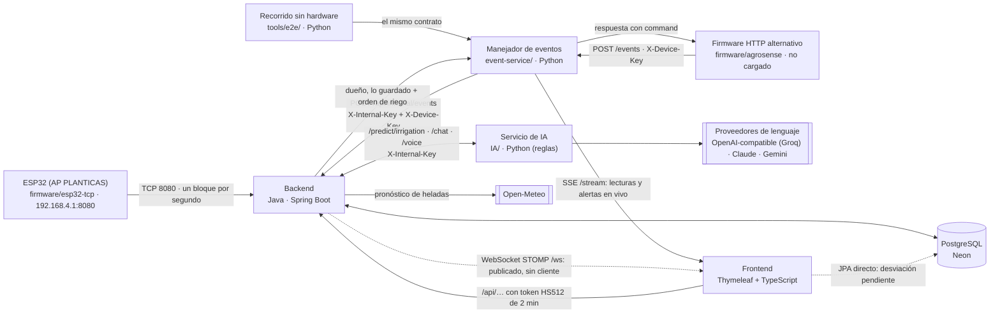

# AgroSense: contexto completo para una IA

> Documento para entregar a un asistente de IA que va a trabajar en este proyecto. Resume qué es, cómo está
> armado, cómo se conecta cada parte, qué está hecho, qué falta y qué reglas seguir. Estado al 20 de noviembre de
> 2026 (dispositivo de campo: ESP32). Los documentos detallados son la fuente de verdad y se citan en cada sección; si algo aquí contradice el
> código, manda el código.

---

## 1. De qué se trata el trabajo

**AgroSense** es un proyecto universitario de la materia **Patrones de Software**. Es un sistema de monitoreo de
cultivos:

1. Un **dispositivo en el campo** (ESP32 Dev Module, `firmware/esp32-tcp/`) mide la humedad del suelo (sensor capacitivo),
   la temperatura exterior (termocupla MAX6675) y la humedad del aire (DHT11).
2. El ESP32 crea su propia red Wi-Fi (`PLANTICAS`) y es un **servidor TCP** en `192.168.4.1:8080`: escribe un bloque de texto
   por segundo. El **backend** se conecta a él, promedia 60 s y guarda una lectura por minuto. (El sistema también acepta
   eventos HTTP a través de un **manejador de eventos**; es la vía de `tools/e2e` y del firmware alternativo.)
3. El backend guarda las lecturas en **PostgreSQL**, genera **alertas** cuando un valor sale del rango del cultivo y pide
   al **servicio de IA** una **recomendación de riego**.
4. Una **aplicación web** muestra fincas, cultivos, sensores, gráficas, alertas en vivo, un asistente conversacional (texto y
   voz) y permite **ordenar riegos**. El ESP32 real no tiene bomba ni acepta órdenes: su riego solo se registra.

El objetivo académico es **aplicar patrones de diseño creacionales y estructurales** en código real y conectado al flujo
del sistema, y sustentarlo. Están los 23 patrones del libro de Gamma y otros (5 creacionales, 7 estructurales y 11 de comportamiento), en 4
lenguajes (Java, Python, C++, TypeScript); ver la sección 7
y `docs/PATRONES.md`.

> Aviso: este repositorio no contiene el enunciado ni la rúbrica oficial de la materia. Si la tarea depende de ellos,
> pídelos al usuario en vez de suponerlos.

---

## 2. Componentes y carpetas

El workspace es un **monorepo local** con un solo `.git`. Cada carpeta se publica después en su propio repositorio.

| Carpeta | Qué es | Tecnología | Pruebas |
|---|---|---|---|
| `backend/agrosense/` | API REST, alertas, predicciones, órdenes de riego, dispositivos; **lee el ESP32 por TCP** (`pattern/structural/adapter/esp32/`, apagado salvo `ESP32_TCP_ENABLED=true`) | Java 17, Spring Boot 4.1.1, Maven, JWT HS512 | `./mvnw test` |
| `frontend/` | Aplicación web renderizada en servidor | Java 21, Spring Boot 4.1.1, Thymeleaf, Spring Security (sesión), JPA; scripts en **TypeScript estricto** compilados con `tsc` | `./mvnw test`, `npm run build && npm test` |
| `IA/` | Reglas de riego (`/predict/irrigation`) y asistente (`/chat`, `/voice`) | Python, FastAPI. **Reglas fijas, no un modelo entrenado** | `pytest`; `python -m unittest tests.test_patterns tests.test_rules` |
| `event-service/` | Webhook de dispositivos (`POST /events`) y canal en vivo SSE (`GET /stream`) | Python, FastAPI | `pytest` |
| `firmware/esp32-tcp/` | **El dispositivo real**: sketch del equipo para ESP32 Dev Module (modo AP `PLANTICAS` con una sola estación, servidor TCP 8080, un bloque por segundo, un solo cliente, sin órdenes). MAX6675 en GPIO5/17/16 (leído cada 250 ms, promedio de 4), DHT11 en GPIO4, suelo en GPIO34 (`ADC_SECO=2900`/`ADC_HUMEDO=1300`, calibrados el 10/11/2026; modo `CALIBRAR_SUELO`). Envía valores **crudos**: las compensaciones las aplica el backend | C++ / Arduino | `sh firmware/test/compile.sh` (en la CI) |
| `firmware/agrosense/` | **Alternativa no usada**: firmware cliente HTTP con relé y patrones (no está cargado en la placa) | C++ (pruebas en PC con g++) | `sh firmware/test/run-tests.sh` |
| `database/` | Esquema (`schema.sql`, única fuente de verdad), `seed_demo.sql`, `reset.sql`, `migrations/001..003`, `datasource.properties` | PostgreSQL (Neon en producción; H2 modo PostgreSQL en pruebas) | — |
| `api/` | Contrato OpenAPI del backend (`openapi.json`), peticiones de ejemplo, verificador de contrato | Python | `python api/tools/validate_spec.py` |
| `tools/e2e/` | Recorrido completo sin hardware (plan B sin placa): envía eventos con su propio cliente HTTP, con el mismo contrato que el ESP32 → backend → alerta → predicción → orden de riego | Python, solo biblioteca estándar | `python tools/e2e/run_e2e.py` |
| `tools/esp32/` | `run-demo.ps1` arranca backend y frontend en Windows, sin Docker, contra una branch de desarrollo de Neon y con el ESP32 por TCP (`-Verificar`, `-PrepararBase`, `-Simulado` con un ESP32 falso en Python, `-SinEsp32`, `-NoAbrir`); `stop-demo.ps1` lo detiene. La protección contra producción compara el endpoint de Neon (`ep-...`), con o sin `-pooler`. Variables en `tools/esp32/.env.local`, fuera de git | PowerShell 5.1 y 7 | `run-demo.ps1 -Verificar` |
| `.github/workflows/agrosense.yml` | CI: todas las pruebas, esquema y migraciones sobre PostgreSQL real | GitHub Actions | — |
| `compose.yaml`, `.env.example` | Todo el sistema en una máquina y todas sus variables | Docker Compose | — |
| `agrosense-entrega/`, `agrosense-export/`, `temp_agrosense/` | Copias de los repositorios de entrega y restos de trabajo. **No se editan como fuente**; ver sección 10 | — | — |

---

## 3. Arquitectura y conexiones



### Cada conexión, en detalle

| Conexión | Código | Seguridad / contrato |
|---|---|---|
| Dispositivo → manejador de eventos | `firmware/agrosense/src/BackendProxy.h` y `ArduinoPorts.h` (`HttpBackend`: `HTTPClient` + `WiFiClientSecure` en una tarea propia), `tools/e2e/run_e2e.py` → `event-service/agrosense_events/app.py` (`POST /events`, alias `POST /webhook/eventos`) | `X-Device-Key` (alias `X-API-KEY`): llave propia del dispositivo; el backend compara su SHA-256 en tiempo constante |
| ESP32 (AP PLANTICAS) --TCP 8080--> Backend | `Esp32TcpClient` (hilo propio; 5 s para conectar, 30 s sin datos = conexión muerta, reconexión 2–30 s, líneas de más de 256 caracteres fuera) → `Esp32BlockParser` (un bloque `===== PLANTICAS =====` → una lectura; `nan` y fuera de rango se omiten) → `Esp32ReadingAggregator` (promedio de `ESP32_AGGREGATE_SECONDS`, 60) → `Esp32TcpIngestionService` → `DeviceIngestionFacade.ingestFromConfiguredDevice` | **Sin `X-Device-Key`**: el dispositivo es `ESP32_DEVICE_ID` porque la configuración lo dice; `ESP32_TCP_HOST` solo IPv4 privada. Solo para la red local del ESP32 (decisión 40 de `docs/ARQUITECTURA.md`). El PC se une a `PLANTICAS` desde el sistema operativo. Nada se escribe en el socket: las órdenes de su cultivo solo se registran (`Esp32ReadOnlyActuatorDriver`). Estado en `GET /api/devices/esp32/status`. En vivo: la vista del cultivo consulta `/api/ui/crops/{id}/latest` cada 30 s |
| Manejador de eventos → backend | `app.py` (`receive`) → `InternalEventController`, `DeviceEventService`, `DeviceIngestionFacade` | `X-Internal-Key` = `EVENTS_INTERNAL_KEY`, verificada por `InternalKeyFilter`; ruta fuera del JWT de usuarios. Reintenta 3 veces (0,5/1/2 s) si el backend no guardó; responde 502 después |
| Backend → manejador → dispositivo (orden de riego) | `irrigation_dispatches`, patrón Bridge (`IrrigationOrder` × `ActuatorDriver`) | Solo con `IRRIGATION_ACTUATOR=relay`. La orden viaja **en la respuesta** al siguiente evento, una sola vez; caduca en 5 min; el dispositivo confirma con `ack` en el evento siguiente |
| Backend ↔ BD | Repositorios Spring Data | Credenciales por variables; `ddl-auto=validate` (nunca crea tablas) |
| Backend → IA | `AiClientService` (predicción), `AiServiceClient` (chat/voz), `AiServiceProxy` | `X-Internal-Key` = `AI_SERVICE_KEY` = `INTERNAL_API_KEY` de la IA; durante la migración también el Bearer `AI_SERVICE_TOKEN` |
| IA → proveedores | `IA/agrosense_ia/providers.py`, `ai_factory.py` | Llave en cabecera. Orden: OpenAI-compatible → Claude → Gemini. Producción usa Groq (`qwen/qwen3.8-27b`, `whisper-large-v3-turbo`) |
| Backend → Open-Meteo | `OpenMeteoAdapter`, `FieldWatchService` | Sin llave. Cada hora por finca con coordenadas → `FROST_RISK` |
| Navegador → frontend | Páginas Thymeleaf, `frontend/src/main/ts/**` | Sesión de servidor (guardada en BD con Spring Session JDBC), CSRF, CSP estricta, sin `innerHTML` |
| Frontend (servidor) → backend | `BackendClient` | Token HS512 de 2 min a nombre del usuario, firmado con `BACKEND_JWT_SECRET` (= `JWT_SECRET` del backend). Si el backend no responde a `/api/health`, cae a la BD |
| Manejador de eventos → navegador | `app.py` (`stream`) → `frontend/src/main/ts/events/live.ts` (`EventSource`) | Token HS256 de 5 min firmado con `EVENTS_STREAM_SECRET`, pedido a `/api/ui/events/token`. Cada evento solo llega a su dueño |
| Frontend → BD (directo) | 9 clases: `EstateService`, `CatalogService`, `SensorService`, `AlertService`, `IrrigationService`, `ReportService`, `AccountService`, `DatabaseUserDetailsService`, `DemoAccountInitializer` | **Desviación aceptada** del diagrama (decisión 27): la API del backend aún no cubre edición/baja ni los listados completos. Migrar servicio por servicio en una rama aparte |

**Solo el backend (y, por ahora, el frontend) tocan la BD.** La IA, el manejador de eventos y los dispositivos no tienen
credenciales de base de datos: la IA recibe el contexto de la finca ya armado (`farm_context`).

### Contratos principales

```
# Dispositivo → manejador de eventos
POST /events   (X-Device-Key)
  {"device_id": "ESP32-01", "type": "reading", "ts": "2026-10-16T08:00:00-05:00",
   "data": {"soil_moisture": 31.5, "air_temperature": 24.1, "relative_humidity": 61.0}}
  # El ESP32 escribe ts en ISO-8601 con -05:00 (NTP) y no envía "ph": no lo mide
  → 200 {"status": "stored", "readings": 3, "alerts": 1, "delivered": 2, "command": {...}?}
  → 401 sin llave · 403 llave mala o dispositivo desconocido · 409 inactivo · 400 datos inválidos
  → 429 sobre DEVICE_MAX_EVENTS_PER_MINUTE · 502 backend caído (reintentar)
  # Con varios sensores del mismo tipo: {"soil_moisture": {"value": 31.5, "sensor_code": "AS-001"}}
  # type "alert": data {"alert_type", "message", "severity"?, "value"?}
  # También acepta {"deviceId", "timestamp", "datos": {"temperatura", "humedad_aire", "humedad_suelo"}}

# Manejador → backend
POST /api/internal/events  (X-Internal-Key, X-Device-Key)  mismo cuerpo
  → 200 {"ownerEmail", "event": {"type", "deviceId", "cropId", "cropName", "readings": [...], "alerts": [...]}}

# Backend → IA
POST /predict/irrigation {"id_crop", "soil_moisture", "air_temperature", "ph", "humidity_min", ...}
  → {"irrigate", "duration_minutes", "recommendation", "confidence", "model_used", "factors"}
POST /chat  {"message", "history": [{"role", "text"}], "farm_context"} → {"reply", "source": "model"}
POST /voice multipart audio|transcript, farm_context → {"reply", "transcript", "source"}
GET  /health → {"status": "UP"}
  # Errores {"message"}: 401, 422, 429, 502, 503, 504. Ante 429/502/503/504 el backend responde
  # con sus datos locales (source: "local", LocalAdvisor).

# Canal en vivo
GET /api/ui/events/token (sesión del frontend) → {"enabled", "token", "streamUrl", "expiresInSeconds": 300}
GET /api/events/token (JWT, backend)           → {"token", "expiresInSeconds": 300}
GET /stream?token=…                            → text/event-stream: ready, reading, alert, expired, ": ping"
```

### API REST del backend (bajo `/api`, JSON, JWT en `Authorization`)

`GET /`, `GET /api/health`, `POST /api/auth/login`, `POST /api/auth/register`, `GET /api/auth/check-user` (públicas);
`GET/POST /api/fincas`, `/api/cultivos`; `GET /api/crops/{id}/sensors`, `POST /api/sensors`; `POST /api/readings`,
`GET /api/sensors/{id}/readings`; `GET /api/alerts`, `GET /api/crops/{id}/alerts`, `PATCH /api/alerts/{id}/acknowledge`;
`GET /api/riego/cultivo/{id}`, `POST /api/riego`; `GET /api/dashboard`, `GET /api/dashboard/{id}`;
`GET/POST /api/crops/{id}/predictions`; `POST /api/ai/chat`, `POST /api/ai/voice`; `POST /api/devices`;
`GET /api/crop-templates`; `POST /api/internal/events` (solo el manejador de eventos). Contrato completo en `api/openapi.json`.

Roles: `ADMIN`, `FARMER`, `TECHNICIAN`. Crear fincas, cultivos, riegos, predicciones, dispositivos y atender alertas exige
`ADMIN` o `FARMER`. Cada consulta se filtra por el dueño; un recurso ajeno da 404.

---

## 4. Modelo de datos

Entidades (duplicadas en backend y frontend, mismo esquema): `User`, `Estate` (finca), `Crop` (cultivo), `Sensor`,
`SensorReading`, `Alert`, `Irrigation`, `AiPrediction`, `Device`. Tablas extra: `irrigation_dispatches`,
`sensor_readings_hourly`, `spring_session`, `spring_session_attributes`.

Tipos de alerta incluyen los de rango (humedad baja/alta, temperatura baja/alta, pH) y `FROST_RISK`, `SENSOR_OFFLINE`,
`SENSOR_FAULT`.

- `database/schema.sql` es la **única fuente de verdad**; idempotente. Backend y frontend usan `ddl-auto=validate`.
- Migraciones para la base existente, en orden: `001_devices.sql`, `002_alert_types.sql`, `003_reliability.sql`.
  Sin la 001 y la 003 el backend nuevo no arranca; sin la 002 la base rechaza las alertas nuevas.
- `seed_demo.sql`: usuario de ejemplo con hash inutilizable (cada app le pone su contraseña con `SEED_USER_PASSWORD` /
  `DEMO_PASSWORD`) y dispositivo `ESP32-PLANTICAS` (llave con `SEED_DEVICE_KEY`). **Nunca correr `seed_demo.sql` ni
  `reset.sql` en producción.**

---

## 4b. De dónde sale cada dato y dónde se guarda

| Dato | De dónde sale | Dónde se guarda (tabla) | Dónde se ve |
|---|---|---|---|
| Humedad del suelo | Sensor capacitivo del ESP32, GPIO34 (`SENSORTIERRA.h`) | `sensor_readings` (sensor `SOIL_MOISTURE`) | Inicio, Cultivos, Sensores, Reportes |
| Temperatura del aire | Termocupla MAX6675 del ESP32, GPIO5/17/16 (`TEMPERATURA.h`) | `sensor_readings` (`AIR_TEMPERATURE`) | Inicio, Cultivos, Sensores, Reportes |
| Humedad del aire | DHT11 del ESP32, GPIO4 (`HUMEDAD.h`) | `sensor_readings` (`RELATIVE_HUMIDITY`) | Inicio, Cultivos, Sensores, Reportes |
| pH y otras medidas | Datos de ejemplo (`database/seed_demo.sql`) o eventos HTTP; la placa no las mide | `sensor_readings` | Cultivos, Sensores |
| Sensores y dispositivos | Se registran en la app (Sensores › Nuevo sensor) o en `seed_demo.sql` | `sensors`, `devices` | Sensores |
| Cultivos, rangos y fincas | Se registran en la app (Parcelas, Cultivos) | `crops`, `estates` | Parcelas, Cultivos |
| Alertas | Las crea el backend al comparar cada lectura con el rango del cultivo, la regla de riego y las vigilancias | `alerts` | Alertas |
| Riegos | Orden manual en Riego o la recomendación de la IA | `irrigations`, `irrigation_dispatches` | Riego |
| Recomendaciones de la IA | Servicio `IA/` o respaldo local | `ai_predictions` | Cultivos |
| Estado del ESP32 | Receptor TCP del backend, en memoria (no se guarda) | — | Monitoreo |

Recorrido de una lectura: el ESP32 envía un bloque de texto por segundo, por Wi-Fi (red `PLANTICAS`, TCP 8080) o por el
cable USB (`tools/esp32/esp32_usb.py`). El backend junta los bloques de cada minuto (promedio o mediana,
`ESP32_AGGREGATE_STRATEGY`) y guarda una lectura por sensor. La base es PostgreSQL en Neon; en la demo local
(`run-demo.ps1 -BaseLocal`) es H2 en `tools/esp32/.run/h2`.

El asistente de la app recibe esta misma información con los datos del usuario: cada sensor activo con su cultivo, lugar,
dispositivo y última lectura, el estado del receptor, la regla de riego y la tabla donde se guarda cada cosa
(`FarmSnapshot`, `FarmContextService`). Sin llave de IA responde el asistente local (`LocalAdvisor`) a preguntas como
«¿de dónde salen los datos?» o «¿dónde se guardan?».

---

## 5. Variables de entorno clave

Todas están en `.env.example`. Ninguna llave tiene valor por defecto ni se escribe en el repositorio.

| Servicio | Variables |
|---|---|
| Backend | `DATABASE_URL/USERNAME/PASSWORD`, `JWT_SECRET` (≥ 64 bytes), `CORS_ALLOWED_ORIGINS`, `LOGIN_MAX_ATTEMPTS_PER_ADDRESS=0`, `AI_SERVICE_URL`, `AI_SERVICE_KEY`, `AI_SERVICE_TOKEN`, `AI_SERVICE_TIMEOUT_MS`, `AI_CHAT_VIA_SERVICE`, `EVENTS_INTERNAL_KEY`, `EVENTS_STREAM_SECRET` (≥ 32 bytes), `SEED_DEVICE_KEY`, `IRRIGATION_ACTUATOR` (`simulated`/`relay`), `IRRIGATION_AI_ORDERS`, `IRRIGATION_MAX_RUN_MINUTES` (5, = `MAX_PUMP_ON_MS` del firmware), `AI_INGESTION_PREDICTION_MINUTES`, `ALERTS_DEVICE_SILENT_MINUTES`, `ALERTS_FROST_WATCH`, `ALERTS_STUCK_READINGS`, `DEVICE_MAX_EVENTS_PER_MINUTE`, `READINGS_RETENTION_DAYS` (0 = no borra), `SENSOR_CALIBRATION` (`TIPO=desplazamiento:ganancia`) |
| IA | `INTERNAL_API_KEY`, `AI_SERVICE_TOKEN`, `AI_ALLOW_OPEN`, `AI_CHAT_API_KEY`, `AI_CHAT_BASE_URL`, `AI_CHAT_MODEL`, `AI_TRANSCRIPTION_MODEL`, `ANTHROPIC_*`, `GEMINI_*`, `AI_TIMEOUT_MS`, `AI_MAX_OUTPUT_TOKENS`, `AI_PROVIDER_REQUESTS_PER_MINUTE`, `AI_REPLY_CACHE_SECONDS` |
| Manejador de eventos | `BACKEND_URL`, `EVENTS_INTERNAL_KEY`, `EVENTS_STREAM_SECRET`, `EVENTS_ALLOWED_ORIGINS`, `BACKEND_TIMEOUT_MS`, `BACKEND_RETRIES`, `EVENTS_HEARTBEAT_S`, `EVENTS_MAX_STREAMS*` |
| Frontend | `BACKEND_URL`, `BACKEND_JWT_SECRET` (= `JWT_SECRET`), `EVENTS_PUBLIC_URL`, `IRRIGATION_ACTUATOR`, `NEON_*` / `DATABASE_*` |
| Backend, ESP32 por TCP | `ESP32_TCP_ENABLED` (`false`; en Render siempre apagado), `ESP32_TCP_HOST` (`192.168.4.1`, solo IPv4 privada), `ESP32_TCP_PORT` (`8080`), `ESP32_DEVICE_ID` (`ESP32-PLANTICAS`, debe existir en `devices`), `ESP32_AGGREGATE_SECONDS` (`60`). La clave de la red Wi-Fi no va en el repositorio |
| Recorrido sin hardware | `BACKEND_URL`, `EVENTS_URL`, `API_EMAIL`, `API_PASSWORD`, `DEVICE_ID`, `DEVICE_KEY`, `CROP_ID`, `EXPECT_MODEL` |
| ESP32 real (`firmware/esp32-tcp/`) | `arduino_secrets.h`, fuera del repositorio: `SECRET_AP_SSID` (`PLANTICAS`) y `SECRET_AP_PASS` (12 caracteres o más, distinta del nombre; el sketch no compila si no) |
| Backend, compensación del ESP32 | `SENSOR_CALIBRATION=AIR_TEMPERATURE=-8.5:1,RELATIVE_HUMIDITY=-6:1` en `.env.example` y `compose.yaml` (Decorator `CalibrationDecorator`, se aplica una sola vez). **Por verificar con termómetro e higrómetro de referencia** |
| Firmware alternativo (`firmware/agrosense/`) | `arduino_secrets.h`, fuera del repositorio: `SECRET_WIFI_SSID/PASS`, `SECRET_DEVICE_ID/KEY`, `SECRET_EVENTS_HOST/PORT/TLS`, `SECRET_EVENTS_CA_CERT`, `AGRO_SOIL_DRY_RAW`/`AGRO_SOIL_WET_RAW` |

**Secretos que deben ser iguales en dos sitios:** `JWT_SECRET` (backend) = `BACKEND_JWT_SECRET` (frontend);
`INTERNAL_API_KEY` (IA) = `AI_SERVICE_KEY` (backend); `EVENTS_INTERNAL_KEY` y `EVENTS_STREAM_SECRET` (backend = manejador).

---

## 6. Despliegue actual

| Componente | Dónde | Dirección |
|---|---|---|
| Base de datos | Neon (PostgreSQL 18) | Variables del proyecto |
| Frontend | Vercel, `agrosense-frontend` (contenedor `Dockerfile.vercel`, `vercel deploy --prod` desde la raíz) | `https://agrosense-frontend-iota.vercel.app` (protegido con Vercel Authentication) |
| Backend | Render, `BACKEND-AGROSENSE`, Docker, plan gratuito | `https://backend-agrosense-u5mz.onrender.com` |
| IA | Render, `ia-agrosense` | `https://ia-agrosense.onrender.com` |
| Manejador de eventos | **No desplegado** (`event-service/render.yaml` listo) | — |

- Render gratuito **duerme** cada servicio tras ~15 min y tarda 1–3 min en despertar. Por eso hay tiempos de espera largos,
  reintentos, cola en el dispositivo y respuestas locales de respaldo.
- Los servicios de la rama `feature/arquitectura-servicios` (dispositivos, eventos en vivo, chat por la IA) **aún no están
  en producción**. Orden de despliegue: migraciones 001→002→003, **frontend antes que backend** (un frontend viejo falla al
  leer tipos de alerta nuevos), backend, IA, manejador de eventos, dispositivo. Pasos completos en `docs/DESPLIEGUE.md`.
- Local: `cp .env.example .env && docker compose up --build` → frontend en `http://localhost:8080`, webhook en
  `http://localhost:8100/events`. El frontend también corre solo con el perfil `demo` (H2 en memoria).

---

## 7. Patrones de diseño implementados (núcleo académico)

Rutas: `B/` = `backend/agrosense/src/main/java/com/agrosense/backend/`, `F/` = `firmware/agrosense/src/`,
`TS/` = `frontend/src/main/ts/api/`. Detalle, diagramas y pruebas de cada uno en `docs/PATRONES.md`.

| Patrón | Dónde | Para qué |
|---|---|---|
| **Singleton** | `F/DeviceConfig.h`, `F/WifiManager.h`, `B/pattern/creational/singleton/CalibrationRegistry.java`, `AiConfigManager.java` | Una sola radio/configuración en la placa; una sola tabla de calibración |
| **Prototype** | `B/pattern/creational/prototype/CropTemplate.java`, `CropTemplateCatalog.java`, `SensorReadingPrototype.java` | Cada cultivo parte de una copia profunda de su plantilla |
| **Builder** | `B/.../builder/PredictionRequest.java`, `AlertBuilder.java`, `F/ReadingJsonBuilder.h` | Objetos con muchos opcionales; `build()` valida |
| **Abstract Factory** | `IA/agrosense_ia/ai_factory.py`, `F/HardwareFactory.h`, `F/ArduinoPorts.h` (`RealHardwareFactory`, la del ESP32) | Familias: chat + transcripción por proveedor; sensores + actuador del ESP32 o simulados |
| **Factory Method** | `B/.../factory/alert/AlertCreator.java` + 8 subclases, `SensorFactory.java` | Cada regla crea su alerta; una alerta nueva = una clase nueva |
| **Adapter** (ESP32 por TCP) | `B/pattern/structural/adapter/esp32/` (`Esp32BlockParser`, `Esp32ReadingAggregator`, `Esp32TcpIngestionService`) | Traduce el bloque de texto del ESP32 al evento del webhook |
| **Adapter** | `IA/agrosense_ia/providers.py`, `F/ClimateAdapters.h`, `B/.../adapter/OpenMeteoAdapter.java`, `MqttAdapter.java` | Traducen APIs/bibliotecas distintas a una interfaz común |
| **Bridge** | `B/pattern/structural/bridge/` (`IrrigationOrder` × `ActuatorDriver`), `F/Irrigation.h` | Quién ordena el riego y cómo se acciona varían por separado |
| **Decorator** | `F/SensorChain.h`, `F/Irrigation.h` (`PumpGuard`), `IA/agrosense_ia/ai_decorators.py`, `B/.../decorator/` | Filtrar/calibrar/validar; registrar/limitar/cachear, en capas |
| **Facade** | `B/.../facade/DeviceIngestionFacade.java`, `SensorFacade.java`, `F/AgroSenseDevice.h`, `TS/facade.ts` | Una llamada oculta autenticar, guardar, alertar, predecir y publicar |
| **Proxy** | `B/.../proxy/AiServiceProxy.java`, `F/BackendProxy.h`, `TS/cache-proxy.ts` | Reintentos, búfer, caché y respaldo detrás de la misma interfaz |
| **Composite** | `B/pattern/structural/composite/` (`AlertRule`, `AlertRuleGroup`) | Las reglas de alerta de una lectura son un árbol que se evalúa como una sola |
| **Flyweight** | `B/pattern/structural/flyweight/Esp32ReadingPool.java` | Los bloques iguales del ESP32 son un solo objeto compartido |
| **Chain of Responsibility** | `B/pattern/behavioral/chain/` | Cada línea del bloque del ESP32 la atiende el primer manejador que la reconoce |
| **Command** | `B/pattern/behavioral/command/` | Cada vigilancia del campo es una orden que el invocador ejecuta y recuerda |
| **Interpreter** | `B/pattern/behavioral/interpreter/` | Lee la regla de riego `suelo < 40 y aire < 60` |
| **Iterator** | `B/pattern/behavioral/iterator/` | Recorre la ventana de bloques de un minuto |
| **Mediator** | `B/pattern/behavioral/mediator/Esp32Mediator.java` | El cliente TCP avisa al servicio sin conocer el parser ni la base |
| **Memento** | `B/pattern/behavioral/memento/CalibrationCheckpoint.java` | Guarda y restaura la calibración si una carga falla |
| **Observer** | `B/pattern/behavioral/observer/` | Contadores y estado del enlace escuchan cada bloque |
| **State** | `B/pattern/behavioral/state/` | Esperando, recibiendo, en silencio o desconectado (página Monitoreo) |
| **Strategy** | `B/pattern/behavioral/strategy/` | Promedio o mediana del minuto |
| **Template Method** | `B/pattern/behavioral/templatemethod/ScheduledWatch.java` | Los pasos fijos de cada vigilancia programada |
| **Visitor** | `B/pattern/behavioral/visitor/` | Cada medida del ESP32 se escribe o describe sin un `switch` |

Las marcadas en `docs/PATRONES.md` como «ya existía» venían del backend original; el resto se añadió después.

---

## 8. Estado de las pruebas (20 de noviembre de 2026)

| Parte | Resultado |
|---|---|
| Backend | 204 pruebas, 0 fallos, 3 omitidas (PostgreSQL) |
| Frontend Java | 148 pruebas, 0 fallos, 2 omitidas (PostgreSQL) |
| Frontend TypeScript | 29 pruebas, 0 fallos |
| IA (patrones y reglas) | 31 pruebas, 0 fallos |
| Firmware en PC | 221 comprobaciones, 0 fallos (10 de noviembre, tras pasar al ESP32) |
| Firmware con compilador real | Compila (33 % flash, 46 % RAM). **No probado en una placa** |

Las pruebas de PostgreSQL solo corren con `POSTGRES_TEST_URL/USERNAME/PASSWORD`. En este equipo Windows el PostgreSQL
local está bloqueado por la directiva de Control de aplicaciones (decisión 17): se usa H2 en modo PostgreSQL, Neon o la CI.
FastAPI no carga en este equipo, así que las pruebas Python con FastAPI corren en la CI.

---

## 9. Qué falta (trabajo pendiente)

Prioridad aproximada para la entrega/sustentación:

0. **ESP32 real** (hallazgos ya decididos con el equipo, ver `firmware/esp32-tcp/README.md`): se quitó el `- 76` del
   suelo, las compensaciones pasaron a `SENSOR_CALIBRATION`, la clave Wi-Fi es propia y la red admite una sola estación;
   GPIO5 se queda; el suelo se calibró el 10/11/2026 (`ADC_SECO=2900`, `ADC_HUMEDO=1300`). **Falta:** compilarlo en el
   Arduino IDE y las pruebas con la placa (`docs/PRUEBAS-ESP32.md`), verificar -8.5 °C y -6 % con referencias, el token de la primera línea
   (mejora futura, decisión 40) y un protocolo de órdenes si el ESP32 llega a tener bomba (TODO en
   `DeviceIngestionFacade` y `Esp32ReadOnlyActuatorDriver`).

1. **Desplegar** la rama `feature/arquitectura-servicios`: migraciones en Neon, frontend, backend, IA, manejador de eventos
   (necesita repositorio propio o la rama `feat/event-service` de `API-AGROSENSE`), `EVENTS_PUBLIC_URL` en el frontend.
   Guía: `docs/DESPLIEGUE.md`.
2. **Decisión abierta:** mantener el manejador de eventos (recomendado, `docs/EVENT-SERVICE.md`) o enviar directo al backend.
3. **Firmware alternativo (`firmware/agrosense/`)**: solo si se decide usarlo en vez del sketch real; está sin probar en una placa.
4. **Desviación del diagrama**: migrar las 9 clases del frontend que usan JPA directo a la API del backend (requiere en el
   backend edición/baja de fincas, cultivos y sensores, listados completos, alertas paginadas con finca, reportes, perfil y
   baja de cuenta).
5. Retirar el Bearer `AI_SERVICE_TOKEN` y la IA interna del backend cuando el chat pase por el servicio de IA
   (`AI_CHAT_VIA_SERVICE=true`).
6. `eventId` único por evento para evitar duplicados sin `ts` (diseño completo en `docs/ARQUITECTURA.md`, sección 9).
7. Dispositivos: listado, desactivación y rotación de llave (hoy solo alta).
8. Menores: edición de sensores y perfil, cambio de contraseña, verificación de correo, `CHECK` en `users.role`,
   `sensor_readings.quality` y `ai_predictions.prediction_type`, rango propio para humedad del aire, exportar reportes a PDF,
   health check `/api/health` en Render, quitar Vercel Authentication y cambiar la contraseña de la cuenta demo antes de abrir.
9. Más pendientes del frontend en `frontend/docs/PENDIENTES.md`.

Trabajo en curso en la rama actual (`feature/rediseno-frontend`): cambios sin confirmar en `database/README.md` (documenta las
migraciones 002 y 003) y en las pruebas `PostgresCompatibilityTests.java` y `WebFlowTests.java` del frontend.

---

## 10. Reglas para trabajar en este repositorio

- **El workspace es la fuente de verdad.** No edites `agrosense-entrega/`, `agrosense-export/` ni `temp_agrosense/` como si
  fueran el código principal.
- **Publicar a los repositorios de entrega** es un procedimiento aparte (`docs/SINCRONIZACION.md`; el detalle local está en
  `SYNC-ENTREGA.md`): los commits de una carpeta se repiten con `git format-patch --relative=<carpeta>` y `git am --3way`
  sobre la rama correspondiente. No se tocan ramas `main`, no se fuerza ningún push y no se borra ni renombra nada en la
  entrega. Hazlo solo cuando el usuario diga «sincroniza».
- Correspondencia: `frontend/`→`FRONTEND-AGROSENSE`, `backend/agrosense/`→`BACKEND-AGROSENSE`, `IA/`→`IA-AGROSENSE`,
  `database/`→`BASE-DE-DATOS-AGROSENSE`, `api/`→`API-AGROSENSE`, `event-service/`→`API-AGROSENSE`
  (rama `feat/event-service`). `firmware/`, `tools/`, `.github/`, `docs/` no tienen repositorio todavía.
- **Esquema:** cualquier cambio de tablas va en `database/schema.sql` **y** en una migración nueva idempotente
  (`database/migrations/00N_*.sql`), y en `reset.sql` si aplica. Las entidades están duplicadas en backend y frontend:
  cámbialas en los dos.
- **Frontend:** los `.ts` se editan en `frontend/src/main/ts/`; `static/js/` es salida de `tsc` y se versiona (corre
  `npm run build`). Sin estilos ni scripts en línea (CSP), sin `innerHTML`, colores solo en `tokens.css`.
- **Secretos:** nunca en archivos del repositorio, ni en logs ni en URLs.
- Commits en inglés con prefijo convencional (`feat(backend): …`, `fix(firmware): …`, `docs: …`); documentación en español.
- Antes de dar algo por terminado, corre las pruebas de la parte tocada (sección 2) y di qué no se pudo correr.
- **Seguridad física:** la bomba no se ha probado con hardware real. La seguridad de la bomba vive en el firmware
  (`PumpGuard`, máximo absoluto, perro guardián) y no debe depender de la red.

---

## 11. Avisos honestos para la sustentación

- La «IA» de riego son **reglas fijas** (`agrosense-riego-reglas-1.0`); cada recomendación nombra sus reglas en `factors`.
  El asistente conversacional sí usa un modelo de lenguaje externo.
- Las plantillas de cultivo traen rangos de partida **no validados agronómicamente**.
- El pH solo es fiable con sonda calibrada; **el firmware actual no lo mide**.
- La calibración por defecto es neutra: inventar valores falsearía las lecturas.
- Plan de demo y qué hacer si algo falla: `docs/DEMO.md`.

---

## 12. Mapa de documentos

| Documento | Contenido |
|---|---|
| `README.md` | Resumen, arquitectura, variables nuevas, orden de despliegue |
| `docs/ARQUITECTURA.md` | Inspección completa, conexiones, contratos, 39 decisiones, cobertura página↔servicio, seguridad, verificación, pendientes |
| `docs/PATRONES.md` | Cada patrón con clases, diagramas, pruebas y justificación |
| `docs/DESPLIEGUE.md` | Pasos de producción en Render y Vercel |
| `docs/DEMO.md` | Plan de la demo y contingencias |
| `docs/PRUEBAS-ESP32.md` | Pruebas del ESP32 real: automáticas, revisión sin placa, cómo compilar en el IDE, qué ver en el monitor serie y pruebas con la placa |
| `docs/EVENT-SERVICE.md` | Mantener o quitar el manejador de eventos |
| `docs/SINCRONIZACION.md` | Qué carpeta va a qué repositorio |
| `database/README.md`, `api/README.md`, `IA/README.md`, `event-service/README.md`, `firmware/README.md`, `frontend/README.md`, `backend/README.md` | Detalle de cada componente |
| `frontend/docs/PENDIENTES.md`, `backend/docs/PRUEBAS-IA.md` | Pendientes del frontend y pruebas de la IA |
