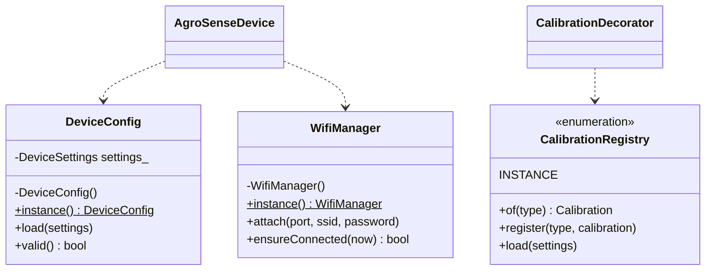
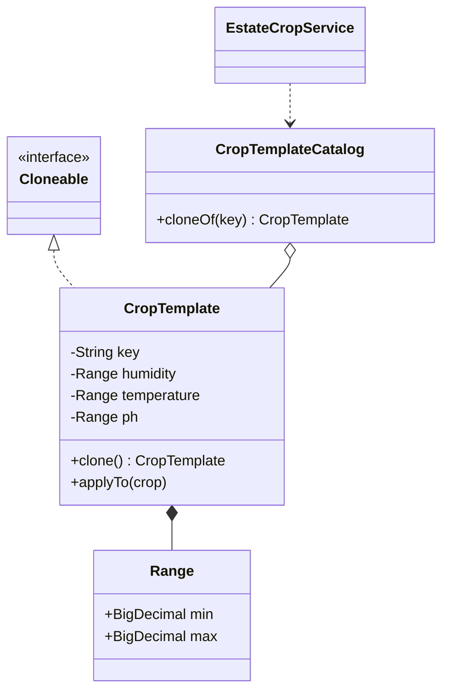
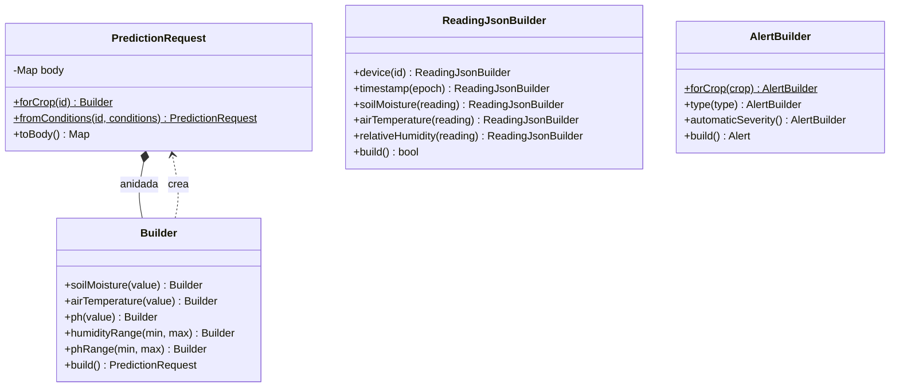
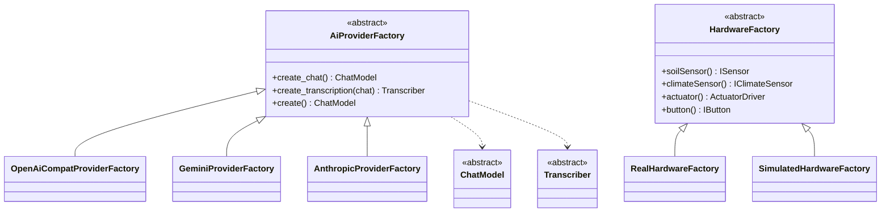
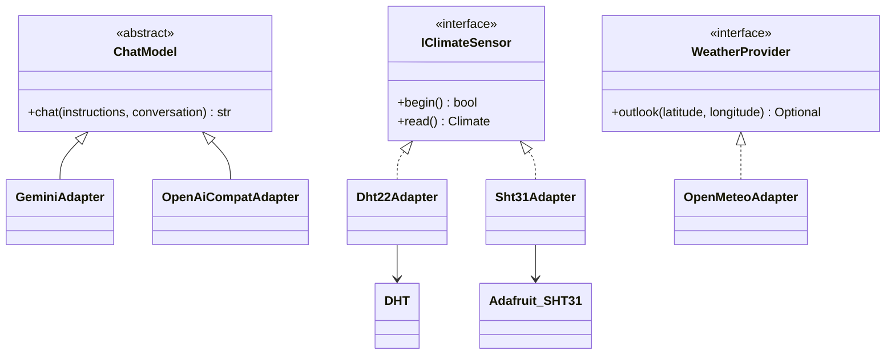
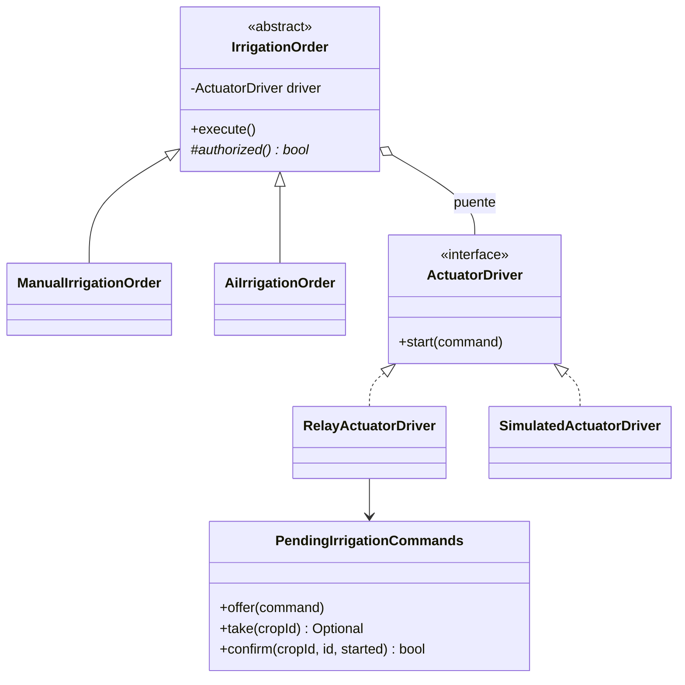
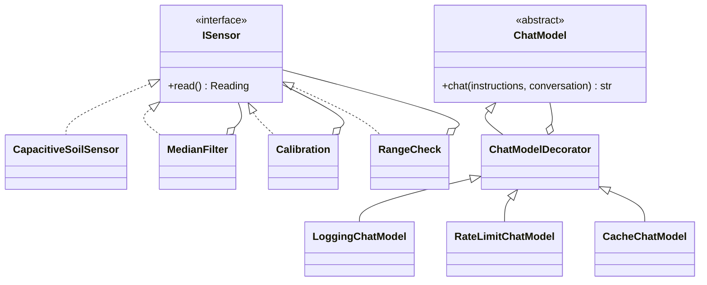
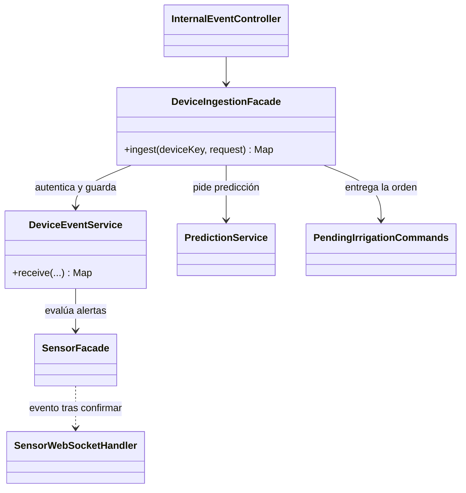
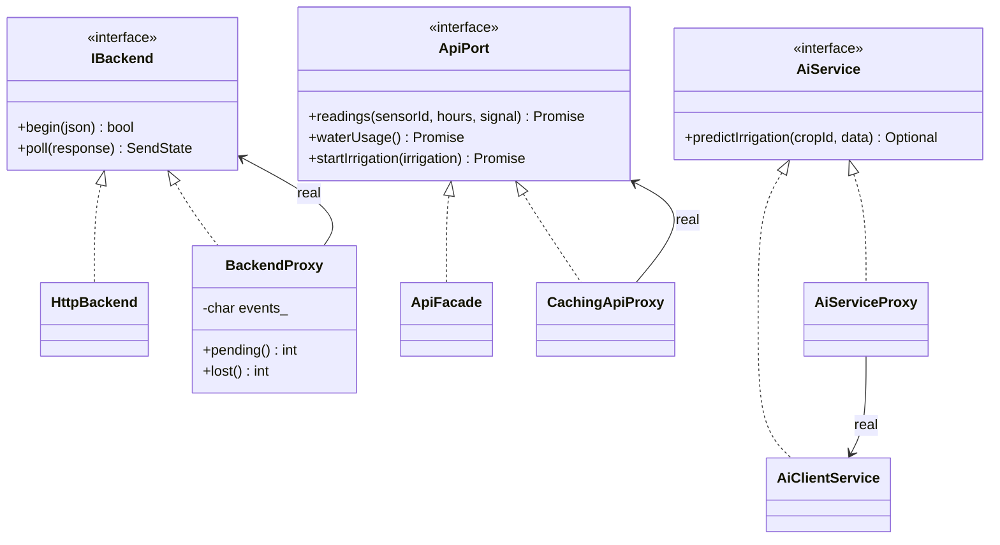

# Patrones de diseño de AgroSense

Estado al 1 de noviembre de 2026. Cada patrón está conectado al flujo real del sistema, salvo donde se indica lo
contrario. La tabla final resume patrón, repositorio, clase y archivo.

Rutas abreviadas:

- `B/` = `backend/agrosense/src/main/java/com/agrosense/backend/`
- `BT/` = `backend/agrosense/src/test/java/com/agrosense/backend/`
- `F/` = `firmware/agrosense/src/`
- `TS/` = `frontend/src/main/ts/api/`

**El dispositivo final es un Arduino UNO R4 WiFi** (`firmware/`). El programa de `raspberry/` se conserva como
simulador de dispositivo para pruebas.

## Cómo correr las pruebas

| Parte | Comando | Resultado del 1 de noviembre de 2026 |
|---|---|---|
| Backend | `cd backend/agrosense && ./mvnw test` | 151 pruebas, 0 fallos, 3 omitidas (PostgreSQL) |
| Frontend, Java | `cd frontend && ./mvnw test` | 115 pruebas, 0 fallos, 2 omitidas (PostgreSQL) |
| Frontend, TypeScript | `cd frontend && npm run build && npm test` | 12 pruebas, 0 fallos |
| IA, patrones y reglas | `cd IA && python -m unittest tests.test_patterns tests.test_rules` | 31 pruebas, 0 fallos |
| Firmware en el PC | `sh firmware/test/run-tests.sh` | 225 comprobaciones, 0 fallos |
| Firmware con el compilador real | `sh firmware/test/compile.sh` | Compila; 33 % de flash y 46 % de RAM. No ejecutado en una placa |

Las suites FastAPI de `IA/` y `event-service/` no pueden correr en este equipo: quedan para CI (`.github/workflows/agrosense.yml`).

## 1. Singleton

**Problema.** Hay recursos de los que no debe existir una segunda copia: la configuración de la placa, su radio y las
correcciones de los sensores.

| Clase | Lenguaje | Archivo | Prueba |
|---|---|---|---|
| `DeviceConfig`, instancia estática | C++ | `F/DeviceConfig.h` | `singletons_are_one_instance_and_refuse_incomplete_settings` |
| `WifiManager`, instancia estática | C++ | `F/WifiManager.h` | `wifi_retries_with_a_growing_wait_and_resets_once_connected` |
| `CalibrationRegistry`, enum | Java | `B/pattern/creational/singleton/CalibrationRegistry.java` | `singletonCalibrationRegistryIsOneInstanceAndReadsItsSettings`, `theCalibrationChangesTheValueThatIsStored` |
| `AiConfigManager`, **ya existía** | Java | `B/pattern/creational/singleton/AiConfigManager.java` | `PatternTests.singletonAlwaysReturnsTheSameConfiguredInstance` |

**Justificación.** Una placa tiene una sola configuración y una sola radio, y dos dueños del Wi-Fi se pelearían por ella.
En Java el enum da la instancia única sin código de sincronización, y `SENSOR_CALIBRATION` la llena al arrancar.

## 2. Prototype

**Problema.** Crear un cultivo exigía escribir seis límites a mano. Si se compartiera la plantilla, ajustar un cultivo
alteraría el catálogo para todos los demás.

| Clase | Lenguaje | Archivo | Prueba |
|---|---|---|---|
| `CropTemplate`, `clone()` profundo | Java | `B/pattern/creational/prototype/CropTemplate.java` | `prototypeHandsOutDeepCopiesSoTheCatalogueNeverChanges` |
| `CropTemplateCatalog` | Java | `B/pattern/creational/prototype/CropTemplateCatalog.java` | `aCropStartsFromItsTemplateAndItsOwnRangesWin`, `theFormOffersTheTemplatesWithTheirRanges` |
| `SensorReadingPrototype`, **ya existía** | Java | `B/pattern/creational/prototype/SensorReadingPrototype.java` | `PatternTests.prototypeCreatesIndependentReadingsWithTheTypesDefaults` |

**Justificación.** `POST /api/cultivos` acepta `template` y parte de una copia con rangos de humedad, temperatura y pH.
La copia es profunda porque `Range` es mutable: cambiar un cultivo nunca toca el catálogo.

Los rangos del catálogo son valores de partida, no recomendaciones agronómicas validadas.

El formulario web de cultivos ofrece el catálogo en un selector (`GET /api/crop-templates`) que rellena los rangos, y se
pueden editar antes de guardar. Sin backend, el formulario funciona sin el selector.

## 3. Builder

**Problema.** Tres objetos tienen muchos campos opcionales y solo son válidos en ciertas combinaciones. Sin Builder, esa
validación queda repartida entre quienes los crean.

| Clase | Lenguaje | Archivo | Prueba |
|---|---|---|---|
| `PredictionRequest.Builder` | Java | `B/pattern/creational/builder/PredictionRequest.java` | `builderSendsOnlyWhatWasMeasuredAndRefusesBadRequests` |
| `AlertBuilder`, **ya existía** | Java | `B/pattern/creational/builder/AlertBuilder.java` | `PatternTests.builderDerivesSeverityAndRefusesIncompleteAlerts` |
| `ReadingJsonBuilder` | C++ | `F/ReadingJsonBuilder.h` | `the_builder_writes_the_event_of_the_contract`, `the_builder_refuses_what_would_not_be_a_valid_event` |

**Justificación.** `build()` es el único lugar que decide si el objeto es válido: una petición sin humedad o un rango a
medias no llegan a la IA. En el firmware además escribe en un búfer fijo y rechaza lo que no cabe, en vez de enviar un
JSON cortado.

## 4. Abstract Factory

**Problema.** Algunas piezas solo funcionan en familia: el chat y la transcripción de un mismo proveedor de IA, o los
sensores y el actuador de un mismo entorno. Mezclarlas por error debe ser imposible.

| Clase | Lenguaje | Archivo | Prueba |
|---|---|---|---|
| `AiProviderFactory` y `OpenAiCompatProviderFactory`, `GeminiProviderFactory`, `AnthropicProviderFactory` | Python | `IA/agrosense_ia/ai_factory.py` | `AbstractFactoryTests` en `IA/tests/test_patterns.py` |
| `HardwareFactory`, `SimulatedHardwareFactory` | C++ | `F/HardwareFactory.h` | `the_factories_give_interchangeable_families` |
| `RealHardwareFactory` | C++ | `F/ArduinoPorts.h` | Solo compilada contra stubs |

**Justificación.** Cambiar de proveedor o de hardware real a simulado es elegir otra fábrica; ni `Assistant` ni
`AgroSenseDevice` cambian. Gemini oye y responde en una llamada y OpenAI en dos, y esa diferencia queda dentro de cada
`Transcriber`, lo que además eliminó un `isinstance` de `Assistant`.

## 5. Factory Method

**Problema.** Un `switch` en `SensorFacade` mezclaba las reglas y los mensajes de todas las alertas. Además, dos alertas
nuevas no nacen de una lectura: un dispositivo callado y un pronóstico de helada.

| Clase | Lenguaje | Archivo | Prueba |
|---|---|---|---|
| `AlertCreator`, abstracta | Java | `B/pattern/creational/factory/alert/AlertCreator.java` | `factoryMethodMakesTheAlertOfEachRule` |
| `LowMoistureAlertCreator`, `HighMoistureAlertCreator`, `HighTemperatureAlertCreator`, `LowTemperatureAlertCreator`, `PhOutOfRangeAlertCreator` | Java | La misma carpeta | `factoryMethodMakesTheAlertOfEachRule` |
| `FrostRiskAlertCreator` | Java | La misma carpeta | `frostWinsOverLowTemperatureButOnlyInTheAir`, `aForecastFrostRaisesAnAlertOnTheCropsOfTheEstateAndDoesNotRepeatEachHour` |
| `SensorOfflineAlertCreator` | Java | La misma carpeta | `aSilentDeviceRaisesAnOfflineAlertThatNamesIt`, `aDeviceThatStoppedReportingRaisesOneAlertAndItStaysAnsweredOnceAnswered` |
| `SensorFaultAlertCreator` | Java | La misma carpeta | `anImpossibleOrStuckValueRaisesASensorFault` |
| `SensorFactory`, **ya existía** | Java | `B/pattern/creational/factory/SensorFactory.java` | `PatternTests.factoryNormalisesTheCodeAndKnowsEveryTypesUnit` |

`HighMoistureAlertCreator` y `LowTemperatureAlertCreator` no estaban en la lista pedida. Hacen falta para conservar dos
alertas que el `switch` ya generaba.

**Justificación.** `evaluate` es igual para todas las alertas y cada subclase decide su regla y crea la suya: una alerta
nueva es una clase nueva, sin tocar las demás. Así entraron helada y dispositivo sin reportar, que `FieldWatchService`
evalúa por horario.

## 6. Adapter

**Problema.** Cada proveedor externo habla su propio formato, pero el sistema quiere una sola interfaz por necesidad.

| Clase | Lenguaje | Archivo | Prueba |
|---|---|---|---|
| `GeminiAdapter`, `OpenAiCompatAdapter`, `AnthropicAdapter` | Python | `IA/agrosense_ia/providers.py` | `AdapterTests` en `IA/tests/test_patterns.py` |
| `Dht22AdapterT`, `Sht31AdapterT` (alias `Dht22Adapter`, `Sht31Adapter`) | C++ | `F/ClimateAdapters.h` | `adapters_give_two_libraries_the_same_face` |
| `OpenMeteoAdapter` | Java | `B/pattern/structural/adapter/OpenMeteoAdapter.java` | `adapterTurnsOpenMeteoArraysIntoTheColdestDay` |
| `MqttAdapter`, **ya existía** | Java | `B/pattern/structural/adapter/MqttAdapter.java` | `PatternTests.adapterTranslatesDeviceMessagesAndRejectsUnusableOnes` |

**Justificación.** Cada adaptador esconde lo raro de su tercero: el DHT22 da NaN y exige 2 s de descanso, el SHT31 lee
los dos valores en una sola transacción y Open-Meteo responde con listas paralelas. Cambiar de sensor o de servicio de
clima no toca a quien los usa.

## 7. Bridge

**Problema.** Hay dos variaciones independientes: quién ordena el riego (persona o IA) y cómo se acciona (relé o
simulado). Combinarlas por herencia daría cuatro clases, y una por cada novedad en cualquiera de los dos ejes.

| Clase | Lenguaje | Archivo | Prueba |
|---|---|---|---|
| `IrrigationOrder`, `ManualIrrigationOrder`, `AiIrrigationOrder` | Java | `B/pattern/structural/bridge/` | `everyOrderWorksWithEveryDriver`, `aPredictionHasToEarnTheWater` en `IrrigationBridgeTests` |
| `ActuatorDriver`, `RelayActuatorDriver`, `SimulatedActuatorDriver` | Java | `B/pattern/structural/bridge/` | `theFacadeHandsTheOrderToTheDeviceInItsAnswer`, `anOrderIsDeliveredOnceAndItsResultIsRecorded`, `theHistoryKeepsWhatTheDeviceReallyRan` |
| `IrrigationOrder`, `ManualIrrigationOrder`, `AiIrrigationOrder` | C++ | `F/Irrigation.h` | `every_order_works_with_every_driver`, `the_device_has_the_last_word_on_an_ai_order` |
| `ActuatorDriver`, `RelayDriver`, `SimulatedDriver`, decorados por `PumpGuard` | C++ | `F/Irrigation.h` | `the_pump_stops_by_itself`, `no_order_runs_the_pump_past_the_absolute_maximum`, `the_interrupt_stops_the_pump_while_the_loop_is_blocked`, `the_daily_limit_cuts_and_then_refuses_until_the_next_day` |

Recorrido de una orden con `IRRIGATION_ACTUATOR=relay`:

**Justificación.** Dos jerarquías unidas por composición: dos órdenes y dos drivers son dos pares de clases, no cuatro
combinaciones. Cada orden pone sus condiciones, y el dispositivo tiene la última palabra sobre una orden de la IA porque
es quien ve el suelo en ese momento.

`PendingIrrigationCommands` guarda cada orden en `irrigation_dispatches`, así que sobrevive a un reinicio y deja constancia de si llegó y de qué hizo el dispositivo.

Valores por defecto: `IRRIGATION_ACTUATOR=simulated` e `IRRIGATION_AI_ORDERS=false`. Hasta cambiarlos, el backend solo
registra el riego, como antes, y la IA no ordena nada.

## 8. Decorator

**Problema.** Una lectura necesita varios tratamientos encadenados, y el servicio de IA varias funciones añadidas.
Meterlo todo en una clase impediría combinarlos o probarlos por separado.

| Clase | Lenguaje | Archivo | Prueba |
|---|---|---|---|
| `PumpGuard`, sobre el driver de la bomba | C++ | `F/Irrigation.h` | `the_gap_between_runs_is_respected` |
| `CapacitiveSoilSensor` → `MedianFilter` → `Calibration` → `RangeCheck` | C++ | `F/SensorChain.h` | `the_median_ignores_a_spike_and_needs_a_majority`, `calibration_maps_either_way_the_sensor_counts`, `range_check_clamps_near_the_limit_and_refuses_far_from_it`, `the_whole_chain_turns_raw_counts_into_a_percentage` |
| `LoggingChatModel`, `RateLimitChatModel`, `CacheChatModel` | Python | `IA/agrosense_ia/ai_decorators.py` | `DecoratorTests` en `IA/tests/test_patterns.py` |
| `CalibrationDecorator`, nuevo eslabón de la cadena existente | Java | `B/pattern/structural/decorator/CalibrationDecorator.java` | `decoratorCorrectsTheReadingBeforeItIsValidated` |
| `SensorReadingProcessor`, `ValidationDecorator`, `NormalizationDecorator`, **ya existían** | Java | `B/pattern/structural/decorator/` | `PatternTests.decoratorsValidateThenNormalise` |

**Justificación.** Cada eslabón añade una sola cosa y conserva la interfaz, así que quien lee no sabe cuántos hay. El
orden importa: la caché va por fuera del límite para que una respuesta repetida no gaste cuota del proveedor.

## 9. Facade

**Problema.** Recibir un evento, operar la placa o llamar a la API obligaría a cada cliente a conocer varios subsistemas
y su orden.

| Clase | Lenguaje | Archivo | Prueba |
|---|---|---|---|
| `DeviceIngestionFacade` | Java | `B/pattern/structural/facade/DeviceIngestionFacade.java` | `facadeStoresTheEventAndAsksForOnePredictionPerInterval`, `facadeNeverLosesAStoredEventOverAPrediction` |
| `AgroSenseDevice` | C++ | `F/AgroSenseDevice.h` | `the_facade_measures_each_interval_and_sends`, `without_wifi_it_keeps_measuring_and_catches_up`, `the_order_in_an_answer_reaches_the_pump_through_the_facade` |
| `ApiFacade` | TypeScript | `TS/facade.ts` | `describe('ApiFacade')` en `frontend/src/test/ts/api-patterns.test.mjs` |
| `SensorFacade`, **ya existía** | Java | `B/pattern/structural/facade/SensorFacade.java` | `readingsAreValidatedNormalisedAndRaiseAlertsOutsideTheCropRange` en `ApiIntegrationTests` |

**Justificación.** El controlador hace una sola llamada, y la predicción ocurre fuera de la transacción para que una IA
lenta no la retenga ni haga perder un evento ya guardado. En la placa, el sketch solo llama a `begin()` y `tick()`; en el
navegador, las páginas no conocen rutas ni validadores.

La publicación por WebSocket sigue en un listener que corre tras confirmar la transacción. El navegador recibe hoy los
eventos en vivo por SSE, desde el manejador de eventos, y no hay ningún cliente STOMP conectado.

## 10. Proxy

**Problema.** Los servicios remotos pueden estar caídos, dormidos en Render o sin cuota. El código que los usa no debería
cargar con esa lógica.

| Clase | Lenguaje | Archivo | Prueba |
|---|---|---|---|
| `AiServiceProxy`, **ya existía**; se le añadió protección, caché y respaldo local | Java | `B/pattern/structural/proxy/AiServiceProxy.java` | `proxyAnswersRepeatedConditionsFromItsCacheUntilTheyExpire`, `proxyFallsBackToLocalRulesAndLeavesAFailingServiceAlone`, `ServiceTests.theProxySkipsADisabledServiceRetriesFailuresAndNeverThrows` |
| `BackendProxy` | C++ | `F/BackendProxy.h` | `the_proxy_delivers_in_order_and_retries_with_a_growing_wait`, `the_proxy_waits_steadily_while_render_wakes_up_then_backs_off`, `the_proxy_drops_a_refused_event_and_the_oldest_when_full` |
| `CachingApiProxy` | TypeScript | `TS/cache-proxy.ts` | `describe('CachingApiProxy')` en `frontend/src/test/ts/api-patterns.test.mjs` |

**Justificación.** Cada proxy tiene la interfaz del objeto real y añade lo que la red exige. `AiServiceProxy` deja
descansar a un servicio que falla y responde con reglas locales marcadas como tales. `BackendProxy` guarda 16 eventos y
distingue un backend dormido de una caída; `CachingApiProxy` evita repetir lecturas recientes.

Una predicción de `agrosense-reglas-locales` tiene confianza 0,5 y nunca puede ordenar un riego.

## Tabla final

Los repositorios siguen la sección 1 de `ARQUITECTURA.md`. `firmware/` todavía no tiene repositorio propio.

| Patrón | Repo | Clase | Archivo |
|---|---|---|---|
| Singleton | firmware | `DeviceConfig` | `firmware/agrosense/src/DeviceConfig.h` |
| Singleton | firmware | `WifiManager` | `firmware/agrosense/src/WifiManager.h` |
| Singleton | BACKEND-AGROSENSE | `CalibrationRegistry` | `B/pattern/creational/singleton/CalibrationRegistry.java` |
| Singleton (existente) | BACKEND-AGROSENSE | `AiConfigManager` | `B/pattern/creational/singleton/AiConfigManager.java` |
| Prototype | BACKEND-AGROSENSE | `CropTemplate`, `CropTemplateCatalog` | `B/pattern/creational/prototype/` |
| Prototype (existente) | BACKEND-AGROSENSE | `SensorReadingPrototype` | `B/pattern/creational/prototype/SensorReadingPrototype.java` |
| Builder | BACKEND-AGROSENSE | `PredictionRequest.Builder` | `B/pattern/creational/builder/PredictionRequest.java` |
| Builder (existente) | BACKEND-AGROSENSE | `AlertBuilder` | `B/pattern/creational/builder/AlertBuilder.java` |
| Builder | firmware | `ReadingJsonBuilder` | `firmware/agrosense/src/ReadingJsonBuilder.h` |
| Abstract Factory | IA-AGROSENSE | `AiProviderFactory` y sus familias | `IA/agrosense_ia/ai_factory.py` |
| Abstract Factory | firmware | `HardwareFactory`, `SimulatedHardwareFactory` | `firmware/agrosense/src/HardwareFactory.h` |
| Abstract Factory | firmware | `RealHardwareFactory` | `firmware/agrosense/src/ArduinoPorts.h` |
| Factory Method | BACKEND-AGROSENSE | `AlertCreator` y 8 subclases | `B/pattern/creational/factory/alert/` |
| Factory (existente) | BACKEND-AGROSENSE | `SensorFactory` | `B/pattern/creational/factory/SensorFactory.java` |
| Adapter | IA-AGROSENSE | `GeminiAdapter`, `OpenAiCompatAdapter`, `AnthropicAdapter` | `IA/agrosense_ia/providers.py` |
| Adapter | firmware | `Dht22Adapter`, `Sht31Adapter` | `firmware/agrosense/src/ClimateAdapters.h` |
| Adapter | BACKEND-AGROSENSE | `OpenMeteoAdapter` | `B/pattern/structural/adapter/OpenMeteoAdapter.java` |
| Adapter (existente) | BACKEND-AGROSENSE | `MqttAdapter` | `B/pattern/structural/adapter/MqttAdapter.java` |
| Bridge | BACKEND-AGROSENSE | `IrrigationOrder` × `ActuatorDriver` | `B/pattern/structural/bridge/` |
| Bridge | firmware | `IrrigationOrder` × `ActuatorDriver` | `firmware/agrosense/src/Irrigation.h` |
| Decorator | firmware | `MedianFilter`, `Calibration`, `RangeCheck` | `firmware/agrosense/src/SensorChain.h` |
| Decorator | IA-AGROSENSE | `LoggingChatModel`, `RateLimitChatModel`, `CacheChatModel` | `IA/agrosense_ia/ai_decorators.py` |
| Decorator (existente, ampliado) | BACKEND-AGROSENSE | `SensorReadingProcessor`, `CalibrationDecorator` | `B/pattern/structural/decorator/` |
| Facade | BACKEND-AGROSENSE | `DeviceIngestionFacade` | `B/pattern/structural/facade/DeviceIngestionFacade.java` |
| Facade (existente) | BACKEND-AGROSENSE | `SensorFacade` | `B/pattern/structural/facade/SensorFacade.java` |
| Facade | firmware | `AgroSenseDevice` | `firmware/agrosense/src/AgroSenseDevice.h` |
| Facade | FRONTEND-AGROSENSE | `ApiFacade` | `frontend/src/main/ts/api/facade.ts` |
| Proxy (existente, ampliado) | BACKEND-AGROSENSE | `AiServiceProxy` | `B/pattern/structural/proxy/AiServiceProxy.java` |
| Proxy | firmware | `BackendProxy` | `firmware/agrosense/src/BackendProxy.h` |
| Proxy | FRONTEND-AGROSENSE | `CachingApiProxy` | `frontend/src/main/ts/api/cache-proxy.ts` |

## Justificación breve para la sustentación

| Patrón | Dos líneas |
|---|---|
| Singleton | La placa tiene una sola radio y una sola configuración, y el backend una sola tabla de calibración. Una segunda instancia solo crearía conflictos, así que la clase la impide. |
| Prototype | Cada cultivo parte de una copia profunda de su plantilla. Ajustar los rangos de un cultivo nunca cambia el catálogo. |
| Builder | Petición, alerta y lectura tienen muchos campos opcionales y reglas entre ellos. `build()` concentra la validación, y nada a medias sale del sistema. |
| Abstract Factory | El chat y la transcripción, o los sensores y el actuador, se crean siempre en familia. Cambiar de proveedor o de hardware es elegir otra fábrica. |
| Factory Method | `AlertCreator` fija el proceso y cada subclase decide y crea su alerta. Una alerta nueva es una clase nueva, no otro caso en un `switch`. |
| Adapter | Gemini, OpenAI, Open-Meteo, el DHT22 y el SHT31 hablan formatos distintos. Cada adaptador los traduce a la interfaz que el sistema ya usa. |
| Bridge | Quién ordena el riego y cómo se acciona varían por separado. La composición evita una clase por cada combinación de orden y actuador. |
| Decorator | Filtrar, calibrar y validar, o registrar, limitar y cachear, son capas independientes. Se encadenan sin cambiar la interfaz y se prueban una a una. |
| Facade | Una sola llamada oculta autenticar, guardar, alertar, predecir y publicar. Quien la usa no depende del orden ni de los subsistemas. |
| Proxy | El proxy tiene la interfaz del objeto real y añade reintentos, búfer, caché y respaldo. Así la red poco fiable no se filtra al resto del código. |
