# Patrones de diseño de AgroSense

Estado al 18 de noviembre de 2026. Están los 23 patrones del libro de Gamma y otros: los 5 creacionales
(secciones 1 a 5), los 7 estructurales (6 a 10, y Composite y Flyweight en 22 y 23) y los 11 de comportamiento (11 a
21). Cada patrón está conectado al flujo real del sistema, salvo donde se indica lo contrario. La tabla final resume
patrón, repositorio, clase y archivo.

Rutas abreviadas:

- `B/` = `backend/agrosense/src/main/java/com/agrosense/backend/`
- `BT/` = `backend/agrosense/src/test/java/com/agrosense/backend/`
- `F/` = `firmware/agrosense/src/`
- `TS/` = `frontend/src/main/ts/api/`

**El dispositivo de campo es un ESP32 Dev Module** (`firmware/`, core `esp32` de Espressif). Solo
`F/ArduinoPorts.h` y los sketches tocan la placa; el resto del firmware compila igual en el PC para las pruebas. Sin
placa, `tools/e2e/run_e2e.py` recorre el sistema con el mismo contrato.

## Mapa: los 23 patrones en el recorrido de una lectura

Una lectura del ESP32 recorre el sistema de arriba abajo. Cada caja nombra el patrón y la clase donde vive; el
número es su sección en este documento. Creacionales en verde, estructurales en azul, de comportamiento en ámbar.

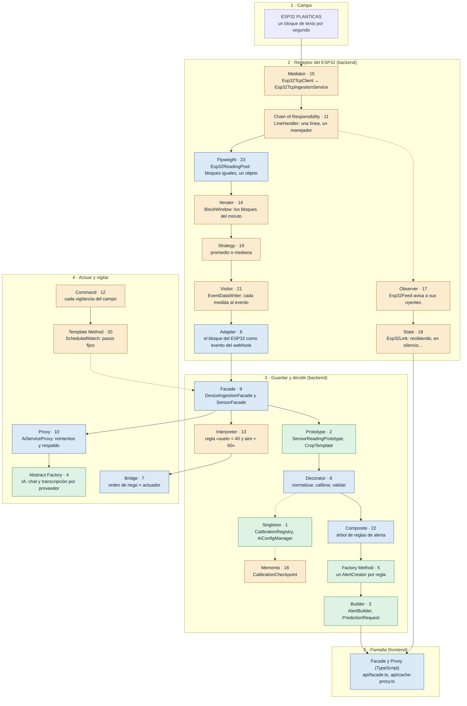

**Cómo contarlo en un minuto.** El ESP32 manda texto; el **Mediator** conecta el cliente TCP con el servicio sin que se
conozcan. Cada línea pasa por una **Chain of Responsibility**, los bloques iguales se comparten (**Flyweight**) y la
ventana del minuto se recorre con un **Iterator** para promediarla con una **Strategy**. Un **Observer** avisa de cada
bloque y el **State** del enlace dice si la placa está recibiendo o en silencio. Un **Visitor** escribe cada medida en
el evento, que el **Adapter** entrega a la **Facade**. Ahí la lectura sale de un **Prototype**, pasa por los
**Decorator** de calibración (la tabla es un **Singleton** protegida por un **Memento**) y se evalúa contra un
**Composite** de reglas, cada una un **Factory Method** que arma su alerta con un **Builder**. El **Interpreter** lee la
regla de riego, el **Proxy** habla con la IA (una **Abstract Factory** por proveedor) y el **Bridge** separa quién
ordena el riego de cómo se acciona. Las vigilancias programadas son **Command** con los pasos fijos de un
**Template Method**.

## Cómo correr las pruebas

| Parte | Comando | Resultado |
|---|---|---|
| Backend | `cd backend/agrosense && ./mvnw test` | 205 pruebas, 0 fallos, 3 omitidas (PostgreSQL); 20 de noviembre |
| Frontend, Java | `cd frontend && ./mvnw test` | 149 pruebas, 0 fallos, 2 omitidas (PostgreSQL); 20 de noviembre |
| Frontend, TypeScript | `cd frontend && npm run build && npm test` | 30 pruebas, 0 fallos; 20 de noviembre |
| IA, patrones y reglas | `cd IA && python -m unittest tests.test_patterns tests.test_rules` | 31 pruebas, 0 fallos |
| Firmware en el PC | `sh firmware/test/run-tests.sh` | 221 comprobaciones, 0 fallos (10 de noviembre, ESP32) |
| Firmware con el compilador real | `sh firmware/test/compile.sh` | Compila; 33 % de flash y 46 % de RAM. No ejecutado en una placa |

**Cobertura del backend** (JaCoCo; `./mvnw test` deja el informe en `target/site/jacoco/index.html`), 20 de noviembre:

| Medida | Cobertura |
|---|---|
| Líneas | 94,6 % (3352 de 3544) |
| Ramas | 82,0 % (1254 de 1530) |
| Métodos | 95,4 % (919 de 963) |
| Líneas de los paquetes `pattern/` (los 23 patrones) | 95,5 % (1405 de 1471) |

Las suites FastAPI de `IA/` y `event-service/` no pueden correr en este equipo: quedan para CI (`.github/workflows/agrosense.yml`).

## 1. Singleton

**Problema.** Hay recursos de los que no debe existir una segunda copia: la configuración de la placa, su radio y las
correcciones de los sensores.

| Clase | Lenguaje | Archivo | Prueba |
|---|---|---|---|
| `DeviceConfig`, instancia estática | C++ | `F/DeviceConfig.h` | `singletons_are_one_instance_and_refuse_incomplete_settings` |
| `WifiManager`, instancia estática | C++ | `F/WifiManager.h` | `wifi_retries_with_a_growing_wait_and_resets_once_connected` |
| `CalibrationRegistry`, enum | Java | `B/pattern/creational/singleton/CalibrationRegistry.java` | `singletonCalibrationRegistryIsOneInstanceAndReadsItsSettings`, `theCalibrationChangesTheValueThatIsStored` |
| `AiConfigManager`, **ya existía** | Java | `B/pattern/creational/singleton/AiConfigManager.java` | `PatternTests.singletonAlwaysReturnsTheSameConfiguredInstance` |

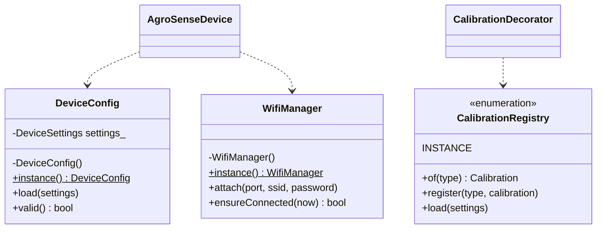

**Justificación.** Una placa tiene una sola configuración y una sola radio, y dos dueños del Wi-Fi se pelearían por ella.
En Java el enum da la instancia única sin código de sincronización, y `SENSOR_CALIBRATION` la llena al arrancar.

## 2. Prototype

**Problema.** Crear un cultivo exigía escribir seis límites a mano. Si se compartiera la plantilla, ajustar un cultivo
alteraría el catálogo para todos los demás.

| Clase | Lenguaje | Archivo | Prueba |
|---|---|---|---|
| `CropTemplate`, `clone()` profundo | Java | `B/pattern/creational/prototype/CropTemplate.java` | `prototypeHandsOutDeepCopiesSoTheCatalogueNeverChanges` |
| `CropTemplateCatalog` | Java | `B/pattern/creational/prototype/CropTemplateCatalog.java` | `aCropStartsFromItsTemplateAndItsOwnRangesWin`, `theFormOffersTheTemplatesWithTheirRanges` |
| `SensorReadingPrototype`, **ya existía** | Java | `B/pattern/creational/prototype/SensorReadingPrototype.java` | `PatternTests.prototypeCreatesIndependentReadingsWithTheTypesDefaults` |

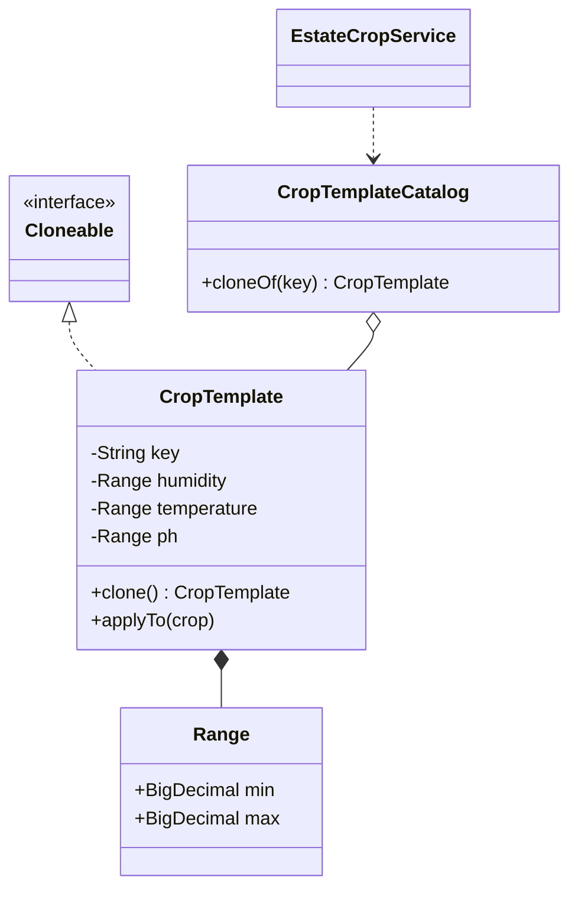

**Justificación.** `POST /api/cultivos` acepta `template` y parte de una copia con rangos de humedad, temperatura y pH.
La copia es profunda porque `Range` es mutable: cambiar un cultivo nunca toca el catálogo.

Los rangos del catálogo son valores de partida, no recomendaciones agronómicas validadas.

El formulario web de cultivos ofrece el catálogo en un selector (`GET /api/crop-templates`) que rellena los rangos, y se
pueden editar antes de guardar. Sin backend, el formulario funciona sin el selector.

## 3. Builder

**Problema.** Tres objetos tienen muchos campos opcionales y solo son válidos en ciertas combinaciones. Sin Builder, esa
validación queda repartida entre quienes los crean.

| Clase | Lenguaje | Archivo | Prueba |
|---|---|---|---|
| `PredictionRequest.Builder` | Java | `B/pattern/creational/builder/PredictionRequest.java` | `builderSendsOnlyWhatWasMeasuredAndRefusesBadRequests` |
| `AlertBuilder`, **ya existía** | Java | `B/pattern/creational/builder/AlertBuilder.java` | `PatternTests.builderDerivesSeverityAndRefusesIncompleteAlerts` |
| `ReadingJsonBuilder` | C++ | `F/ReadingJsonBuilder.h` | `the_builder_writes_the_event_of_the_contract`, `the_builder_refuses_what_would_not_be_a_valid_event` |

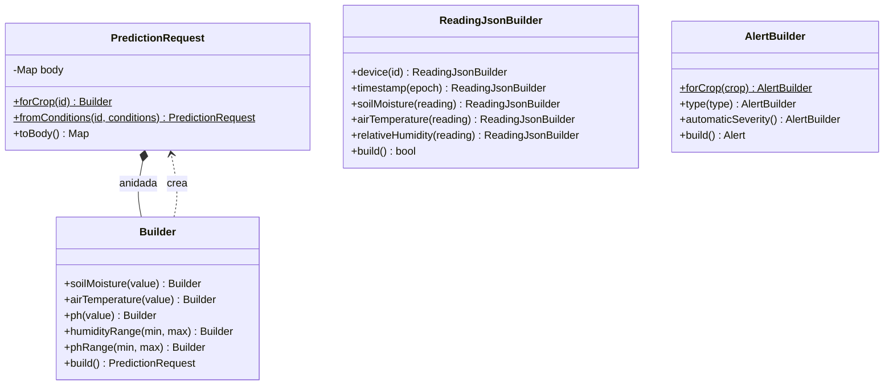

**Justificación.** `build()` es el único lugar que decide si el objeto es válido: una petición sin humedad o un rango a
medias no llegan a la IA. En el firmware además escribe en un búfer fijo y rechaza lo que no cabe, en vez de enviar un
JSON cortado.

## 4. Abstract Factory

**Problema.** Algunas piezas solo funcionan en familia: el chat y la transcripción de un mismo proveedor de IA, o los
sensores y el actuador de un mismo entorno. Mezclarlas por error debe ser imposible.

| Clase | Lenguaje | Archivo | Prueba |
|---|---|---|---|
| `AiProviderFactory` y `OpenAiCompatProviderFactory`, `GeminiProviderFactory`, `AnthropicProviderFactory` | Python | `IA/agrosense_ia/ai_factory.py` | `AbstractFactoryTests` en `IA/tests/test_patterns.py` |
| `HardwareFactory`, `SimulatedHardwareFactory` | C++ | `F/HardwareFactory.h` | `the_factories_give_interchangeable_families` |
| `RealHardwareFactory` | C++ | `F/ArduinoPorts.h` | Solo compilada contra stubs |


**Justificación.** Cambiar de proveedor o de hardware real a simulado es elegir otra fábrica; ni `Assistant` ni
`AgroSenseDevice` cambian. Gemini oye y responde en una llamada y OpenAI en dos, y esa diferencia queda dentro de cada
`Transcriber`, lo que además eliminó un `isinstance` de `Assistant`.

## 5. Factory Method

**Problema.** Un `switch` en `SensorFacade` mezclaba las reglas y los mensajes de todas las alertas. Además, dos alertas
nuevas no nacen de una lectura: un dispositivo callado y un pronóstico de helada.

| Clase | Lenguaje | Archivo | Prueba |
|---|---|---|---|
| `AlertCreator`, abstracta | Java | `B/pattern/creational/factory/alert/AlertCreator.java` | `factoryMethodMakesTheAlertOfEachRule` |
| `LowMoistureAlertCreator`, `HighMoistureAlertCreator`, `HighTemperatureAlertCreator`, `LowTemperatureAlertCreator`, `PhOutOfRangeAlertCreator` | Java | La misma carpeta | `factoryMethodMakesTheAlertOfEachRule` |
| `FrostRiskAlertCreator` | Java | La misma carpeta | `frostWinsOverLowTemperatureButOnlyInTheAir`, `aForecastFrostRaisesAnAlertOnTheCropsOfTheEstateAndDoesNotRepeatEachHour` |
| `SensorOfflineAlertCreator` | Java | La misma carpeta | `aSilentDeviceRaisesAnOfflineAlertThatNamesIt`, `aDeviceThatStoppedReportingRaisesOneAlertAndItStaysAnsweredOnceAnswered` |
| `SensorFaultAlertCreator` | Java | La misma carpeta | `anImpossibleOrStuckValueRaisesASensorFault` |
| `SensorFactory`, **ya existía** | Java | `B/pattern/creational/factory/SensorFactory.java` | `PatternTests.factoryNormalisesTheCodeAndKnowsEveryTypesUnit` |

`HighMoistureAlertCreator` y `LowTemperatureAlertCreator` no estaban en la lista pedida. Hacen falta para conservar dos
alertas que el `switch` ya generaba.

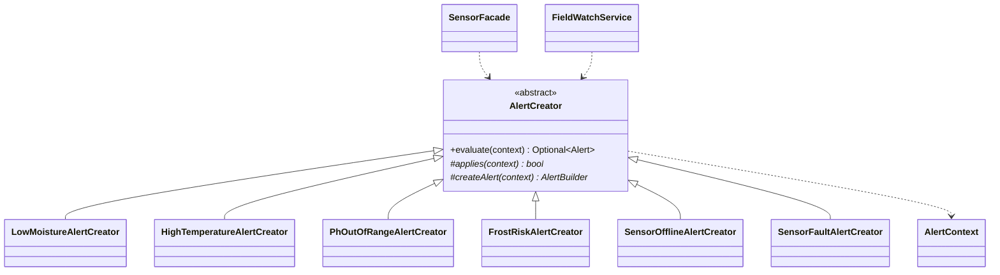

**Justificación.** `evaluate` es igual para todas las alertas y cada subclase decide su regla y crea la suya: una alerta
nueva es una clase nueva, sin tocar las demás. Así entraron helada y dispositivo sin reportar, que `FieldWatchService`
evalúa por horario.

## 6. Adapter

**Problema.** Cada proveedor externo habla su propio formato, pero el sistema quiere una sola interfaz por necesidad.

| Clase | Lenguaje | Archivo | Prueba |
|---|---|---|---|
| `GeminiAdapter`, `OpenAiCompatAdapter`, `AnthropicAdapter` | Python | `IA/agrosense_ia/providers.py` | `AdapterTests` en `IA/tests/test_patterns.py` |
| `Dht22AdapterT`, `Sht31AdapterT` (alias `Dht22Adapter`, `Sht31Adapter`) | C++ | `F/ClimateAdapters.h` | `adapters_give_two_libraries_the_same_face` |
| `OpenMeteoAdapter` | Java | `B/pattern/structural/adapter/OpenMeteoAdapter.java` | `adapterTurnsOpenMeteoArraysIntoTheColdestDay` |
| `MqttAdapter`, **ya existía** | Java | `B/pattern/structural/adapter/MqttAdapter.java` | `PatternTests.adapterTranslatesDeviceMessagesAndRejectsUnusableOnes` |
| `Esp32BlockParser`, `Esp32ReadingAggregator`, `Esp32TcpIngestionService` (con `Esp32TcpClient`) | Java | `B/pattern/structural/adapter/esp32/` | `Esp32BlockParserTests`, `Esp32ReadingAggregatorTests`, `Esp32TcpIntegrationTests`, `Esp32OffTests` |

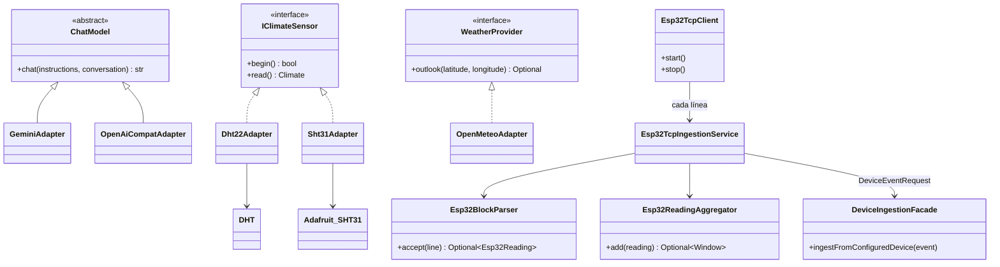

**El adaptador del ESP32.** El ESP32 real (`firmware/esp32-tcp/`) es un servidor TCP en su propia red Wi-Fi y escribe cada
segundo un bloque de texto (`===== PLANTICAS =====`, `Temperatura exterior: 24.50 C`, `Humedad relativa: 60.00 %`,
`Humedad del suelo: 31.00 %`, línea vacía). El resto del backend solo conoce el evento de `POST /api/internal/events`.
`Esp32BlockParser` lee las etiquetas sin distinguir mayúsculas ni tildes y deja fuera `nan`, `inf` y lo que esté fuera
de rango; `Esp32ReadingAggregator` promedia 60 s; `Esp32TcpIngestionService` escribe el resultado como ese evento
(`air_temperature`, `relative_humidity`, `soil_moisture`, con la hora del final de la ventana) y lo entrega a
`DeviceIngestionFacade`. Así, calibración, guardado, alertas, publicación y predicción son las del webhook, sin duplicar
nada. `Esp32TcpClient` es solo el transporte: un hilo propio, reconexión con espera de 2 a 30 s.

**Justificación.** Cada adaptador esconde lo raro de su tercero: el DHT22 da NaN y exige 2 s de descanso, el SHT31 lee
los dos valores en una sola transacción, Open-Meteo responde con listas paralelas y el ESP32 escribe líneas de texto
con sus propias etiquetas. Cambiar de sensor, de servicio de clima o de formato de bloque no toca a quien los usa.

## 7. Bridge

**Problema.** Hay dos variaciones independientes: quién ordena el riego (persona o IA) y cómo se acciona (relé o
simulado). Combinarlas por herencia daría cuatro clases, y una por cada novedad en cualquiera de los dos ejes.

| Clase | Lenguaje | Archivo | Prueba |
|---|---|---|---|
| `IrrigationOrder`, `ManualIrrigationOrder`, `AiIrrigationOrder` | Java | `B/pattern/structural/bridge/` | `everyOrderWorksWithEveryDriver`, `aPredictionHasToEarnTheWater` en `IrrigationBridgeTests` |
| `ActuatorDriver`, `RelayActuatorDriver`, `SimulatedActuatorDriver` | Java | `B/pattern/structural/bridge/` | `theFacadeHandsTheOrderToTheDeviceInItsAnswer`, `anOrderIsDeliveredOnceAndItsResultIsRecorded`, `theHistoryKeepsWhatTheDeviceReallyRan` |
| `IrrigationOrder`, `ManualIrrigationOrder`, `AiIrrigationOrder` | C++ | `F/Irrigation.h` | `every_order_works_with_every_driver`, `the_device_has_the_last_word_on_an_ai_order` |
| `ActuatorDriver`, `RelayDriver`, `SimulatedDriver`, decorados por `PumpGuard` | C++ | `F/Irrigation.h` | `the_pump_stops_by_itself`, `no_order_runs_the_pump_past_the_absolute_maximum`, `the_interrupt_stops_the_pump_while_the_loop_is_blocked`, `the_daily_limit_cuts_and_then_refuses_until_the_next_day` |

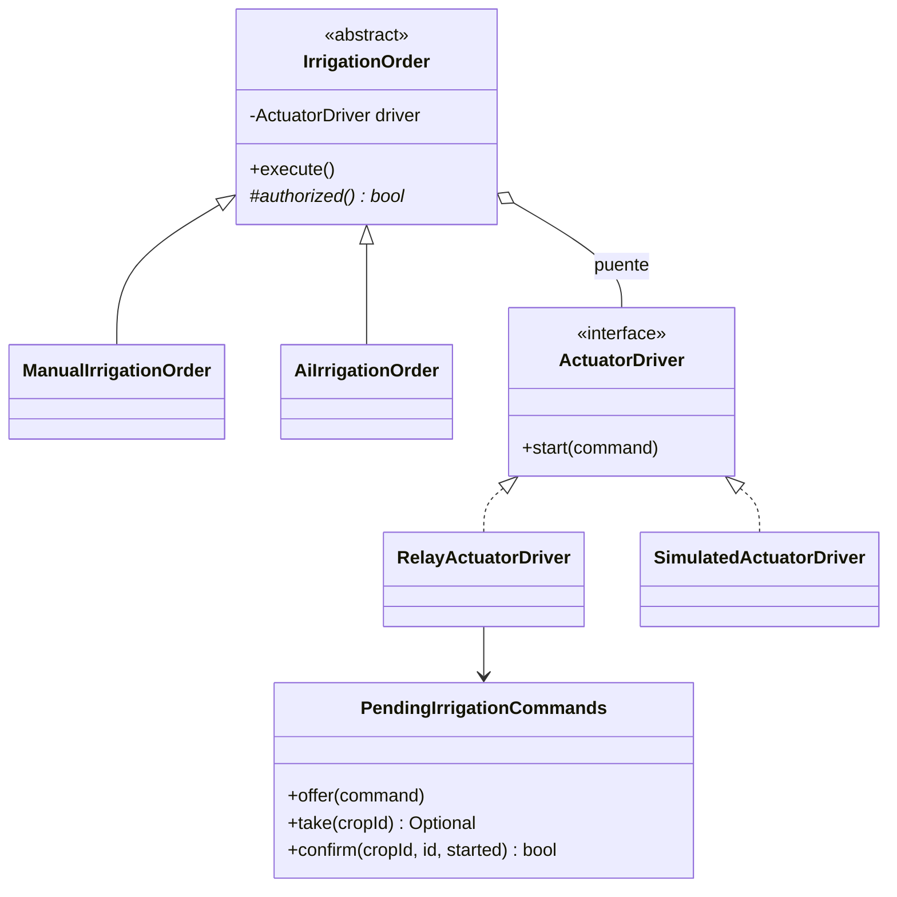

Recorrido de una orden con `IRRIGATION_ACTUATOR=relay`:

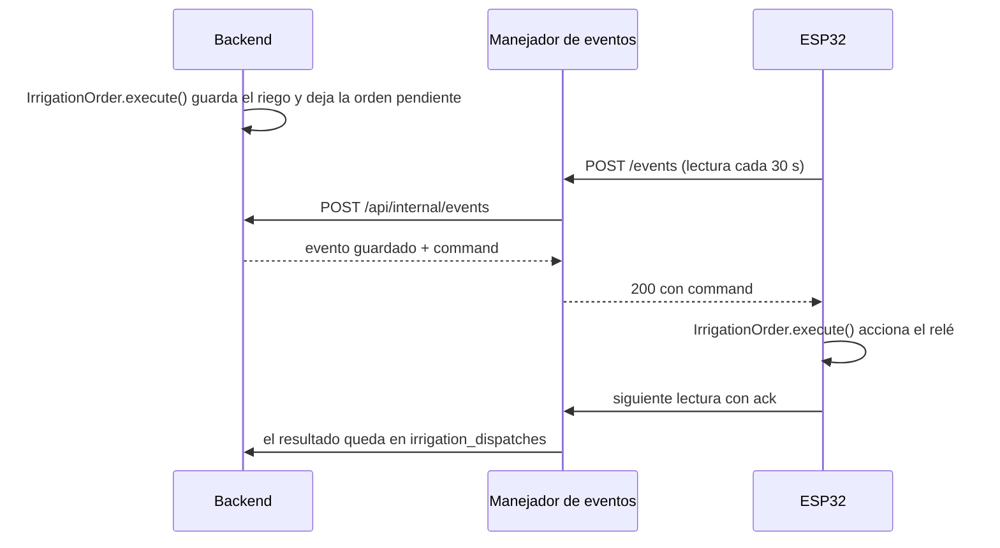

**Justificación.** Dos jerarquías unidas por composición: dos órdenes y dos drivers son dos pares de clases, no cuatro
combinaciones. Cada orden pone sus condiciones, y el dispositivo tiene la última palabra sobre una orden de la IA porque
es quien ve el suelo en ese momento.

`PendingIrrigationCommands` guarda cada orden en `irrigation_dispatches`, así que sobrevive a un reinicio y deja constancia de si llegó y de qué hizo el dispositivo.

Valores por defecto: `IRRIGATION_ACTUATOR=simulated` e `IRRIGATION_AI_ORDERS=false`. Hasta cambiarlos, el backend solo
registra el riego, como antes, y la IA no ordena nada.

## 8. Decorator

**Problema.** Una lectura necesita varios tratamientos encadenados, y el servicio de IA varias funciones añadidas.
Meterlo todo en una clase impediría combinarlos o probarlos por separado.

| Clase | Lenguaje | Archivo | Prueba |
|---|---|---|---|
| `PumpGuard`, sobre el driver de la bomba | C++ | `F/Irrigation.h` | `the_gap_between_runs_is_respected` |
| `CapacitiveSoilSensor` → `MedianFilter` → `Calibration` → `RangeCheck` | C++ | `F/SensorChain.h` | `the_median_ignores_a_spike_and_needs_a_majority`, `calibration_maps_either_way_the_sensor_counts`, `range_check_clamps_near_the_limit_and_refuses_far_from_it`, `the_whole_chain_turns_raw_counts_into_a_percentage` |
| `LoggingChatModel`, `RateLimitChatModel`, `CacheChatModel` | Python | `IA/agrosense_ia/ai_decorators.py` | `DecoratorTests` en `IA/tests/test_patterns.py` |
| `CalibrationDecorator`, nuevo eslabón de la cadena existente. Aplica `SENSOR_CALIBRATION`; desde el 10 de noviembre también las compensaciones del ESP32 real (-8.5 °C, -6 %, por verificar), que el sketch ya no resta | Java | `B/pattern/structural/decorator/CalibrationDecorator.java` | `decoratorCorrectsTheReadingBeforeItIsValidated`, `Esp32TcpIntegrationTests` (la compensación se aplica una sola vez) |
| `SensorReadingProcessor`, `ValidationDecorator`, `NormalizationDecorator`, **ya existían** | Java | `B/pattern/structural/decorator/` | `PatternTests.decoratorsValidateThenNormalise` |

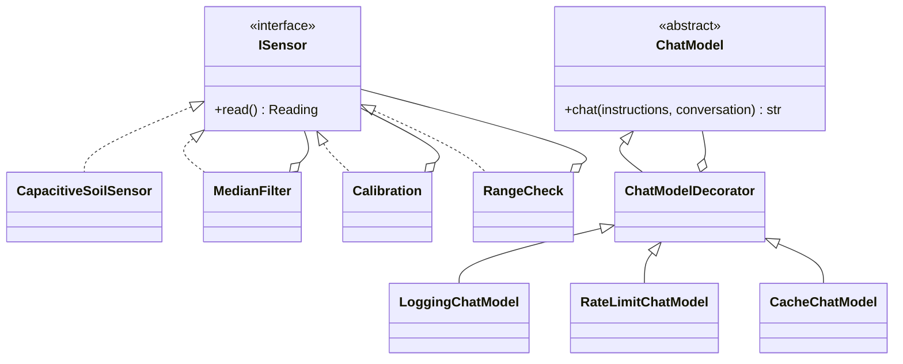

**Justificación.** Cada eslabón añade una sola cosa y conserva la interfaz, así que quien lee no sabe cuántos hay. El
orden importa: la caché va por fuera del límite para que una respuesta repetida no gaste cuota del proveedor.

## 9. Facade

**Problema.** Recibir un evento, operar la placa o llamar a la API obligaría a cada cliente a conocer varios subsistemas
y su orden.

| Clase | Lenguaje | Archivo | Prueba |
|---|---|---|---|
| `DeviceIngestionFacade` | Java | `B/pattern/structural/facade/DeviceIngestionFacade.java` | `facadeStoresTheEventAndAsksForOnePredictionPerInterval`, `facadeNeverLosesAStoredEventOverAPrediction` |
| `AgroSenseDevice` | C++ | `F/AgroSenseDevice.h` | `the_facade_measures_each_interval_and_sends`, `without_wifi_it_keeps_measuring_and_catches_up`, `the_order_in_an_answer_reaches_the_pump_through_the_facade` |
| `ApiFacade` | TypeScript | `TS/facade.ts` | `describe('ApiFacade')` en `frontend/src/test/ts/api-patterns.test.mjs` |
| `SensorFacade`, **ya existía** | Java | `B/pattern/structural/facade/SensorFacade.java` | `readingsAreValidatedNormalisedAndRaiseAlertsOutsideTheCropRange` en `ApiIntegrationTests` |

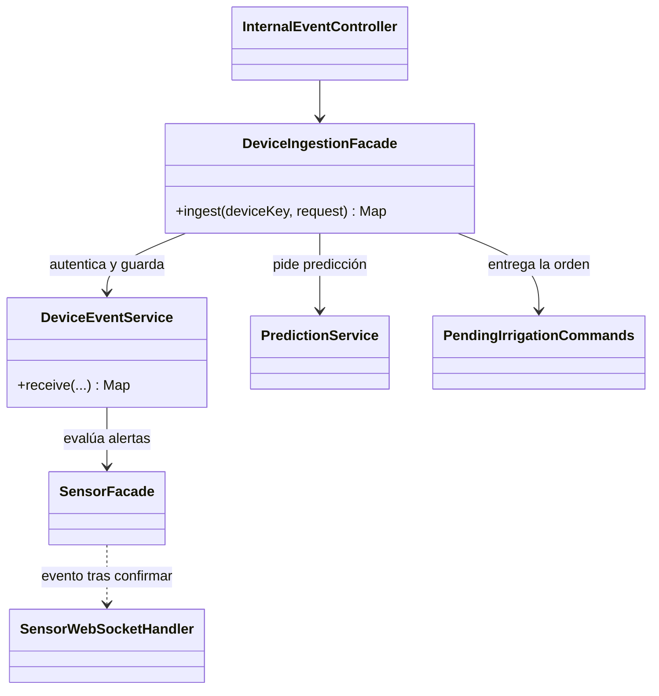

**Justificación.** El controlador hace una sola llamada, y la predicción ocurre fuera de la transacción para que una IA
lenta no la retenga ni haga perder un evento ya guardado. En la placa, el sketch solo llama a `begin()` y `tick()`; en el
navegador, las páginas no conocen rutas ni validadores.

La publicación por WebSocket sigue en un listener que corre tras confirmar la transacción. El navegador recibe hoy los
eventos en vivo por SSE, desde el manejador de eventos, y no hay ningún cliente STOMP conectado.

## 10. Proxy

**Problema.** Los servicios remotos pueden estar caídos, dormidos en Render o sin cuota. El código que los usa no debería
cargar con esa lógica.

| Clase | Lenguaje | Archivo | Prueba |
|---|---|---|---|
| `AiServiceProxy`, **ya existía**; se le añadió protección, caché y respaldo local | Java | `B/pattern/structural/proxy/AiServiceProxy.java` | `proxyAnswersRepeatedConditionsFromItsCacheUntilTheyExpire`, `proxyFallsBackToLocalRulesAndLeavesAFailingServiceAlone`, `ServiceTests.theProxySkipsADisabledServiceRetriesFailuresAndNeverThrows` |
| `BackendProxy` | C++ | `F/BackendProxy.h` | `the_proxy_delivers_in_order_and_retries_with_a_growing_wait`, `the_proxy_waits_steadily_while_render_wakes_up_then_backs_off`, `the_proxy_drops_a_refused_event_and_the_oldest_when_full` |
| `CachingApiProxy` | TypeScript | `TS/cache-proxy.ts` | `describe('CachingApiProxy')` en `frontend/src/test/ts/api-patterns.test.mjs` |

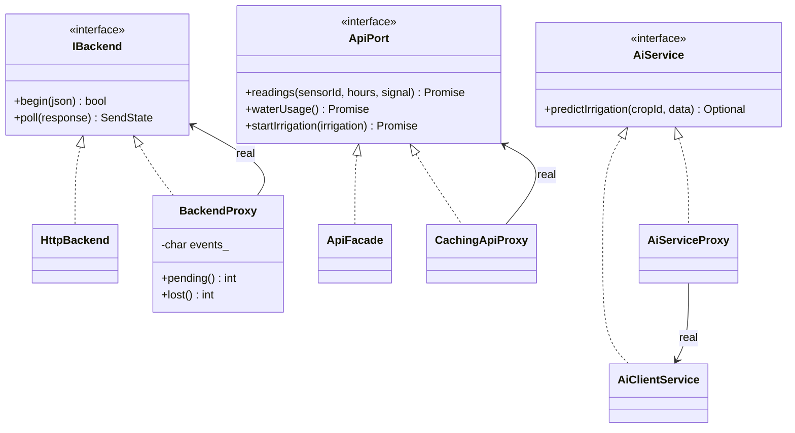

**Justificación.** Cada proxy tiene la interfaz del objeto real y añade lo que la red exige. `AiServiceProxy` deja
descansar a un servicio que falla y responde con reglas locales marcadas como tales. `BackendProxy` guarda 16 eventos y
distingue un backend dormido de una caída; `CachingApiProxy` evita repetir lecturas recientes.

Una predicción de `agrosense-reglas-locales` tiene confianza 0,5 y nunca puede ordenar un riego.

## Patrones de comportamiento

Los once patrones de comportamiento están en el backend, en `B/pattern/behavioral/`, y casi todos sobre el camino real de
las lecturas del ESP32: la placa escribe un bloque de texto cada segundo, el backend lo lee por TCP, lo convierte en una
lectura, junta las de un minuto y la guarda.

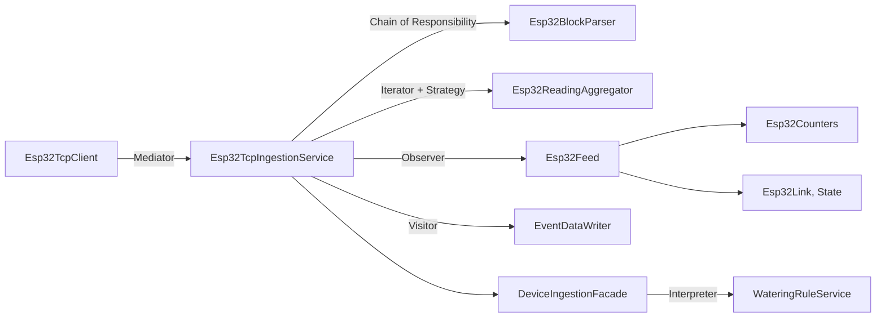

Las pruebas están en `BT/BehavioralPatternTests.java`, `BT/CalibrationMementoTests.java` y
`BT/Esp32TcpIntegrationTests.java`, que recorre el camino completo con un ESP32 falso.

## 11. Chain of Responsibility

**Problema.** El analizador de bloques decidía con un `switch` qué hacer con cada línea: encabezado, línea en blanco,
cada medida y las líneas desconocidas. Una línea nueva obligaba a tocar ese `switch`.

| Clase | Lenguaje | Archivo | Prueba |
|---|---|---|---|
| `LineHandler`, abstracta | Java | `B/pattern/behavioral/chain/LineHandler.java` | `eachLineIsTakenByTheFirstHandlerThatRecognisesItAndNoOtherSeesIt` |
| `TooLong`, `Header`, `OutsideBlock`, `Blank`, `Measure` (una por medida), `Ignored` | Java | `B/pattern/behavioral/chain/Esp32LineHandlers.java` | La misma, y las 10 de `Esp32BlockParserTests` |
| `BlockInProgress`, `Line` | Java | `B/pattern/behavioral/chain/` | Las mismas |
| `Esp32BlockParser`, cliente | Java | `B/pattern/structural/adapter/esp32/Esp32BlockParser.java` | `Esp32BlockParserTests` |

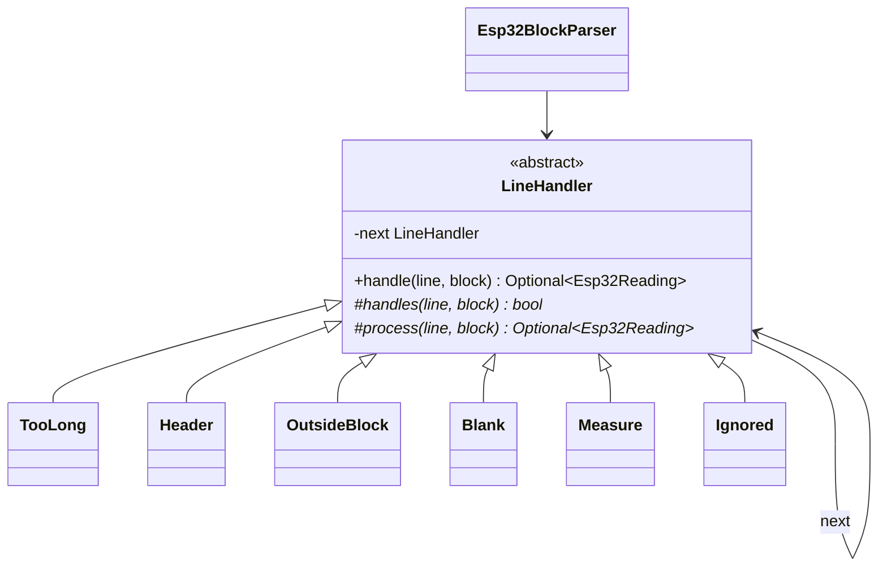

**Justificación.** Cada línea baja por la cadena hasta el primer eslabón que la reconoce, y los demás no la ven. Una
etiqueta nueva del firmware es un eslabón más en `Esp32LineHandlers.chain`, no otra rama.

## 12. Command

**Problema.** Las tres vigilancias programadas del campo (dispositivos callados, helada y resultado de los riegos) eran
métodos sueltos con su propio `try`. No había forma de saber cuáles corrieron ni cuándo.

| Clase | Lenguaje | Archivo | Prueba |
|---|---|---|---|
| `FieldWatchCommand`, interfaz | Java | `B/pattern/behavioral/command/FieldWatchCommand.java` | `theInvokerRunsAnyWatchAndRemembersTheLastRunsNewestFirst` |
| `FieldWatchInvoker` | Java | `B/pattern/behavioral/command/FieldWatchInvoker.java` | La misma |
| `SilentDevicesWatch`, `FrostWatch`, `IrrigationResultsWatch` | Java | `B/service/FieldWatchService.java` | Las 16 de `FieldWatchIntegrationTests` |

**Justificación.** Cada vigilancia es un objeto con `execute()`. El programador de Spring solo decide cuándo; el invocador
la ejecuta y guarda las últimas 20 corridas (`FieldWatchService.history()`) sin saber qué hace cada una.

## 13. Interpreter

**Problema.** Cuándo recomendar riego dependía de reglas fijas en el código. El agricultor no podía escribir la suya.

| Clase | Lenguaje | Archivo | Prueba |
|---|---|---|---|
| `RuleExpression` y sus nodos `Comparison`, `And`, `Or` | Java | `B/pattern/behavioral/interpreter/RuleExpression.java` | `aWateringRuleIsReadIntoATreeThatJudgesTheFieldsConditions` |
| `RuleParser` | Java | `B/pattern/behavioral/interpreter/RuleParser.java` | La misma |
| `WateringRuleService`, cliente | Java | `B/service/WateringRuleService.java` | `Esp32TcpIntegrationTests` |

La regla va en `ALERTS_WATERING_RULE`, en español: `suelo`, `temperatura` y `aire`; `<`, `<=`, `>` y `>=`; `y`, `o` y
paréntesis. `y` pesa más que `o`. Por defecto es `suelo < 40 y aire < 60`. En blanco se apaga, y una regla mal escrita
detiene el arranque con el motivo.

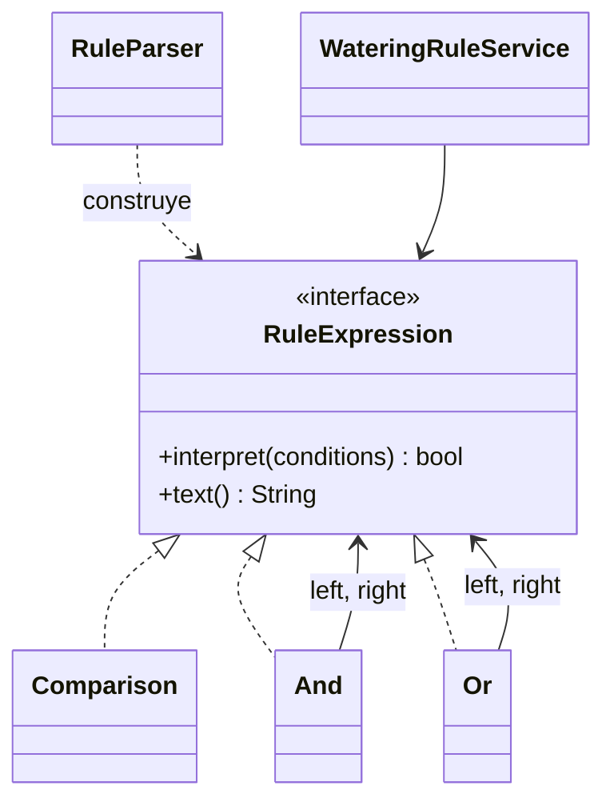

**Justificación.** `RuleParser` convierte el texto en un árbol y cada nodo se interpreta a sí mismo con los valores ya
calibrados de cada lectura. Cuando la regla se cumple, el cultivo recibe la alerta «Riego recomendado», que nombra la
regla y los valores; si ya hay una abierta, no se repite.

## 14. Iterator

**Problema.** El agregador guardaba sumas en arreglos por índice (0 temperatura, 1 aire, 2 suelo). Con eso solo podía
sacar promedios, y quien quisiera otra cuenta tenía que conocer los índices.

| Clase | Lenguaje | Archivo | Prueba |
|---|---|---|---|
| `BlockWindow`, la colección, y su `BlockIterator` | Java | `B/pattern/behavioral/iterator/BlockWindow.java` | `theWindowIsWalkedOneFieldAtATimeSkippingTheBlocksThatDidNotMeasureIt` |
| `FieldIterator` | Java | `B/pattern/behavioral/iterator/FieldIterator.java` | La misma |

**Justificación.** La ventana guarda los bloques del minuto y los entrega con un iterador, sin mostrar cómo los guarda.
`FieldIterator` recorre un solo campo y se salta los bloques donde faltó (un «nan» del DHT11), así quien combina los
valores nunca revisa nulos.

## 15. Mediator

**Problema.** El cliente TCP recibía dos funciones sueltas y no había un lugar que dijera quién coordina el cliente, el
analizador, el agregador, los observadores y la fachada de ingreso.

| Clase | Lenguaje | Archivo | Prueba |
|---|---|---|---|
| `Esp32Mediator`, interfaz | Java | `B/pattern/behavioral/mediator/Esp32Mediator.java` | `theServiceMediatesBetweenTheLinesTheWindowAndTheIngestion` |
| `Esp32TcpIngestionService`, el mediador | Java | `B/pattern/structural/adapter/esp32/Esp32TcpIngestionService.java` | La misma y `Esp32TcpIntegrationTests` |
| `Esp32TcpClient`, colega | Java | `B/pattern/structural/adapter/esp32/Esp32TcpClient.java` | `Esp32TcpIntegrationTests` |

**Justificación.** El cliente solo avisa al mediador que se abrió la conexión, que llegó una línea o que se perdió. Los
colegas no se llaman entre sí: el cliente no sabe que existe un analizador, ni el analizador un agregador.

## 16. Memento

**Problema.** `CalibrationRegistry.load` borraba la calibración y cargaba la nueva entrada por entrada. Si una entrada
venía mal, la calibración quedaba a medias: las correcciones anteriores se perdían y las primeras nuevas quedaban puestas.
Era un error real; `CalibrationMementoTests` falla con el código anterior.

| Clase | Lenguaje | Archivo | Prueba |
|---|---|---|---|
| `CalibrationRegistry`, el originador, y su `Snapshot`, el memento | Java | `B/pattern/creational/singleton/CalibrationRegistry.java` | `aCalibrationWithABadEntryLeavesThePreviousOneUntouched` |
| `CalibrationCheckpoint`, el cuidador | Java | `B/pattern/behavioral/memento/CalibrationCheckpoint.java` | La misma |

**Justificación.** Antes de cargar, el cuidador guarda una foto del registro; si algo falla, la devuelve. El `Snapshot`
es opaco: solo el registro lee lo que contiene.

## 17. Observer

**Problema.** El servicio del ESP32 llevaba sus contadores a mano, mezclados con la lectura y el guardado, y nadie más
podía enterarse de lo que pasaba en la conexión.

| Clase | Lenguaje | Archivo | Prueba |
|---|---|---|---|
| `Esp32FeedObserver`, interfaz | Java | `B/pattern/behavioral/observer/Esp32FeedObserver.java` | `theFeedTellsEveryObserverEvenWhenOneOfThemFails` |
| `Esp32Feed`, el sujeto | Java | `B/pattern/behavioral/observer/Esp32Feed.java` | La misma |
| `Esp32Counters` y `Esp32Link`, observadores | Java | `B/pattern/behavioral/observer/`, `B/pattern/behavioral/state/` | `theServiceMediatesBetweenTheLinesTheWindowAndTheIngestion` |

**Justificación.** El servicio le cuenta al `Esp32Feed` cada bloque, lectura guardada o rechazada y conexión abierta o
perdida, y el feed avisa a todos los suscritos. Un observador que falla no impide avisar a los demás. Además, el backend
ya usaba los eventos de Spring (`SensorReadingRecordedEvent`, `AlertRaisedEvent`) para publicar en vivo, que es este
mismo patrón dado por el framework.

## 18. State

**Problema.** `GET /api/devices/esp32/status` solo decía «conectado: sí o no». Una conexión abierta por la que no llega
nada se veía igual que una que funciona.

| Clase | Lenguaje | Archivo | Prueba |
|---|---|---|---|
| `Esp32LinkState`: `WAITING`, `RECEIVING`, `SILENT`, `DISCONNECTED` | Java | `B/pattern/behavioral/state/Esp32LinkState.java` | `theLinkMovesBetweenItsStatesAsTheFeedAndTheTimeSay` |
| `Esp32Link`, el contexto | Java | `B/pattern/behavioral/state/Esp32Link.java` | La misma y `Esp32TcpIntegrationTests` |

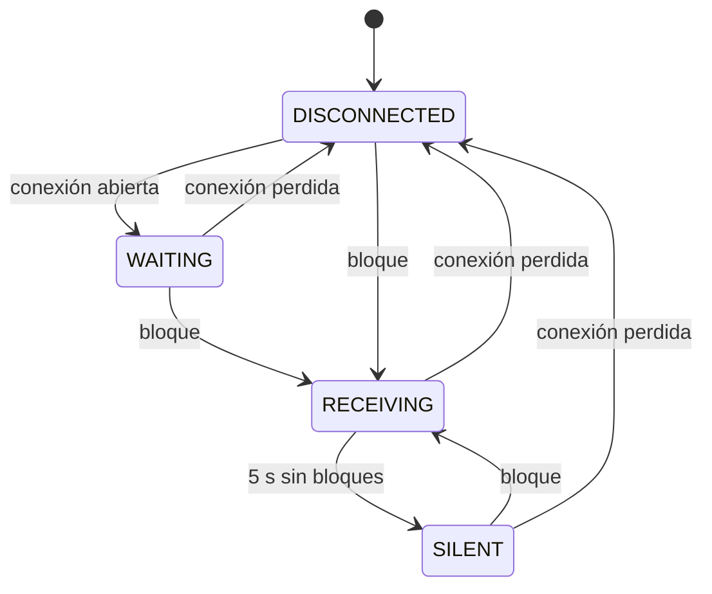

**Justificación.** Cada estado decide cuál sigue ante cada evento y se describe a sí mismo, así `Esp32Link` no tiene un
`if` sobre el estado actual. El estado y su texto («Recibiendo datos del ESP32», «Conectado, pero el ESP32 no envía datos
desde hace 8 s»…) salen en los campos `link` y `linkLabel` del estado del receptor.

## 19. Strategy

**Problema.** El agregador solo sabía promediar. Un pico del DHT11 en un solo bloque movía el promedio de todo el minuto.

| Clase | Lenguaje | Archivo | Prueba |
|---|---|---|---|
| `AggregationStrategy`, interfaz | Java | `B/pattern/behavioral/strategy/AggregationStrategy.java` | `theAggregatorCombinesTheWindowWithTheStrategyItIsGiven` |
| `MeanAggregation`, `MedianAggregation` | Java | `B/pattern/behavioral/strategy/` | La misma y `Esp32ReadingAggregatorTests` |
| `Esp32ReadingAggregator`, el contexto | Java | `B/pattern/structural/adapter/esp32/Esp32ReadingAggregator.java` | `Esp32ReadingAggregatorTests` |

**Justificación.** El agregador no sabe qué estrategia tiene. `ESP32_AGGREGATE_STRATEGY` la elige: `mean` (por defecto, el
comportamiento de siempre) o `median`, que ignora un pico aislado. El estado del receptor la muestra en `aggregation`.

## 20. Template Method

**Problema.** Las tres vigilancias del campo repetían los mismos pasos: revisar si están encendidas, correr y atrapar el
error para que el programador no se detenga.

| Clase | Lenguaje | Archivo | Prueba |
|---|---|---|---|
| `ScheduledWatch`, abstracta | Java | `B/pattern/behavioral/templatemethod/ScheduledWatch.java` | `everyWatchFollowsTheSameStepsAndAFailureNeverReachesTheScheduler` |
| `SilentDevicesWatch`, `FrostWatch`, `IrrigationResultsWatch` | Java | `B/service/FieldWatchService.java` | `FieldWatchIntegrationTests` |

**Justificación.** `execute()` es `final` y fija los pasos; cada vigilancia rellena solo `watch()` y, si se puede apagar,
`isEnabled()`. `AlertCreator.evaluate` (sección 5) también es un método plantilla: el Factory Method suele vivir dentro
de uno.

## 21. Visitor

**Problema.** Para escribir el evento de una lectura había un `if` por cada medida, y otra operación sobre las medidas
(describirlas para el registro) habría repetido esos `if`.

| Clase | Lenguaje | Archivo | Prueba |
|---|---|---|---|
| `Esp32Measure` y sus elementos `AirTemperature`, `RelativeHumidity`, `SoilMoisture` | Java | `B/pattern/behavioral/visitor/Esp32Measure.java` | `visitorsWriteTheEventAndDescribeTheReadingWithoutAskingWhichMeasureEachOneIs` |
| `Esp32MeasureVisitor`, interfaz | Java | `B/pattern/behavioral/visitor/Esp32MeasureVisitor.java` | La misma |
| `EventDataWriter`, `MeasureDescriber` | Java | `B/pattern/behavioral/visitor/` | La misma y `Esp32TcpIntegrationTests` |

**Justificación.** Cada medida manda al visitante a su propio método (doble despacho). Una operación nueva sobre las
medidas es un visitante nuevo, sin tocar las medidas ni preguntar de qué tipo es cada una.

## Los dos estructurales que faltaban

## 22. Composite

**Problema.** Las reglas de alerta de una lectura eran una lista plana de ocho creadores. No se veía qué reglas van juntas
(las tres de temperatura, las dos del suelo, las dos del aire) ni se podía tratar un grupo como una sola regla.

| Clase | Lenguaje | Archivo | Prueba |
|---|---|---|---|
| `AlertRule`, el componente | Java | `B/pattern/structural/composite/AlertRule.java` | `aGroupIsEvaluatedLikeASingleRuleAndStopsAtTheFirstAlert` |
| `AlertRuleGroup`, el compuesto | Java | `B/pattern/structural/composite/AlertRuleGroup.java` | La misma y `theReadingsRulesAreOneTreeOfOneGroupPerMeasure` |
| `AlertCreator` y sus subclases, las hojas | Java | `B/pattern/creational/factory/alert/` | `DesignPatternTests` (las alertas de cada regla y la helada primero) |

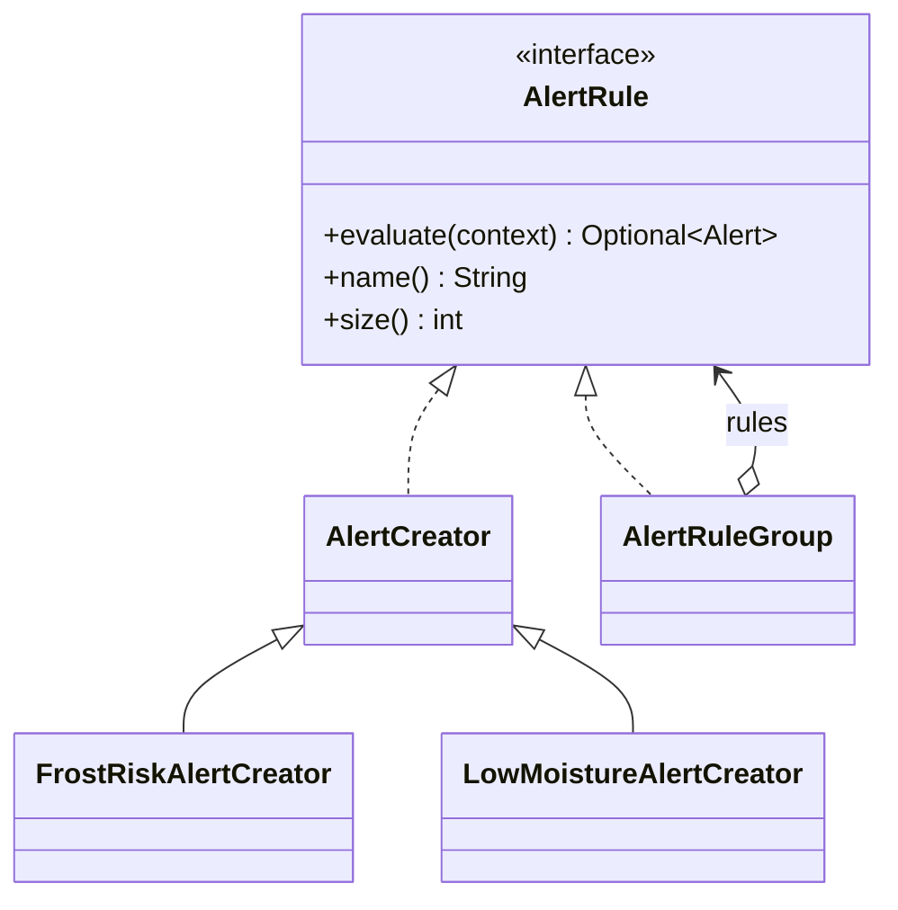

El árbol de las lecturas, en el mismo orden de antes:

```text
lecturas
├── temperatura del aire: helada, temperatura baja, temperatura alta
├── humedad del suelo: humedad baja, humedad alta
├── humedad del aire: aire seco, aire muy húmedo
└── pH fuera de rango
```

**Justificación.** Un creador suelto y un grupo de reglas tienen la misma interfaz, así `SensorFacade` evalúa el árbol
entero como una regla. Un grupo pregunta a sus reglas en orden y se queda con la primera alerta, y puede contener otros
grupos. El orden es el mismo de antes, así que la helada sigue ganando a la temperatura baja.

## 23. Flyweight

**Problema.** El ESP32 manda un bloque por segundo y sus valores casi no cambian: el DHT11 mide en porcentajes enteros.
La ventana de un minuto guardaba 60 objetos de lectura, casi todos iguales.

| Clase | Lenguaje | Archivo | Prueba |
|---|---|---|---|
| `Esp32ReadingPool`, la fábrica de pesos ligeros | Java | `B/pattern/structural/flyweight/Esp32ReadingPool.java` | `equalBlocksFromTheEsp32AreOneSharedReading`, `thePoolKeepsOnlyTheValuesUsedLast` |
| `Esp32Reading`, el peso ligero (inmutable) | Java | `B/pattern/structural/adapter/esp32/Esp32Reading.java` | Las mismas |
| `BlockInProgress`, cliente | Java | `B/pattern/behavioral/chain/BlockInProgress.java` | Las 10 de `Esp32BlockParserTests` |

**Justificación.** El pool entrega una sola lectura compartida por cada combinación de valores, y la ventana guarda 60
referencias a unos pocos objetos. Los valores son el estado intrínseco, compartido. El momento en que llegó cada bloque es
el extrínseco y viaja aparte (`Esp32Feed.blockReceived(block, at)`). Se guardan solo las 256 combinaciones usadas por
última vez, así la memoria no crece aunque los valores cambien.

## Tabla final

Los repositorios siguen la sección 1 de `ARQUITECTURA.md`. `firmware/` todavía no tiene repositorio propio.

| Patrón | Repo | Clase | Archivo |
|---|---|---|---|
| Singleton | firmware | `DeviceConfig` | `firmware/agrosense/src/DeviceConfig.h` |
| Singleton | firmware | `WifiManager` | `firmware/agrosense/src/WifiManager.h` |
| Singleton | BACKEND-AGROSENSE | `CalibrationRegistry` | `B/pattern/creational/singleton/CalibrationRegistry.java` |
| Singleton (existente) | BACKEND-AGROSENSE | `AiConfigManager` | `B/pattern/creational/singleton/AiConfigManager.java` |
| Prototype | BACKEND-AGROSENSE | `CropTemplate`, `CropTemplateCatalog` | `B/pattern/creational/prototype/` |
| Prototype (existente) | BACKEND-AGROSENSE | `SensorReadingPrototype` | `B/pattern/creational/prototype/SensorReadingPrototype.java` |
| Builder | BACKEND-AGROSENSE | `PredictionRequest.Builder` | `B/pattern/creational/builder/PredictionRequest.java` |
| Builder (existente) | BACKEND-AGROSENSE | `AlertBuilder` | `B/pattern/creational/builder/AlertBuilder.java` |
| Builder | firmware | `ReadingJsonBuilder` | `firmware/agrosense/src/ReadingJsonBuilder.h` |
| Abstract Factory | IA-AGROSENSE | `AiProviderFactory` y sus familias | `IA/agrosense_ia/ai_factory.py` |
| Abstract Factory | firmware | `HardwareFactory`, `SimulatedHardwareFactory` | `firmware/agrosense/src/HardwareFactory.h` |
| Abstract Factory | firmware | `RealHardwareFactory` | `firmware/agrosense/src/ArduinoPorts.h` |
| Factory Method | BACKEND-AGROSENSE | `AlertCreator` y 8 subclases | `B/pattern/creational/factory/alert/` |
| Factory (existente) | BACKEND-AGROSENSE | `SensorFactory` | `B/pattern/creational/factory/SensorFactory.java` |
| Adapter | IA-AGROSENSE | `GeminiAdapter`, `OpenAiCompatAdapter`, `AnthropicAdapter` | `IA/agrosense_ia/providers.py` |
| Adapter | firmware | `Dht22Adapter`, `Sht31Adapter` | `firmware/agrosense/src/ClimateAdapters.h` |
| Adapter | BACKEND-AGROSENSE | `OpenMeteoAdapter` | `B/pattern/structural/adapter/OpenMeteoAdapter.java` |
| Adapter (existente) | BACKEND-AGROSENSE | `MqttAdapter` | `B/pattern/structural/adapter/MqttAdapter.java` |
| Adapter | BACKEND-AGROSENSE | `Esp32BlockParser`, `Esp32ReadingAggregator`, `Esp32TcpIngestionService` | `B/pattern/structural/adapter/esp32/` |
| Bridge | BACKEND-AGROSENSE | `IrrigationOrder` × `ActuatorDriver` | `B/pattern/structural/bridge/` |
| Bridge | firmware | `IrrigationOrder` × `ActuatorDriver` | `firmware/agrosense/src/Irrigation.h` |
| Decorator | firmware | `MedianFilter`, `Calibration`, `RangeCheck` | `firmware/agrosense/src/SensorChain.h` |
| Decorator | IA-AGROSENSE | `LoggingChatModel`, `RateLimitChatModel`, `CacheChatModel` | `IA/agrosense_ia/ai_decorators.py` |
| Decorator (existente, ampliado) | BACKEND-AGROSENSE | `SensorReadingProcessor`, `CalibrationDecorator` | `B/pattern/structural/decorator/` |
| Facade | BACKEND-AGROSENSE | `DeviceIngestionFacade` | `B/pattern/structural/facade/DeviceIngestionFacade.java` |
| Facade (existente) | BACKEND-AGROSENSE | `SensorFacade` | `B/pattern/structural/facade/SensorFacade.java` |
| Facade | firmware | `AgroSenseDevice` | `firmware/agrosense/src/AgroSenseDevice.h` |
| Facade | FRONTEND-AGROSENSE | `ApiFacade` | `frontend/src/main/ts/api/facade.ts` |
| Proxy (existente, ampliado) | BACKEND-AGROSENSE | `AiServiceProxy` | `B/pattern/structural/proxy/AiServiceProxy.java` |
| Proxy | firmware | `BackendProxy` | `firmware/agrosense/src/BackendProxy.h` |
| Proxy | FRONTEND-AGROSENSE | `CachingApiProxy` | `frontend/src/main/ts/api/cache-proxy.ts` |
| Chain of Responsibility | BACKEND-AGROSENSE | `LineHandler` y `Esp32LineHandlers` | `B/pattern/behavioral/chain/` |
| Command | BACKEND-AGROSENSE | `FieldWatchCommand`, `FieldWatchInvoker` | `B/pattern/behavioral/command/`, `B/service/FieldWatchService.java` |
| Interpreter | BACKEND-AGROSENSE | `RuleExpression`, `RuleParser` | `B/pattern/behavioral/interpreter/`, `B/service/WateringRuleService.java` |
| Iterator | BACKEND-AGROSENSE | `BlockWindow`, `FieldIterator` | `B/pattern/behavioral/iterator/` |
| Mediator | BACKEND-AGROSENSE | `Esp32Mediator`, `Esp32TcpIngestionService` | `B/pattern/behavioral/mediator/Esp32Mediator.java` |
| Memento | BACKEND-AGROSENSE | `CalibrationRegistry.Snapshot`, `CalibrationCheckpoint` | `B/pattern/behavioral/memento/CalibrationCheckpoint.java` |
| Observer | BACKEND-AGROSENSE | `Esp32Feed`, `Esp32FeedObserver`, `Esp32Counters` | `B/pattern/behavioral/observer/` |
| State | BACKEND-AGROSENSE | `Esp32LinkState`, `Esp32Link` | `B/pattern/behavioral/state/` |
| Strategy | BACKEND-AGROSENSE | `AggregationStrategy`, `MeanAggregation`, `MedianAggregation` | `B/pattern/behavioral/strategy/` |
| Template Method | BACKEND-AGROSENSE | `ScheduledWatch` | `B/pattern/behavioral/templatemethod/ScheduledWatch.java` |
| Visitor | BACKEND-AGROSENSE | `Esp32Measure`, `EventDataWriter`, `MeasureDescriber` | `B/pattern/behavioral/visitor/` |
| Composite | BACKEND-AGROSENSE | `AlertRule`, `AlertRuleGroup` y los `AlertCreator` como hojas | `B/pattern/structural/composite/` |
| Flyweight | BACKEND-AGROSENSE | `Esp32ReadingPool` | `B/pattern/structural/flyweight/Esp32ReadingPool.java` |

## Justificación breve para la sustentación

| Patrón | Dos líneas |
|---|---|
| Singleton | La placa tiene una sola radio y una sola configuración, y el backend una sola tabla de calibración.<br>Una segunda instancia solo crearía conflictos, así que la clase la impide. |
| Prototype | Cada cultivo parte de una copia profunda de su plantilla.<br>Ajustar los rangos de un cultivo nunca cambia el catálogo. |
| Builder | Petición, alerta y lectura tienen muchos campos opcionales y reglas entre ellos.<br>`build()` concentra la validación, y nada a medias sale del sistema. |
| Abstract Factory | El chat y la transcripción, o los sensores y el actuador, se crean siempre en familia.<br>Cambiar de proveedor o de hardware es elegir otra fábrica. |
| Factory Method | `AlertCreator` fija el proceso y cada subclase decide y crea su alerta.<br>Una alerta nueva es una clase nueva, no otro caso en un `switch`. |
| Adapter | Gemini, OpenAI, Open-Meteo, el DHT22 y el SHT31 hablan formatos distintos.<br>Cada adaptador los traduce a la interfaz que el sistema ya usa. |
| Bridge | Quién ordena el riego y cómo se acciona varían por separado.<br>La composición evita una clase por cada combinación de orden y actuador. |
| Decorator | Filtrar, calibrar y validar, o registrar, limitar y cachear, son capas independientes.<br>Se encadenan sin cambiar la interfaz y se prueban una a una. |
| Facade | Una sola llamada oculta autenticar, guardar, alertar, predecir y publicar.<br>Quien la usa no depende del orden ni de los subsistemas. |
| Proxy | El proxy tiene la interfaz del objeto real y añade reintentos, búfer, caché y respaldo.<br>Así la red poco fiable no se filtra al resto del código. |
| Chain of Responsibility | Cada línea del ESP32 baja por la cadena hasta el eslabón que la reconoce.<br>Una línea nueva es un eslabón más, no otra rama de un `switch`. |
| Command | Cada vigilancia del campo es un objeto con `execute()`.<br>El programador decide cuándo y el invocador la corre y recuerda sus corridas. |
| Interpreter | La regla de riego se escribe en español y se convierte en un árbol.<br>Cada nodo se evalúa con las lecturas y, si se cumple, recomienda regar. |
| Iterator | La ventana entrega sus bloques sin mostrar cómo los guarda.<br>Recorrer un campo se salta solo los bloques donde faltó. |
| Mediator | El cliente TCP solo habla con el mediador.<br>Analizador, agregador, observadores y fachada no se conocen entre sí. |
| Memento | Antes de cargar una calibración se guarda una foto del registro.<br>Si una entrada falla, se devuelve la foto y nada queda a medias. |
| Observer | El feed del ESP32 avisa a quien se suscriba.<br>Los contadores y el estado de la conexión se enteran sin que el servicio los llame. |
| State | Cada estado de la conexión decide el siguiente y se describe a sí mismo.<br>Así se distingue «recibiendo» de «conectado pero callado». |
| Strategy | Promedio o mediana se eligen en la configuración.<br>El agregador combina igual sin saber cuál tiene. |
| Template Method | `execute()` fija los pasos de toda vigilancia.<br>Cada una rellena solo lo suyo y un fallo nunca detiene al programador. |
| Visitor | Cada medida manda al visitante a su propio método.<br>Escribir el evento o describir la lectura son visitantes, sin `if` por tipo. |
| Composite | Una regla de alerta y un grupo de reglas tienen la misma interfaz.<br>Las reglas de una lectura son un árbol que se evalúa como una sola. |
| Flyweight | Los bloques iguales del ESP32 son un solo objeto compartido.<br>La ventana guarda referencias, y la hora de cada bloque va aparte. |
